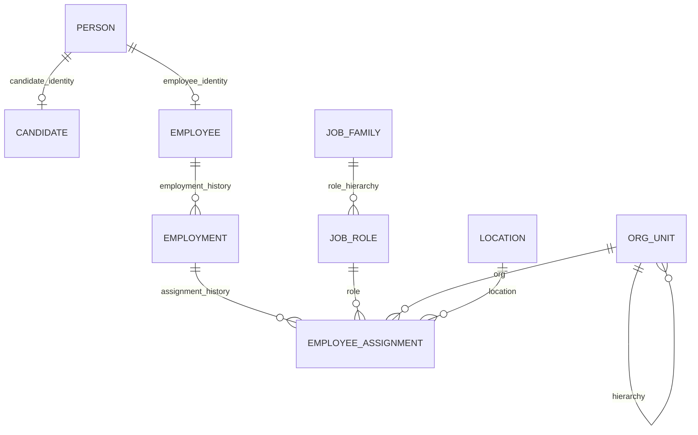
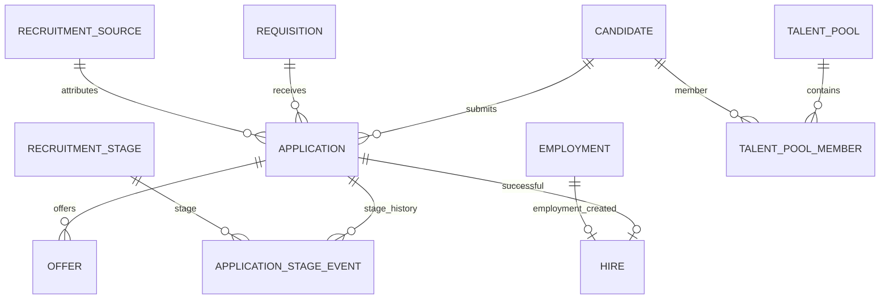
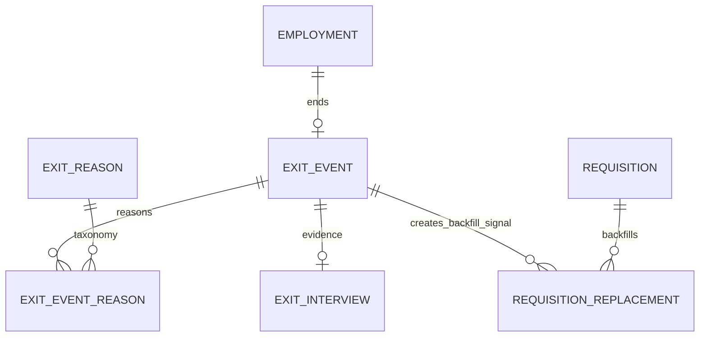
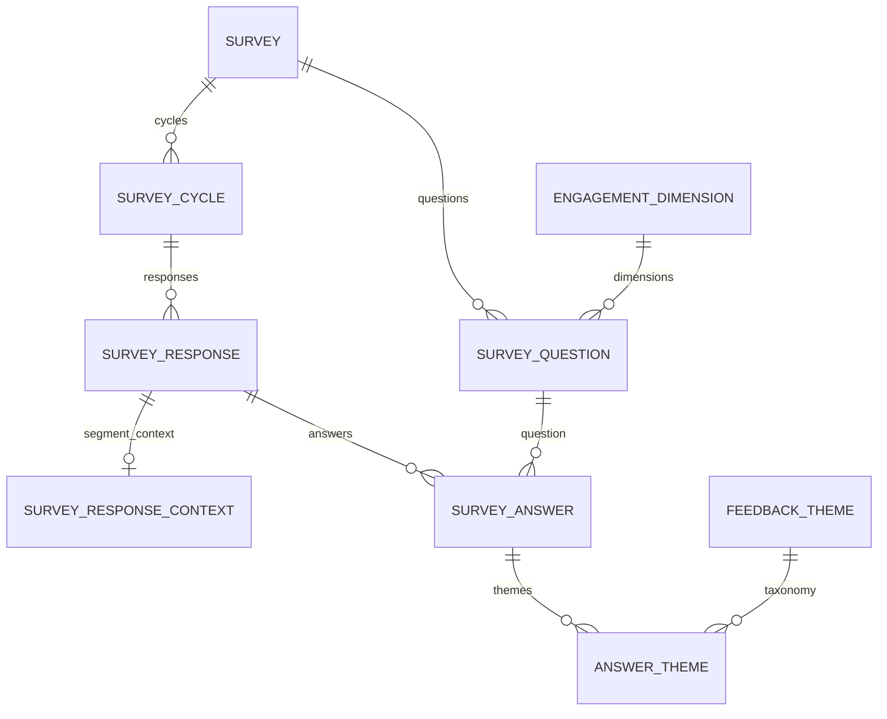

# FIT HUB People Intelligence Data Architecture

**Version:** v4

> Future-state People Intelligence architecture covering Source -> Raw -> Staging -> Core -> Mart -> App, with ERD, relationships, data dictionary, source-to-target mapping, synthetic-data strategy, Supabase implementation, and prototype guidance.

> **Revision v4:** Adds the full executable PostgreSQL / Supabase internal-mobility benchmark and matching engine. The SQL follows the same benchmark -> compare -> weight -> aggregate pattern used in the earlier Talent Intelligence work, but adapts the formula for FIT HUB so capability and demonstrated performance are primary, development is supporting evidence, and optional psychometric / work-style / strengths context is capped at low weight.


## 1. Purpose

This document translates the FIT HUB People Analytics case into a future-state People Intelligence data architecture.

The objective is not to pretend that the current case files already contain a fully connected employee lifecycle. The current workbook contains three separate analytical datasets: Hiring, Turnover, and Engagement. They are useful for aggregate diagnosis, but they do not contain the shared identifiers and lifecycle tables required for person-level causal linkage.

The proposed architecture therefore has two goals:

1. Preserve the current source data exactly in a raw layer.
2. Define the normalized identifiers, entities, events, and analytical marts needed to operationalize the recommendations across Hiring, Retention, Employee Experience, Performance, Capability, and Internal Mobility.

The central design principle is:

`Candidate -> Requisition -> Hire -> Employee -> Assignment -> Engagement -> Performance -> Capability -> Development -> Mobility / Retention -> Exit -> Replacement Requisition`

This creates one connected employee lifecycle instead of three disconnected reporting files.

## 2. Current-State Source Data


The source workbook used in the case contains:

| Sheet | Data rows | Current role in the case |
|---|---:|---|
| Hiring | 1,552 | Hiring demand, source, SLA, time-to-fill, role and geography analysis |
| Turnover | 889 | Recorded exits, tenure, role, location, exit type, regrettability and reasons |
| Engagement | 1,636 | eNPS, experience dimensions, role/location segmentation and Voice of Employee |

Important current-state limitations:

- No shared `Employee ID` across Hiring, Turnover, and Engagement.
- No `Requisition ID` that connects an exit to the exact replacement requisition.
- No monthly active headcount denominator.
- No full candidate recruitment funnel.
- Limited post-hire performance and probation outcomes.
- No structured capability or internal mobility history.
- No representation of employees below 6 months tenure in the current Engagement dataset.
- Cross-dataset temporal or segment convergence is therefore directional, not a person-level causal relationship.

## 3. Target Architecture: Source -> Raw -> Staging -> Core -> Mart -> App

This document now uses one explicit end-to-end flow:

```text
SOURCE
  |
  v
RAW
  |
  v
STAGING
  |
  v
CORE
  |
  v
MART
  |
  v
APP
```

The important point is that these layers have different responsibilities. They should not be treated as six names for the same data.

### 3.1 Layer responsibilities

| Layer | Main responsibility | Does it contain business PK/FK relationships? | Should the prototype app query it directly? |
|---|---|---:|---:|
| **Source** | Original operational files or systems | Depends on the source system | No |
| **Raw** | Exact landed copy of the source plus ingestion metadata | Preserve source identifiers only | No |
| **Staging** | Clean, cast, standardize, validate, deduplicate, map codes | Transitional identifiers and mapping columns are allowed | No |
| **Core** | Canonical integrated People model with governed IDs and PK/FK integrity | Yes | Usually no |
| **Mart** | Dashboard-ready metrics, facts, cohorts, and feature tables | Derived from Core | Yes |
| **App** | People Intelligence workflow, filters, insights, actions | Consumes Mart outputs | Yes |

A separate `restricted` schema can be used across the architecture for PII and highly sensitive HR text. It is a security boundary, not a new transformation stage.

### 3.2 Source layer

`Source` means the data as it exists before the warehouse transformation process.

For the current case, the observed source is the original workbook:

```text
Observed FIT HUB case workbook
├── Hiring
├── Turnover
└── Engagement
```

For the future-state prototype, create a separate synthetic source package that represents systems FIT HUB would ideally have:

```text
Synthetic future-state sources
├── ATS
│   ├── Requisition
│   ├── Candidate
│   ├── Application
│   ├── Application Stage Event
│   ├── Offer
│   ├── Hire
│   └── Talent Pool
│
├── HRIS
│   ├── Employee
│   ├── Employment
│   ├── Assignment
│   ├── Organization
│   └── Exit
│
├── Survey / Listening
│   ├── Survey
│   ├── Survey Cycle
│   ├── Survey Question
│   ├── Survey Response
│   └── Survey Answer
│
├── Performance
│   ├── Performance Review
│   ├── Performance Result
│   └── Probation Review
│
└── Talent
    ├── Capability Assessment
    ├── Assessment Definition
    ├── Employee Assessment
    ├── Employee Assessment Result
    ├── Role Assessment Reference
    ├── Role Benchmark Profile
    ├── Development Plan
    └── Mobility Event
```

This is where prototype records should be generated first.

Do **not** generate only final dashboard rows in Mart and call that an end-to-end architecture. If the objective is to showcase the data product properly, generate realistic source-level records, load them through the pipeline, and let Core and Mart be produced by transformations.

### 3.3 Why the source can already contain IDs

If an actual source system provides an identifier, keep it.

Examples:

```text
ATS:
requisition_id = REQ-2027-000184
candidate_id   = CAN-000392
application_id = APP-001827

HRIS:
employee_id    = EMP-000421
employment_id  = EML-000511
```

Those identifiers are valid Source and Raw fields because they came from the system.

The current FIT HUB case files are different. They do not provide a shared Employee ID or Requisition ID. Therefore the observed case Raw tables must not suddenly receive invented business identifiers.

For a future-state demo, synthetic ATS and HRIS source records **may** contain Employee ID, Requisition ID, Application ID, and other IDs because the entire future-state source system is explicitly synthetic.

### 3.4 Raw layer

Recommended schema:

```text
raw
├── case_hiring
├── case_turnover
├── case_engagement
├── ats_requisition
├── ats_candidate
├── ats_application
├── ats_application_stage_event
├── ats_offer
├── ats_hire
├── ats_talent_pool
├── hris_employee
├── hris_employment
├── hris_assignment
├── hris_exit
├── survey_response
├── survey_answer
├── performance_review
├── performance_result
├── probation_review
├── capability_assessment
├── assessment_definition
├── assessment_dimension
├── employee_assessment
├── employee_assessment_result
├── role_assessment_reference
├── role_benchmark_profile
├── role_benchmark_member
├── role_benchmark_metric
└── mobility_event
```

Raw rules:

1. Keep source column names and source values as faithfully as practical.
2. Preserve source-provided IDs.
3. Add technical metadata such as:
   - `_source_system`
   - `_source_file`
   - `_batch_id`
   - `_loaded_at`
   - `_source_row_number`
4. Do not standardize business labels in Raw.
5. Do not create unsupported cross-file Employee ID links for the observed case data.
6. Raw is append-oriented and should be reproducible from the source.

### 3.5 Staging layer

Recommended schema:

```text
staging
├── stg_case_hiring
├── stg_case_turnover
├── stg_case_engagement
├── stg_ats_requisition
├── stg_ats_candidate
├── stg_ats_application
├── stg_ats_application_stage_event
├── stg_ats_offer
├── stg_ats_hire
├── stg_hris_employee
├── stg_hris_employment
├── stg_hris_assignment
├── stg_hris_exit
├── stg_survey_response
├── stg_survey_answer
├── stg_performance_review
├── stg_performance_result
├── stg_probation_review
├── stg_capability_assessment
├── stg_assessment_definition
├── stg_assessment_dimension
├── stg_employee_assessment
├── stg_employee_assessment_result
├── stg_role_assessment_reference
├── stg_role_benchmark_profile
├── stg_role_benchmark_member
├── stg_role_benchmark_metric
└── stg_mobility_event
```

Typical staging work:

```text
" BALI "               -> "Bali"
"replacement"          -> "REPLACEMENT"
"0 Y 8 M"              -> derived tenure months = 8
text date              -> DATE
duplicate source row   -> deduplication rule
Position text          -> standardized role code
Location text          -> standardized location code
```

Staging may contain mapping outputs such as:

```text
source_job_role_text
standardized_job_role_name
job_role_code
location_code
dq_valid_date_flag
dq_duplicate_flag
```

If a source provides stable IDs, Staging preserves them.

If the observed case does not provide a stable Employee ID, Staging still must not guess one from Gender + Position + Location + dates.

### 3.6 Core layer

Core is the canonical integrated business model.

```text
core
├── person
├── employee
├── employment
├── employee_assignment
├── job_family
├── job_role
├── location
├── org_unit
│
├── requisition
├── candidate
├── application
├── application_stage_event
├── offer
├── hire
├── talent_pool
│
├── exit_event
├── exit_reason
├── exit_interview
│
├── survey
├── survey_cycle
├── survey_question
├── survey_response
├── survey_answer
│
├── performance_review
├── performance_result
├── probation_review
│
├── capability
├── capability_assessment
├── assessment_definition
├── assessment_dimension
├── employee_assessment
├── employee_assessment_result
├── role_assessment_reference
├── role_benchmark_profile
├── role_benchmark_member
├── role_benchmark_metric
├── development_plan
└── mobility_event
```

This is where governed PK/FK relationships become authoritative.

Example:

```text
requisition_id
      |
application_id
      |
hire_id
      |
employment_id
      |
employee_id
      |
assignment_id
      |
survey / performance / capability / mobility / exit
```

### 3.7 Mart layer

The App should normally consume Mart, not run large lifecycle joins against Core on every page load.

Recommended prototype marts:

```text
mart
├── fact_monthly_headcount
├── mart_hiring_effectiveness
├── mart_recruitment_funnel
├── mart_retention_cohort
├── mart_employee_experience
├── mart_quality_of_hire
├── mart_internal_mobility
├── mart_capability_readiness
├── mart_role_success_benchmark
├── mart_internal_mobility_match
└── mart_workforce_lifecycle_event
```

Examples:

`mart_hiring_effectiveness`

```text
period
job_role
location
hiring_type
requisition_count
hire_count
beyond_sla_count
beyond_sla_rate
median_ttf
```

`mart_retention_cohort`

```text
join_cohort
tenure_band
job_role
location
starting_headcount
active_headcount
exit_count
retention_rate
```

`mart_quality_of_hire`

```text
hire_id
source
job_role
location
probation_outcome
performance_6m
retained_6m
retained_12m
quality_of_hire_score
```

### 3.8 App layer

Recommended stack for the showcase:

```text
Excel / CSV source package
        |
        v
Supabase PostgreSQL
 raw -> staging -> core -> mart
        |
        v
Next.js
        |
        v
Vercel
```

The App should use Mart-level data for most visuals and only use carefully scoped Core queries for drill-through where necessary.

### 3.9 Where should prototype data live?

The strongest design is:

```text
CREATE synthetic records at SOURCE level
              |
              v
LOAD to RAW
              |
              v
TRANSFORM to STAGING
              |
              v
INTEGRATE to CORE
              |
              v
CALCULATE MARTS
              |
              v
SHOW in APP
```

So the answer is **not** "the prototype data lives only in Core" or "only in Mart".

There are copies or transformed representations of the same business events across the pipeline:

```text
Source record
   -> Raw landed record
      -> Staging cleaned record
         -> Core canonical entity/event
            -> Mart analytical output
               -> App visualization
```

### 3.10 Excel package for the prototype

Yes, the source data can be made visible and reviewable in Excel before loading it to Supabase.

Recommended workbook package:

**Workbook A: `FIT_HUB_Observed_Case_Source.xlsx`**

```text
Hiring
Turnover
Engagement
```

Keep it as observed case data.

**Workbook B: `FIT_HUB_Synthetic_Future_State_Source.xlsx`**

Recommended sheets:

```text
ATS_Requisition
ATS_Candidate
ATS_Application
ATS_Application_Stage_Event
ATS_Offer
ATS_Hire
ATS_Talent_Pool

HRIS_Employee
HRIS_Employment
HRIS_Assignment
HRIS_Exit

Survey_Definition
Survey_Response
Survey_Answer

Performance_Review
Performance_Result
Probation_Review

Capability_Assessment

Assessment_Definition
Assessment_Dimension
Employee_Assessment
Employee_Assessment_Result
Role_Assessment_Reference

Role_Benchmark_Profile
Role_Benchmark_Member
Role_Benchmark_Metric

Development_Plan
Development_Action
Mobility_Event
```

The second workbook is explicitly synthetic.

This structure is useful because the interviewer can understand what the hypothetical source systems send before seeing how the data is transformed in Supabase.

### 3.11 Observed versus synthetic data

Keep these two concepts separate.

```text
OBSERVED CASE DATA
actual case rows and actual case aggregate findings

SYNTHETIC FUTURE-STATE DATA
generated records required to demonstrate lifecycle integration
```

Recommended metadata:

```text
data_origin
source_system
scenario_version
synthetic_seed
```

Values:

```text
data_origin = OBSERVED_CASE
data_origin = SYNTHETIC_FUTURE_STATE
```

Do not join an observed Hiring row to an observed Turnover or Engagement row as if they were the same person unless the source actually provides a reliable key.


### 3.12 Generic assessment and benchmark layer

The future-state model should support optional reuse of existing psychometric, behavioral, work-style, and strengths assessments without making them the center of internal mobility.

The evidence hierarchy is:

```text
PRIMARY
Capability
Performance
Development Evidence
Critical Role Requirements

SUPPORTING
Psychometric / Work-Style / Strengths Context
```

For operational roles, do not automatically retest employees. Reuse existing valid results when available and relevant.

For HO or specialist roles, a new role-specific assessment may be introduced only when the organization has a documented business need and has selected an appropriate instrument.

The model should support different data shapes:

```text
DISC / MBTI
    categorical

PAPI
    multiple numeric dimensions

Strengths
    ranked categorical themes

IQ / GTQ
    numeric, only where role-relevant and governed
```

Benchmark treatment should follow the data type:

- categorical: mode **plus distribution**;
- ranked multi-value: frequency and overlap;
- numeric dimension: median and IQR / range;
- capability ordinal: approved target requirement plus empirical distribution;
- performance: threshold and observed distribution.

A historical high-performer benchmark is a calibration layer, not a mandatory personality template.


## 4. Identifier Strategy


The architecture should use surrogate UUID primary keys internally and optional human-readable codes for operational use.

| Identifier | Why it exists | Example |
|---|---|---|
| `person_id` | Stable identity of a human across candidate and employee states | UUID |
| `candidate_id` | Recruitment identity | UUID |
| `employee_id` | Stable employee identity across the employee lifecycle | UUID |
| `employment_id` | One employment episode, preserving rehire history | UUID |
| `assignment_id` | Effective-dated role, organization and location history | UUID |
| `requisition_id` | Exact unit of hiring demand | UUID |
| `application_id` | Candidate x requisition application | UUID |
| `hire_id` | Recruitment-to-employment bridge | UUID |
| `exit_event_id` | Formal employment exit event | UUID |
| `response_id` | One survey submission | UUID |
| `review_id` | One employee performance review | UUID |
| `assessment_id` | One capability assessment | UUID |
| `mobility_event_id` | One internal movement event | UUID |

### 4.1 Why `employee_id` alone is not enough

A stable `employee_id` identifies the employee, but `employment_id` is still required because the same person can leave and later rejoin.

```text
person P001
  |
  +-- employee EMP001
        |
        +-- employment E001: 2025-01-01 to 2026-05-31
        |
        +-- employment E002: 2027-02-01 to present
```

### 4.2 Do not manufacture false linkage in the current data

For the prototype, do not assign the same synthetic `employee_id` to current Hiring, Turnover, and Engagement rows merely because Position, Gender, Location, or dates appear similar. Those fields are not unique identifiers.

If a connected future-state demo is needed:

- Preserve current rows in `raw_*`.
- Generate a separate synthetic lifecycle dataset with valid IDs and FK relationships.
- Condition the synthetic distributions to resemble observed case-level patterns where useful.
- Label all added person-level lifecycle records as `Synthetic Future-State Data`.

## 5. Complete Lifecycle Flow


```text
PERSON
  |
  +--> CANDIDATE
  |      |
  |      +--> APPLICATION --> RECRUITMENT STAGES --> OFFER --> HIRE
  |                              ^                         |
  |                              |                         v
  |                        REQUISITION                EMPLOYMENT
  |                              |                         |
  |                              |                         v
  |                              |                 EMPLOYEE ASSIGNMENT
  |                              |                  /      |       \
  |                              |                 /       |        \
  |                              |          ENGAGEMENT  PERFORMANCE  CAPABILITY
  |                              |                 |       |             |
  |                              |                 |       |        DEVELOPMENT
  |                              |                 |       |             |
  |                              |                 +-------+-------------+
  |                              |                               |
  |                              |                           MOBILITY
  |                              |                               |
  |                              |                           RETENTION
  |                              |                               |
  |                              +<-- REPLACEMENT LINK <-- EXIT EVENT
  |
  +--> EMPLOYEE
```

## 6. Master ERD


The diagram below focuses on relationship structure. Domain-specific diagrams later in the document are easier to read when implementing each module.

```mermaid
erDiagram
    PERSON ||--o| CANDIDATE : "may be"
    PERSON ||--o| EMPLOYEE : "may become"
    EMPLOYEE ||--o{ EMPLOYMENT : "has episodes"
    EMPLOYMENT ||--o{ EMPLOYEE_ASSIGNMENT : "has history"

    JOB_FAMILY ||--o{ JOB_ROLE : contains
    JOB_ROLE ||--o{ EMPLOYEE_ASSIGNMENT : assigned_as
    ORG_UNIT ||--o{ EMPLOYEE_ASSIGNMENT : assigned_to
    LOCATION ||--o{ EMPLOYEE_ASSIGNMENT : located_at
    ORG_UNIT ||--o{ ORG_UNIT : parent_of

    JOB_ROLE ||--o{ REQUISITION : requested_for
    LOCATION ||--o{ REQUISITION : requested_at
    CANDIDATE ||--o{ APPLICATION : submits
    REQUISITION ||--o{ APPLICATION : receives
    RECRUITMENT_SOURCE ||--o{ APPLICATION : sourced_by
    APPLICATION ||--o{ APPLICATION_STAGE_EVENT : progresses_through
    RECRUITMENT_STAGE ||--o{ APPLICATION_STAGE_EVENT : defines
    APPLICATION ||--o{ OFFER : receives
    APPLICATION ||--o| HIRE : becomes
    EMPLOYMENT ||--o| HIRE : created_by
    TALENT_POOL ||--o{ TALENT_POOL_MEMBER : contains
    CANDIDATE ||--o{ TALENT_POOL_MEMBER : joins

    EMPLOYMENT ||--o| EXIT_EVENT : ends_with
    EXIT_EVENT ||--o{ EXIT_EVENT_REASON : has
    EXIT_REASON ||--o{ EXIT_EVENT_REASON : classifies
    EXIT_EVENT ||--o| EXIT_INTERVIEW : may_have
    REQUISITION ||--o{ REQUISITION_REPLACEMENT : links
    EXIT_EVENT ||--o{ REQUISITION_REPLACEMENT : backfilled_by

    SURVEY ||--o{ SURVEY_CYCLE : fielded_as
    SURVEY ||--o{ SURVEY_QUESTION : contains
    ENGAGEMENT_DIMENSION ||--o{ SURVEY_QUESTION : groups
    SURVEY_CYCLE ||--o{ SURVEY_RESPONSE : receives
    SURVEY_RESPONSE ||--o| SURVEY_RESPONSE_CONTEXT : has_context
    SURVEY_RESPONSE ||--o{ SURVEY_ANSWER : contains
    SURVEY_QUESTION ||--o{ SURVEY_ANSWER : answered_by
    SURVEY_ANSWER ||--o{ ANSWER_THEME : coded_as
    FEEDBACK_THEME ||--o{ ANSWER_THEME : labels

    PERFORMANCE_CYCLE ||--o{ PERFORMANCE_REVIEW : contains
    EMPLOYEE ||--o{ PERFORMANCE_REVIEW : receives
    PERFORMANCE_REVIEW ||--o{ PERFORMANCE_RESULT : contains
    PERFORMANCE_METRIC ||--o{ PERFORMANCE_RESULT : measured_by
    JOB_ROLE ||--o{ ROLE_PERFORMANCE_METRIC : expects
    PERFORMANCE_METRIC ||--o{ ROLE_PERFORMANCE_METRIC : applies_to
    EMPLOYMENT ||--o{ PROBATION_REVIEW : receives

    JOB_ROLE ||--o{ ROLE_CAPABILITY_REQUIREMENT : requires
    CAPABILITY ||--o{ ROLE_CAPABILITY_REQUIREMENT : defined_in
    PROFICIENCY_LEVEL ||--o{ ROLE_CAPABILITY_REQUIREMENT : target_level
    EMPLOYEE ||--o{ CAPABILITY_ASSESSMENT : assessed
    CAPABILITY ||--o{ CAPABILITY_ASSESSMENT : measures
    EMPLOYEE ||--o{ DEVELOPMENT_PLAN : owns
    DEVELOPMENT_PLAN ||--o{ DEVELOPMENT_ACTION : contains
    CAPABILITY ||--o{ DEVELOPMENT_ACTION : develops

    EMPLOYEE ||--o{ MOBILITY_EVENT : moves
    EMPLOYEE_ASSIGNMENT ||--o{ MOBILITY_EVENT : from_assignment
    EMPLOYEE_ASSIGNMENT ||--o{ MOBILITY_EVENT : to_assignment
    REQUISITION ||--o{ MOBILITY_EVENT : may_fill

    EMPLOYEE ||--o{ EMPLOYEE_ASSESSMENT : has
    ASSESSMENT_DEFINITION ||--o{ ASSESSMENT_DIMENSION : defines
    ASSESSMENT_DEFINITION ||--o{ EMPLOYEE_ASSESSMENT : administered_as
    EMPLOYEE_ASSESSMENT ||--o{ EMPLOYEE_ASSESSMENT_RESULT : contains
    ASSESSMENT_DIMENSION ||--o{ EMPLOYEE_ASSESSMENT_RESULT : measured_by
    JOB_ROLE ||--o{ ROLE_ASSESSMENT_REFERENCE : contextual_reference
    ASSESSMENT_DEFINITION ||--o{ ROLE_ASSESSMENT_REFERENCE : assessment_context

    JOB_ROLE ||--o{ ROLE_BENCHMARK_PROFILE : benchmarked_for
    ROLE_BENCHMARK_PROFILE ||--o{ ROLE_BENCHMARK_MEMBER : contains
    EMPLOYEE ||--o{ ROLE_BENCHMARK_MEMBER : incumbent
    ROLE_BENCHMARK_PROFILE ||--o{ ROLE_BENCHMARK_METRIC : summarizes

    EMPLOYMENT ||--o{ FACT_MONTHLY_HEADCOUNT : snapshots
```



## 7. Domain ERDs


### 7.1 Identity, Employment and Organization



### 7.2 Recruitment



### 7.3 Exit and Replacement



### 7.4 Employee Experience and Listening



The same survey model supports annual Engagement, Pulse, 30-day, 60-day, 90-day and Exit surveys.

### 7.5 Performance, Capability, Development and Mobility

```mermaid
erDiagram
    EMPLOYEE ||--o{ PERFORMANCE_REVIEW : reviewed
    PERFORMANCE_CYCLE ||--o{ PERFORMANCE_REVIEW : cycle
    PERFORMANCE_REVIEW ||--o{ PERFORMANCE_RESULT : results
    PERFORMANCE_METRIC ||--o{ PERFORMANCE_RESULT : metric
    JOB_ROLE ||--o{ ROLE_PERFORMANCE_METRIC : KPI_expectation
    PERFORMANCE_METRIC ||--o{ ROLE_PERFORMANCE_METRIC : KPI

    JOB_ROLE ||--o{ ROLE_CAPABILITY_REQUIREMENT : capability_expectation
    CAPABILITY ||--o{ ROLE_CAPABILITY_REQUIREMENT : capability
    PROFICIENCY_LEVEL ||--o{ ROLE_CAPABILITY_REQUIREMENT : target
    EMPLOYEE ||--o{ CAPABILITY_ASSESSMENT : assessed
    CAPABILITY ||--o{ CAPABILITY_ASSESSMENT : capability

    EMPLOYEE ||--o{ DEVELOPMENT_PLAN : plan
    DEVELOPMENT_PLAN ||--o{ DEVELOPMENT_ACTION : actions
    CAPABILITY ||--o{ DEVELOPMENT_ACTION : gap

    EMPLOYEE ||--o{ EMPLOYEE_ASSESSMENT : assessment_history
    ASSESSMENT_DEFINITION ||--o{ ASSESSMENT_DIMENSION : dimensions
    ASSESSMENT_DEFINITION ||--o{ EMPLOYEE_ASSESSMENT : assessment_type
    EMPLOYEE_ASSESSMENT ||--o{ EMPLOYEE_ASSESSMENT_RESULT : results
    ASSESSMENT_DIMENSION ||--o{ EMPLOYEE_ASSESSMENT_RESULT : dimension
    JOB_ROLE ||--o{ ROLE_ASSESSMENT_REFERENCE : contextual_reference

    JOB_ROLE ||--o{ ROLE_BENCHMARK_PROFILE : benchmark
    ROLE_BENCHMARK_PROFILE ||--o{ ROLE_BENCHMARK_MEMBER : members
    EMPLOYEE ||--o{ ROLE_BENCHMARK_MEMBER : benchmark_member
    ROLE_BENCHMARK_PROFILE ||--o{ ROLE_BENCHMARK_METRIC : benchmark_metric

    EMPLOYEE ||--o{ MOBILITY_EVENT : mobility
    EMPLOYEE_ASSIGNMENT ||--o{ MOBILITY_EVENT : from_to
    REQUISITION ||--o{ MOBILITY_EVENT : internal_fill
```



## 8. Relationship Catalog

| Parent | Child | Cardinality | Foreign key / bridge | Business meaning |
|---|---|---|---|---|

| `person` | `candidate` | 1 : 0..1 | `candidate.person_id -> person.person_id` | A person may enter the system as a candidate. |

| `person` | `employee` | 1 : 0..1 | `employee.person_id -> person.person_id` | A person may become an employee. |

| `employee` | `employment` | 1 : N | `employment.employee_id -> employee.employee_id` | Preserves rehire episodes. |

| `job_family` | `job_role` | 1 : N | `job_role.job_family_id -> job_family.job_family_id` | Standard role hierarchy. |

| `org_unit` | `org_unit` | 1 : N recursive | `org_unit.parent_org_unit_id -> org_unit.org_unit_id` | Organization hierarchy. |

| `employment` | `employee_assignment` | 1 : N | `employee_assignment.employment_id -> employment.employment_id` | Effective-dated role/location history. |

| `job_role` | `employee_assignment` | 1 : N | `employee_assignment.job_role_id -> job_role.job_role_id` | Role assignment. |

| `location` | `employee_assignment` | 1 : N | `employee_assignment.location_id -> location.location_id` | Location assignment. |

| `employee` | `employee_assignment` | 1 : N as manager | `employee_assignment.manager_employee_id -> employee.employee_id` | Manager relationship. |

| `job_role` | `requisition` | 1 : N | `requisition.job_role_id -> job_role.job_role_id` | Hiring demand by role. |

| `location` | `requisition` | 1 : N | `requisition.location_id -> location.location_id` | Hiring demand by location. |

| `candidate` | `application` | 1 : N | `application.candidate_id -> candidate.candidate_id` | Candidate can apply to multiple requisitions. |

| `requisition` | `application` | 1 : N | `application.requisition_id -> requisition.requisition_id` | Requisition receives many applications. |

| `recruitment_source` | `application` | 1 : N | `application.source_id -> recruitment_source.source_id` | Source attribution. |

| `application` | `application_stage_event` | 1 : N | `application_stage_event.application_id -> application.application_id` | Funnel history. |

| `recruitment_stage` | `application_stage_event` | 1 : N | `application_stage_event.stage_id -> recruitment_stage.stage_id` | Stage definition. |

| `application` | `offer` | 1 : N | `offer.application_id -> application.application_id` | Supports revised offers. |

| `application` | `hire` | 1 : 0..1 | `hire.application_id -> application.application_id` | Successful application may become hire. |

| `employment` | `hire` | 1 : 0..1 | `hire.employment_id -> employment.employment_id` | Recruitment to employment bridge. |

| `talent_pool` | `talent_pool_member` | 1 : N | `talent_pool_member.talent_pool_id -> talent_pool.talent_pool_id` | Pool membership. |

| `candidate` | `talent_pool_member` | 1 : N | `talent_pool_member.candidate_id -> candidate.candidate_id` | Candidate may belong to multiple pools. |

| `employment` | `exit_event` | 1 : 0..1 | `exit_event.employment_id -> employment.employment_id` | One employment episode can end once. |

| `exit_event` | `exit_event_reason` | 1 : N | `exit_event_reason.exit_event_id -> exit_event.exit_event_id` | Supports multiple exit reasons. |

| `exit_reason` | `exit_event_reason` | 1 : N | `exit_event_reason.exit_reason_id -> exit_reason.exit_reason_id` | Standard reason taxonomy. |

| `exit_event` | `exit_interview` | 1 : 0..1 | `exit_interview.exit_event_id -> exit_event.exit_event_id` | Structured interview evidence. |

| `requisition` | `requisition_replacement` | 1 : N | `requisition_replacement.requisition_id -> requisition.requisition_id` | Replacement linkage. |

| `exit_event` | `requisition_replacement` | 1 : N | `requisition_replacement.exit_event_id -> exit_event.exit_event_id` | Exit-to-backfill linkage. |

| `survey` | `survey_cycle` | 1 : N | `survey_cycle.survey_id -> survey.survey_id` | Repeated survey cycles. |

| `survey` | `survey_question` | 1 : N | `survey_question.survey_id -> survey.survey_id` | Question library. |

| `engagement_dimension` | `survey_question` | 1 : N | `survey_question.dimension_id -> engagement_dimension.dimension_id` | Dimension mapping. |

| `survey_cycle` | `survey_response` | 1 : N | `survey_response.survey_cycle_id -> survey_cycle.survey_cycle_id` | Survey submissions. |

| `survey_response` | `survey_response_context` | 1 : 0..1 | `survey_response_context.response_id -> survey_response.response_id` | Snapshot segmentation context. |

| `survey_response` | `survey_answer` | 1 : N | `survey_answer.response_id -> survey_response.response_id` | Question answers. |

| `survey_question` | `survey_answer` | 1 : N | `survey_answer.question_id -> survey_question.question_id` | Question-answer relationship. |

| `survey_answer` | `answer_theme` | 1 : N | `answer_theme.answer_id -> survey_answer.answer_id` | Qualitative coding. |

| `feedback_theme` | `answer_theme` | 1 : N | `answer_theme.theme_id -> feedback_theme.theme_id` | Theme taxonomy. |

| `performance_cycle` | `performance_review` | 1 : N | `performance_review.performance_cycle_id -> performance_cycle.performance_cycle_id` | Review cycle. |

| `employee` | `performance_review` | 1 : N | `performance_review.employee_id -> employee.employee_id` | Employee performance history. |

| `performance_review` | `performance_result` | 1 : N | `performance_result.review_id -> performance_review.review_id` | Metric results. |

| `performance_metric` | `performance_result` | 1 : N | `performance_result.metric_id -> performance_metric.metric_id` | Metric definition. |

| `job_role` | `role_performance_metric` | 1 : N | `role_performance_metric.job_role_id -> job_role.job_role_id` | Role KPI expectation. |

| `performance_metric` | `role_performance_metric` | 1 : N | `role_performance_metric.metric_id -> performance_metric.metric_id` | Metric to role mapping. |

| `employment` | `probation_review` | 1 : N | `probation_review.employment_id -> employment.employment_id` | Early post-hire outcomes. |

| `job_role` | `role_capability_requirement` | 1 : N | `role_capability_requirement.job_role_id -> job_role.job_role_id` | Capability expectation by role. |

| `capability` | `role_capability_requirement` | 1 : N | `role_capability_requirement.capability_id -> capability.capability_id` | Capability requirements. |

| `proficiency_level` | `role_capability_requirement` | 1 : N | `role_capability_requirement.target_level_id -> proficiency_level.level_id` | Target proficiency. |

| `employee` | `capability_assessment` | 1 : N | `capability_assessment.employee_id -> employee.employee_id` | Capability history. |

| `capability` | `capability_assessment` | 1 : N | `capability_assessment.capability_id -> capability.capability_id` | Assessment by capability. |

| `employee` | `development_plan` | 1 : N | `development_plan.employee_id -> employee.employee_id` | Development plans. |

| `development_plan` | `development_action` | 1 : N | `development_action.development_plan_id -> development_plan.development_plan_id` | Plan actions. |

| `capability` | `development_action` | 1 : N | `development_action.capability_id -> capability.capability_id` | Actions tied to gaps. |

| `employee` | `mobility_event` | 1 : N | `mobility_event.employee_id -> employee.employee_id` | Career movement history. |

| `employee_assignment` | `mobility_event` | 1 : N as from/to | `mobility_event.from_assignment_id / to_assignment_id` | Movement between assignments. |

| `requisition` | `mobility_event` | 1 : 0..N | `mobility_event.requisition_id -> requisition.requisition_id` | Internal fill of requisition. |


| `employee` | `employee_assessment` | 1 : N | `employee_assessment.employee_id -> employee.employee_id` | Employee assessment history. |
| `assessment_definition` | `assessment_dimension` | 1 : N | `assessment_dimension.assessment_definition_id -> assessment_definition.assessment_definition_id` | Defines dimensions for PAPI-like or other multidimensional assessments. |
| `assessment_definition` | `employee_assessment` | 1 : N | `employee_assessment.assessment_definition_id -> assessment_definition.assessment_definition_id` | Assessment type. |
| `employee_assessment` | `employee_assessment_result` | 1 : N | `employee_assessment_result.employee_assessment_id -> employee_assessment.employee_assessment_id` | Individual result rows. |
| `assessment_dimension` | `employee_assessment_result` | 1 : N | `employee_assessment_result.assessment_dimension_id -> assessment_dimension.assessment_dimension_id` | Optional assessment dimension. |
| `job_role` | `role_assessment_reference` | 1 : N | `role_assessment_reference.job_role_id -> job_role.job_role_id` | Optional contextual role reference, not a default hard gate. |
| `job_role` | `role_benchmark_profile` | 1 : N | `role_benchmark_profile.job_role_id -> job_role.job_role_id` | Versioned empirical target-role benchmark. |
| `role_benchmark_profile` | `role_benchmark_member` | 1 : N | `role_benchmark_member.benchmark_id -> role_benchmark_profile.benchmark_id` | Benchmark lineage. |
| `employee` | `role_benchmark_member` | 1 : N | `role_benchmark_member.employee_id -> employee.employee_id` | Incumbent included in benchmark. |
| `role_benchmark_profile` | `role_benchmark_metric` | 1 : N | `role_benchmark_metric.benchmark_id -> role_benchmark_profile.benchmark_id` | Aggregate benchmark values and distributions. |

| `employment` | `fact_monthly_headcount` | 1 : N | `fact_monthly_headcount.employment_id -> employment.employment_id` | Monthly denominator snapshots. |


## 9. Data Dictionary


Conventions:

- `PK`: primary key.
- `FK`: foreign key.
- `UNIQUE`: uniqueness constraint.
- `UUID`: recommended internal key type in PostgreSQL.
- Raw source values should remain available in the `raw` schema even when the normalized value is standardized in `core`.
- Hard deletion of employee lifecycle records is not recommended. Use retention policy, status flags, effective dating, or controlled archival.


### 9.1 `core.answer_theme`

**Purpose:** Many-to-many coding of qualitative answers into themes.


**Grain:** One row per answer-theme classification.


| Column | Type | Key / Constraint | Nullable | Definition | Example / Rule |
|---|---|---|---|---|---|

| `answer_id` | `UUID` | PK/FK -> survey_answer.answer_id | No | Qualitative answer. | UUID |

| `theme_id` | `UUID` | PK/FK -> feedback_theme.theme_id | No | Assigned theme. | UUID |

| `confidence_score` | `NUMERIC(5,4)` |  | Yes | Confidence if machine-assisted. | 0.9400 |

| `coding_method` | `TEXT` |  | No | How the theme was assigned. | HUMAN / RULE / LLM |

| `reviewed_flag` | `BOOLEAN` |  | No | Whether a human validated machine coding. | true |


**Recommended constraints / indexes:**

- `INDEX(theme_id)`


### 9.2 `core.application`

**Purpose:** A candidate's application to one requisition through one sourcing channel.


**Grain:** One row per candidate-requisition application.


| Column | Type | Key / Constraint | Nullable | Definition | Example / Rule |
|---|---|---|---|---|---|

| `application_id` | `UUID` | PK | No | Application identifier. | UUID |

| `candidate_id` | `UUID` | FK -> candidate.candidate_id | No | Candidate. | UUID |

| `requisition_id` | `UUID` | FK -> requisition.requisition_id | No | Applied requisition. | UUID |

| `source_id` | `UUID` | FK -> recruitment_source.source_id | No | Attributed sourcing channel. | UUID |

| `application_date` | `DATE` |  | No | Application date. | 2026-03-05 |

| `gym_experience_flag` | `BOOLEAN` |  | Yes | Whether candidate had relevant gym experience, if collected. | true |

| `application_status` | `TEXT` |  | No | Current application status. | ACTIVE / REJECTED / WITHDRAWN / HIRED |

| `created_at` | `TIMESTAMPTZ` |  | No | Creation timestamp. | timestamp |


**Recommended constraints / indexes:**

- `INDEX(requisition_id, application_date)`

- `INDEX(source_id, requisition_id)`

- `INDEX(candidate_id)`


### 9.3 `core.application_stage_event`

**Purpose:** Timestamped history of an application moving through recruitment stages.


**Grain:** One row per application-stage visit.


| Column | Type | Key / Constraint | Nullable | Definition | Example / Rule |
|---|---|---|---|---|---|

| `stage_event_id` | `UUID` | PK | No | Stage event identifier. | UUID |

| `application_id` | `UUID` | FK -> application.application_id | No | Application. | UUID |

| `stage_id` | `UUID` | FK -> recruitment_stage.stage_id | No | Stage. | UUID |

| `entered_at` | `TIMESTAMPTZ` |  | No | When the stage started. | timestamp |

| `exited_at` | `TIMESTAMPTZ` |  | Yes | When the stage ended. | timestamp |

| `stage_outcome` | `TEXT` |  | Yes | Outcome at stage exit. | PASS / FAIL / WITHDRAWN / PENDING |

| `owner_employee_id` | `UUID` | FK -> employee.employee_id | Yes | Recruiter/interviewer responsible for stage. | UUID |


**Notes:**

- This table enables funnel conversion, stage aging, and bottleneck diagnostics.


**Recommended constraints / indexes:**

- `INDEX(application_id, entered_at)`

- `INDEX(stage_id, entered_at)`


### 9.4 `core.candidate`

**Purpose:** Recruitment identity for a person before or during hiring.


**Grain:** One row per person represented in the recruitment system.


| Column | Type | Key / Constraint | Nullable | Definition | Example / Rule |
|---|---|---|---|---|---|

| `candidate_id` | `UUID` | PK | No | Surrogate candidate identifier. | UUID |

| `person_id` | `UUID` | FK -> person.person_id, UNIQUE | No | Links candidate identity to the human master. | UUID |

| `candidate_status` | `TEXT` |  | No | Current high-level recruitment relationship status. | ACTIVE / HIRED / INACTIVE |

| `created_at` | `TIMESTAMPTZ` |  | No | First creation in ATS. | timestamp |

| `updated_at` | `TIMESTAMPTZ` |  | No | Last update. | timestamp |


**Recommended constraints / indexes:**

- `UNIQUE(person_id)`


### 9.5 `core.capability`

**Purpose:** Enterprise capability catalog.


**Grain:** One row per capability.


| Column | Type | Key / Constraint | Nullable | Definition | Example / Rule |
|---|---|---|---|---|---|

| `capability_id` | `UUID` | PK | No | Capability identifier. | UUID |

| `capability_name` | `TEXT` | UNIQUE | No | Capability name. | Consultative Selling |

| `capability_category` | `TEXT` |  | No | Capability group. | FUNCTIONAL / LEADERSHIP / CORE_VALUES |

| `description` | `TEXT` |  | Yes | Capability definition. | Ability to diagnose member needs and recommend suitable solutions. |

| `active_flag` | `BOOLEAN` |  | No | Whether capability is active. | true |


### 9.6 `core.capability_assessment`

**Purpose:** Observed employee proficiency against the capability framework.


**Grain:** One row per employee-capability assessment event.


| Column | Type | Key / Constraint | Nullable | Definition | Example / Rule |
|---|---|---|---|---|---|

| `assessment_id` | `UUID` | PK | No | Assessment identifier. | UUID |

| `employee_id` | `UUID` | FK -> employee.employee_id | No | Assessed employee. | UUID |

| `capability_id` | `UUID` | FK -> capability.capability_id | No | Capability. | UUID |

| `assessed_level_id` | `UUID` | FK -> proficiency_level.level_id | No | Observed proficiency level. | L2 UUID |

| `assessor_employee_id` | `UUID` | FK -> employee.employee_id | Yes | Manager or assessor. | UUID |

| `assessment_date` | `DATE` |  | No | Assessment date. | 2026-09-15 |

| `assessment_method` | `TEXT` |  | No | Method. | MANAGER / ASSESSMENT / SELF / MULTI_RATER |

| `evidence` | `TEXT` |  | Yes | Evidence supporting the rating. | Observed during member consultation. |


**Recommended constraints / indexes:**

- `INDEX(employee_id, capability_id, assessment_date)`


### 9.7 `core.development_action`

**Purpose:** Specific development action inside a plan.


**Grain:** One row per development action.


| Column | Type | Key / Constraint | Nullable | Definition | Example / Rule |
|---|---|---|---|---|---|

| `development_action_id` | `UUID` | PK | No | Action identifier. | UUID |

| `development_plan_id` | `UUID` | FK -> development_plan.development_plan_id | No | Parent plan. | UUID |

| `capability_id` | `UUID` | FK -> capability.capability_id | Yes | Capability being developed. | UUID |

| `action_type` | `TEXT` |  | No | Development mechanism. | COACHING / TRAINING / STRETCH_ASSIGNMENT / MENTORING / CERTIFICATION |

| `action_description` | `TEXT` |  | No | Action detail. | Lead two member-retention improvement huddles. |

| `due_date` | `DATE` |  | Yes | Target completion date. | 2026-12-15 |

| `completed_at` | `TIMESTAMPTZ` |  | Yes | Completion timestamp. | timestamp |

| `action_status` | `TEXT` |  | No | Status. | PLANNED / IN_PROGRESS / COMPLETED |


**Recommended constraints / indexes:**

- `INDEX(development_plan_id, action_status)`


### 9.8 `core.development_plan`

**Purpose:** Employee development plan connected to a current role gap or target role.


**Grain:** One row per employee development plan.


| Column | Type | Key / Constraint | Nullable | Definition | Example / Rule |
|---|---|---|---|---|---|

| `development_plan_id` | `UUID` | PK | No | Plan identifier. | UUID |

| `employee_id` | `UUID` | FK -> employee.employee_id | No | Employee. | UUID |

| `target_job_role_id` | `UUID` | FK -> job_role.job_role_id | Yes | Target role if plan supports career progression. | UUID |

| `created_by_employee_id` | `UUID` | FK -> employee.employee_id | Yes | Manager/HR creator. | UUID |

| `start_date` | `DATE` |  | No | Plan start. | 2026-10-01 |

| `target_date` | `DATE` |  | Yes | Target completion date. | 2027-01-01 |

| `plan_status` | `TEXT` |  | No | Status. | ACTIVE / COMPLETED / CANCELLED |


**Recommended constraints / indexes:**

- `INDEX(employee_id, plan_status)`


### 9.9 `core.employee`

**Purpose:** Enterprise employee identity. This is the main cross-lifecycle identifier used by People Analytics.


**Grain:** One row per employee identity, independent of rehire episodes.


| Column | Type | Key / Constraint | Nullable | Definition | Example / Rule |
|---|---|---|---|---|---|

| `employee_id` | `UUID` | PK | No | Stable enterprise employee identifier. | UUID |

| `person_id` | `UUID` | FK -> person.person_id, UNIQUE | No | Links employee to the person master. | UUID |

| `employee_code` | `TEXT` | UNIQUE | No | Human-readable HRIS employee code. | EMP-000123 |

| `employee_status` | `TEXT` |  | No | Current employee-level status. | ACTIVE / INACTIVE |

| `created_at` | `TIMESTAMPTZ` |  | No | Creation timestamp. | timestamp |

| `updated_at` | `TIMESTAMPTZ` |  | No | Last update timestamp. | timestamp |


**Notes:**

- Do not recycle employee_code after an employee exits.


**Recommended constraints / indexes:**

- `UNIQUE(person_id)`

- `UNIQUE(employee_code)`


### 9.10 `core.employee_assignment`

**Purpose:** Effective-dated history of where an employee works, in what role, and under which manager.


**Grain:** One row per continuous assignment period.


| Column | Type | Key / Constraint | Nullable | Definition | Example / Rule |
|---|---|---|---|---|---|

| `assignment_id` | `UUID` | PK | No | Assignment history identifier. | UUID |

| `employment_id` | `UUID` | FK -> employment.employment_id | No | Employment episode. | UUID |

| `job_role_id` | `UUID` | FK -> job_role.job_role_id | No | Assigned role. | UUID |

| `org_unit_id` | `UUID` | FK -> org_unit.org_unit_id | No | Assigned organizational unit. | UUID |

| `location_id` | `UUID` | FK -> location.location_id | No | Primary work location. | UUID |

| `manager_employee_id` | `UUID` | FK -> employee.employee_id | Yes | Line manager for the assignment. | UUID |

| `valid_from` | `DATE` |  | No | Assignment effective start date. | 2026-01-15 |

| `valid_to` | `DATE` |  | Yes | Assignment end date. Null for current assignment. | 2026-09-30 |

| `assignment_type` | `TEXT` |  | No | Reason or type of assignment. | PRIMARY / TEMPORARY / ACTING |


**Notes:**

- Use effective dating so role and location at hire, survey, performance review, mobility, and exit can be reconstructed historically.


**Recommended constraints / indexes:**

- `INDEX(employment_id, valid_from, valid_to)`

- `INDEX(job_role_id, location_id)`


### 9.11 `core.employment`

**Purpose:** A distinct period of employment. Separating employee from employment preserves rehire history.


**Grain:** One row per employment episode.


| Column | Type | Key / Constraint | Nullable | Definition | Example / Rule |
|---|---|---|---|---|---|

| `employment_id` | `UUID` | PK | No | Identifier for an employment episode. | UUID |

| `employee_id` | `UUID` | FK -> employee.employee_id | No | Employee associated with this employment period. | UUID |

| `join_date` | `DATE` |  | No | Actual employment start date. | 2026-01-15 |

| `exit_date` | `DATE` |  | Yes | Final employment date. Null while active. | 2027-08-31 |

| `employment_type` | `TEXT` |  | No | Contract type or workforce category. | PERMANENT / CONTRACT / INTERN / FREELANCE |

| `employment_status` | `TEXT` |  | No | Status of this employment episode. | ACTIVE / ENDED |

| `probation_end_date` | `DATE` |  | Yes | Expected or actual end of probation period. | 2026-04-15 |

| `fte` | `NUMERIC(4,2)` |  | No | Full-time-equivalent value. | 1.00 |

| `created_at` | `TIMESTAMPTZ` |  | No | Creation timestamp. | timestamp |


**Notes:**

- Length of Service is derived from join_date to exit_date or as-of date.

- A rehired employee receives a new employment_id but retains the same employee_id.


**Recommended constraints / indexes:**

- `INDEX(employee_id, join_date)`

- `CHECK(exit_date IS NULL OR exit_date >= join_date)`


### 9.12 `core.engagement_dimension`

**Purpose:** Reference list for employee experience dimensions.


**Grain:** One row per dimension.


| Column | Type | Key / Constraint | Nullable | Definition | Example / Rule |
|---|---|---|---|---|---|

| `dimension_id` | `UUID` | PK | No | Dimension identifier. | UUID |

| `dimension_name` | `TEXT` | UNIQUE | No | Dimension name. | Career Growth |

| `description` | `TEXT` |  | Yes | Definition of dimension. | Perceived opportunity to grow and develop. |

| `active_flag` | `BOOLEAN` |  | No | Whether currently measured. | true |


### 9.13 `core.exit_event`

**Purpose:** Formal end-of-employment event with turnover classifications.


**Grain:** One row per ended employment episode.


| Column | Type | Key / Constraint | Nullable | Definition | Example / Rule |
|---|---|---|---|---|---|

| `exit_event_id` | `UUID` | PK | No | Exit event identifier. | UUID |

| `employment_id` | `UUID` | FK -> employment.employment_id, UNIQUE | No | Employment episode ending. | UUID |

| `exit_date` | `DATE` |  | No | Exit effective date. | 2026-08-31 |

| `exit_type` | `TEXT` |  | No | Voluntary or involuntary classification. | VOLUNTARY / INVOLUNTARY |

| `regrettability` | `TEXT` |  | Yes | Regrettable classification. | REGRETTABLE / NON_REGRETTABLE |

| `procedure_completed` | `BOOLEAN` |  | Yes | Whether formal exit procedure was followed. | true |

| `replacement_required` | `BOOLEAN` |  | Yes | Whether the role should be backfilled. | true |

| `created_at` | `TIMESTAMPTZ` |  | No | Creation timestamp. | timestamp |


**Notes:**

- Recorded exits are not the same as turnover rate. Turnover rate requires an active headcount denominator.


**Recommended constraints / indexes:**

- `UNIQUE(employment_id)`

- `INDEX(exit_date, exit_type)`


### 9.14 `core.exit_event_reason`

**Purpose:** Bridge supporting one or more reasons for an exit.


**Grain:** One row per exit-event-to-reason relationship.


| Column | Type | Key / Constraint | Nullable | Definition | Example / Rule |
|---|---|---|---|---|---|

| `exit_event_id` | `UUID` | PK/FK -> exit_event.exit_event_id | No | Exit event. | UUID |

| `exit_reason_id` | `UUID` | PK/FK -> exit_reason.exit_reason_id | No | Standardized reason. | UUID |

| `is_primary` | `BOOLEAN` |  | No | Primary reason flag. | true |

| `reason_source` | `TEXT` |  | Yes | Where the reason was captured. | EXIT_SURVEY / EXIT_INTERVIEW / HR_CLASSIFICATION |


**Recommended constraints / indexes:**

- `INDEX(exit_reason_id)`


### 9.15 `core.exit_interview`

**Purpose:** Structured exit interview record separate from the exit event itself.


**Grain:** Zero or one main exit interview per exit event in the baseline model.


| Column | Type | Key / Constraint | Nullable | Definition | Example / Rule |
|---|---|---|---|---|---|

| `exit_interview_id` | `UUID` | PK | No | Exit interview identifier. | UUID |

| `exit_event_id` | `UUID` | FK -> exit_event.exit_event_id, UNIQUE | No | Related exit. | UUID |

| `interviewer_employee_id` | `UUID` | FK -> employee.employee_id | Yes | Interviewer if applicable. | UUID |

| `interview_date` | `DATE` |  | Yes | Interview date. | 2026-08-25 |

| `interview_completed` | `BOOLEAN` |  | No | Whether interview occurred. | true |

| `primary_theme` | `TEXT` |  | Yes | Structured interview theme. | Leadership Issue |

| `summary` | `TEXT` |  | Yes | Structured or summarized notes. | Employee cited inconsistent coaching. |

| `raw_notes` | `TEXT` |  | Yes | Restricted original notes when permitted. | text |


**Notes:**

- Access to free-text exit notes should be restricted due to privacy and sensitivity.


**Recommended constraints / indexes:**

- `UNIQUE(exit_event_id)`


### 9.16 `core.exit_reason`

**Purpose:** Standardized library of exit reason categories and details.


**Grain:** One row per standardized exit reason.


| Column | Type | Key / Constraint | Nullable | Definition | Example / Rule |
|---|---|---|---|---|---|

| `exit_reason_id` | `UUID` | PK | No | Exit reason identifier. | UUID |

| `reason_category` | `TEXT` |  | No | High-level reason. | Career Development / Pursue Career Goals |

| `reason_detail` | `TEXT` |  | Yes | More detailed subreason. | Accepted job offer at another company |

| `reason_group` | `TEXT` |  | Yes | Optional analytical grouping. | CAREER / FAMILY / HEALTH / ROLE_FIT / PERFORMANCE |

| `active_flag` | `BOOLEAN` |  | No | Whether reason remains in current taxonomy. | true |


**Recommended constraints / indexes:**

- `UNIQUE(reason_category, reason_detail)`


### 9.17 `core.feedback_theme`

**Purpose:** Controlled taxonomy for qualitative employee feedback themes.


**Grain:** One row per theme.


| Column | Type | Key / Constraint | Nullable | Definition | Example / Rule |
|---|---|---|---|---|---|

| `theme_id` | `UUID` | PK | No | Theme identifier. | UUID |

| `theme_name` | `TEXT` | UNIQUE | No | Theme name. | Facilities, Gym Equipment & Cleanliness |

| `theme_type` | `TEXT` |  | No | Positive or improvement taxonomy. | POSITIVE / IMPROVEMENT / EXIT |

| `active_flag` | `BOOLEAN` |  | No | Whether theme is active. | true |


### 9.18 `core.hire`

**Purpose:** Bridge from recruitment to employment once a candidate actually joins.


**Grain:** One row per successful hire into an employment episode.


| Column | Type | Key / Constraint | Nullable | Definition | Example / Rule |
|---|---|---|---|---|---|

| `hire_id` | `UUID` | PK | No | Hire identifier. | UUID |

| `application_id` | `UUID` | FK -> application.application_id, UNIQUE | No | Successful application. | UUID |

| `employment_id` | `UUID` | FK -> employment.employment_id, UNIQUE | No | Created employment episode. | UUID |

| `actual_join_date` | `DATE` |  | No | Actual join date. | 2026-04-05 |

| `hire_created_at` | `TIMESTAMPTZ` |  | No | Hire record creation timestamp. | timestamp |


**Notes:**

- This table is the critical bridge that enables Source -> Hire -> Performance -> Retention analysis.


**Recommended constraints / indexes:**

- `UNIQUE(application_id)`

- `UNIQUE(employment_id)`


### 9.19 `core.job_family`

**Purpose:** Standardized grouping of roles for workforce reporting.


**Grain:** One row per standardized job family.


| Column | Type | Key / Constraint | Nullable | Definition | Example / Rule |
|---|---|---|---|---|---|

| `job_family_id` | `UUID` | PK | No | Job family identifier. | JF UUID |

| `job_family_name` | `TEXT` | UNIQUE | No | Standardized family name. | Sales / Membership |

| `active_flag` | `BOOLEAN` |  | No | Whether the family is currently active. | true |


### 9.20 `core.job_role`

**Purpose:** Standardized role or position catalog.


**Grain:** One row per unique role definition.


| Column | Type | Key / Constraint | Nullable | Definition | Example / Rule |
|---|---|---|---|---|---|

| `job_role_id` | `UUID` | PK | No | Role identifier. | UUID |

| `job_family_id` | `UUID` | FK -> job_family.job_family_id | No | Parent job family. | UUID |

| `role_name` | `TEXT` |  | No | Standardized role name. | Fitness Consultant |

| `role_level` | `TEXT` |  | Yes | Career or job level. | Individual Contributor / Leader |

| `grade` | `TEXT` |  | Yes | Optional HR grade. | G5 |

| `active_flag` | `BOOLEAN` |  | No | Whether role can currently be assigned. | true |


**Recommended constraints / indexes:**

- `UNIQUE(job_family_id, role_name, role_level)`


### 9.21 `core.location`

**Purpose:** Geographic and physical location dimension.


**Grain:** One row per workforce location or club location.


| Column | Type | Key / Constraint | Nullable | Definition | Example / Rule |
|---|---|---|---|---|---|

| `location_id` | `UUID` | PK | No | Location identifier. | UUID |

| `club_name` | `TEXT` |  | Yes | Physical club or site when applicable. | FIT HUB Example Club |

| `city` | `TEXT` |  | No | City or municipality. | Denpasar |

| `province` | `TEXT` |  | Yes | Province. | Bali |

| `region_cluster` | `TEXT` |  | Yes | Analytical region grouping. | Outside Java |

| `country` | `TEXT` |  | No | Country. | Indonesia |

| `active_flag` | `BOOLEAN` |  | No | Whether the location is active. | true |


**Recommended constraints / indexes:**

- `INDEX(city, province)`

- `INDEX(region_cluster)`


### 9.22 `core.mobility_event`

**Purpose:** Internal movement between assignments such as promotion, transfer, or role change.


**Grain:** One row per internal mobility event.


| Column | Type | Key / Constraint | Nullable | Definition | Example / Rule |
|---|---|---|---|---|---|

| `mobility_event_id` | `UUID` | PK | No | Mobility event identifier. | UUID |

| `employee_id` | `UUID` | FK -> employee.employee_id | No | Employee moving. | UUID |

| `from_assignment_id` | `UUID` | FK -> employee_assignment.assignment_id | No | Previous assignment. | UUID |

| `to_assignment_id` | `UUID` | FK -> employee_assignment.assignment_id | No | New assignment. | UUID |

| `requisition_id` | `UUID` | FK -> requisition.requisition_id | Yes | Internal requisition filled, if applicable. | UUID |

| `mobility_type` | `TEXT` |  | No | Movement type. | PROMOTION / LATERAL_TRANSFER / LOCATION_TRANSFER / FUNCTION_TRANSFER / DEMOTION |

| `effective_date` | `DATE` |  | No | Movement effective date. | 2027-01-01 |

| `readiness_basis` | `TEXT` |  | Yes | Reference to decision basis. | Capability assessment and performance calibration |


**Recommended constraints / indexes:**

- `INDEX(employee_id, effective_date)`

- `INDEX(requisition_id)`


### 9.23 `core.offer`

**Purpose:** Offer events for an application. Multiple rows are allowed for revised offers.


**Grain:** One row per offer version/event.


| Column | Type | Key / Constraint | Nullable | Definition | Example / Rule |
|---|---|---|---|---|---|

| `offer_id` | `UUID` | PK | No | Offer identifier. | UUID |

| `application_id` | `UUID` | FK -> application.application_id | No | Application receiving the offer. | UUID |

| `offer_version` | `SMALLINT` |  | No | Offer revision number. | 1 |

| `offer_date` | `DATE` |  | No | Offer issuance date. | 2026-03-20 |

| `decision_date` | `DATE` |  | Yes | Candidate response date. | 2026-03-22 |

| `offer_status` | `TEXT` |  | No | Offer outcome. | PENDING / ACCEPTED / DECLINED / EXPIRED |

| `planned_join_date` | `DATE` |  | Yes | Expected join date. | 2026-04-01 |


**Recommended constraints / indexes:**

- `UNIQUE(application_id, offer_version)`

- `INDEX(offer_status, offer_date)`


### 9.24 `core.org_unit`

**Purpose:** Hierarchical organizational structure such as function, region, area, or club.


**Grain:** One row per organizational unit.


| Column | Type | Key / Constraint | Nullable | Definition | Example / Rule |
|---|---|---|---|---|---|

| `org_unit_id` | `UUID` | PK | No | Organization unit identifier. | UUID |

| `parent_org_unit_id` | `UUID` | FK -> org_unit.org_unit_id | Yes | Parent node for hierarchy. | UUID |

| `org_unit_name` | `TEXT` |  | No | Display name. | Region Bali |

| `org_unit_type` | `TEXT` |  | No | Hierarchy type. | COMPANY / FUNCTION / REGION / AREA / CLUB |

| `active_flag` | `BOOLEAN` |  | No | Whether the unit is active. | true |


**Notes:**

- Self-referencing hierarchy allows organization depth to evolve without redesigning the schema.


**Recommended constraints / indexes:**

- `INDEX(parent_org_unit_id)`


### 9.25 `core.performance_cycle`

**Purpose:** Performance review cycle definition.


**Grain:** One row per performance cycle.


| Column | Type | Key / Constraint | Nullable | Definition | Example / Rule |
|---|---|---|---|---|---|

| `performance_cycle_id` | `UUID` | PK | No | Cycle identifier. | UUID |

| `cycle_name` | `TEXT` |  | No | Cycle label. | 2026 H2 Performance |

| `start_date` | `DATE` |  | No | Cycle start. | 2026-07-01 |

| `end_date` | `DATE` |  | No | Cycle end. | 2026-12-31 |

| `status` | `TEXT` |  | No | Cycle status. | OPEN / CLOSED |


### 9.26 `core.performance_metric`

**Purpose:** Catalog of measurable performance outcomes.


**Grain:** One row per performance metric definition.


| Column | Type | Key / Constraint | Nullable | Definition | Example / Rule |
|---|---|---|---|---|---|

| `metric_id` | `UUID` | PK | No | Metric identifier. | UUID |

| `metric_name` | `TEXT` |  | No | Metric name. | Member Conversion Rate |

| `metric_type` | `TEXT` |  | No | Metric category. | KPI / BEHAVIOR / QUALITY / ATTENDANCE |

| `unit` | `TEXT` |  | Yes | Measurement unit. | PERCENT / COUNT / SCORE |

| `higher_is_better` | `BOOLEAN` |  | No | Direction of performance. | true |

| `active_flag` | `BOOLEAN` |  | No | Whether metric is active. | true |


### 9.27 `core.performance_result`

**Purpose:** Metric-level result for a performance review.


**Grain:** One row per review-metric combination.


| Column | Type | Key / Constraint | Nullable | Definition | Example / Rule |
|---|---|---|---|---|---|

| `performance_result_id` | `UUID` | PK | No | Result identifier. | UUID |

| `review_id` | `UUID` | FK -> performance_review.review_id | No | Performance review. | UUID |

| `metric_id` | `UUID` | FK -> performance_metric.metric_id | No | Metric. | UUID |

| `actual_value` | `NUMERIC` |  | Yes | Actual measured value. | 84.5 |

| `target_value` | `NUMERIC` |  | Yes | Target used for the review. | 80 |

| `metric_rating` | `NUMERIC(4,2)` |  | Yes | Normalized rating. | 4.0 |

| `evidence_note` | `TEXT` |  | Yes | Supporting evidence reference. | Monthly KPI average |


**Recommended constraints / indexes:**

- `UNIQUE(review_id, metric_id)`


### 9.28 `core.performance_review`

**Purpose:** Employee-level performance review header.


**Grain:** One row per employee per performance cycle and review type.


| Column | Type | Key / Constraint | Nullable | Definition | Example / Rule |
|---|---|---|---|---|---|

| `review_id` | `UUID` | PK | No | Review identifier. | UUID |

| `employee_id` | `UUID` | FK -> employee.employee_id | No | Reviewed employee. | UUID |

| `performance_cycle_id` | `UUID` | FK -> performance_cycle.performance_cycle_id | No | Cycle. | UUID |

| `manager_employee_id` | `UUID` | FK -> employee.employee_id | Yes | Reviewing manager. | UUID |

| `assignment_id` | `UUID` | FK -> employee_assignment.assignment_id | Yes | Role context for the review. | UUID |

| `overall_rating` | `NUMERIC(4,2)` |  | Yes | Overall performance rating if used. | 4.20 |

| `review_date` | `DATE` |  | Yes | Review completion date. | 2026-12-20 |

| `review_status` | `TEXT` |  | No | Workflow status. | DRAFT / CALIBRATED / FINAL |


**Recommended constraints / indexes:**

- `UNIQUE(employee_id, performance_cycle_id, assignment_id)`

- `INDEX(performance_cycle_id, overall_rating)`


### 9.29 `core.person`

**Purpose:** Master identity for a human being. A person can first appear as a candidate and later become an employee.


**Grain:** One row per unique person.


| Column | Type | Key / Constraint | Nullable | Definition | Example / Rule |
|---|---|---|---|---|---|

| `person_id` | `UUID` | PK | No | Surrogate identifier for the person. Never use name, email, phone, or NIK as the primary key. | UUID |

| `gender` | `TEXT` |  | Yes | Controlled demographic value if collected and legally appropriate. | Female / Male / Other / Prefer not to say |

| `birth_date` | `DATE` |  | Yes | Date of birth. Store birth date rather than a changing Age field. | 1998-05-20 |

| `created_at` | `TIMESTAMPTZ` |  | No | Row creation timestamp. | now() |

| `updated_at` | `TIMESTAMPTZ` |  | No | Last update timestamp. | now() |


**Notes:**

- Personally identifiable attributes such as legal name, phone, email, or government ID should live in a restricted PII table or HRIS vault rather than broad analytics access.

- Age is derived from birth_date at the relevant event date. Do not use Age as a permanent source-of-truth field.


**Recommended constraints / indexes:**

- `UNIQUE index only on stable enterprise identity keys if available in the restricted identity layer.`


### 9.30 `core.probation_review`

**Purpose:** Post-hire probation outcome used for early quality and role-fit measurement.


**Grain:** One row per probation review event.


| Column | Type | Key / Constraint | Nullable | Definition | Example / Rule |
|---|---|---|---|---|---|

| `probation_review_id` | `UUID` | PK | No | Review identifier. | UUID |

| `employment_id` | `UUID` | FK -> employment.employment_id | No | Employment episode. | UUID |

| `manager_employee_id` | `UUID` | FK -> employee.employee_id | Yes | Reviewing manager. | UUID |

| `review_date` | `DATE` |  | No | Review date. | 2026-04-15 |

| `performance_rating` | `NUMERIC(4,2)` |  | Yes | Probation performance rating. | 4.0 |

| `role_fit_rating` | `NUMERIC(4,2)` |  | Yes | Role-fit assessment. | 4.2 |

| `probation_outcome` | `TEXT` |  | No | Outcome. | PASS / EXTEND / FAIL |

| `remarks` | `TEXT` |  | Yes | Structured comments. | Meets role expectations. |


**Recommended constraints / indexes:**

- `INDEX(employment_id, review_date)`


### 9.31 `core.proficiency_level`

**Purpose:** Standardized proficiency scale.


**Grain:** One row per proficiency level.


| Column | Type | Key / Constraint | Nullable | Definition | Example / Rule |
|---|---|---|---|---|---|

| `level_id` | `UUID` | PK | No | Level identifier. | UUID |

| `level_code` | `TEXT` | UNIQUE | No | Short level code. | L3 |

| `level_name` | `TEXT` |  | No | Level label. | Independent |

| `level_rank` | `SMALLINT` | UNIQUE | No | Ordered numeric rank. | 3 |

| `level_description` | `TEXT` |  | No | Observable standard. | Performs independently in normal situations. |


### 9.32 `core.recruitment_source`

**Purpose:** Controlled recruitment sourcing channel.


**Grain:** One row per source/channel.


| Column | Type | Key / Constraint | Nullable | Definition | Example / Rule |
|---|---|---|---|---|---|

| `source_id` | `UUID` | PK | No | Source identifier. | UUID |

| `source_name` | `TEXT` | UNIQUE | No | Channel name. | Employee Referral |

| `source_group` | `TEXT` |  | Yes | Higher-level grouping. | REFERRAL / PORTAL / SOCIAL / INTERNAL |

| `active_flag` | `BOOLEAN` |  | No | Whether source is still used. | true |


### 9.33 `core.recruitment_stage`

**Purpose:** Reference list for stages in the recruitment funnel.


**Grain:** One row per funnel stage definition.


| Column | Type | Key / Constraint | Nullable | Definition | Example / Rule |
|---|---|---|---|---|---|

| `stage_id` | `UUID` | PK | No | Stage identifier. | UUID |

| `stage_name` | `TEXT` | UNIQUE | No | Stage name. | User Interview |

| `stage_order` | `SMALLINT` |  | No | Default logical order. | 4 |

| `terminal_flag` | `BOOLEAN` |  | No | Whether stage is terminal. | false |


### 9.34 `core.requisition`

**Purpose:** Formal hiring demand for one role and location. This is the primary identifier for recruitment demand.


**Grain:** One row per requisition.


| Column | Type | Key / Constraint | Nullable | Definition | Example / Rule |
|---|---|---|---|---|---|

| `requisition_id` | `UUID` | PK | No | Requisition identifier. | UUID |

| `requisition_code` | `TEXT` | UNIQUE | No | Human-readable requisition code. | REQ-2026-00142 |

| `job_role_id` | `UUID` | FK -> job_role.job_role_id | No | Requested role. | UUID |

| `org_unit_id` | `UUID` | FK -> org_unit.org_unit_id | No | Requesting organization. | UUID |

| `location_id` | `UUID` | FK -> location.location_id | No | Hiring location. | UUID |

| `requested_by_employee_id` | `UUID` | FK -> employee.employee_id | Yes | Hiring requester. | UUID |

| `recruiter_employee_id` | `UUID` | FK -> employee.employee_id | Yes | Recruiter owner. | UUID |

| `hiring_type` | `TEXT` |  | No | Demand type. | NEW / REPLACEMENT |

| `request_date` | `DATE` |  | No | Date requisition was requested/opened. | 2026-03-01 |

| `need_by_date` | `DATE` |  | Yes | Business target date for filling the role. | 2026-04-01 |

| `openings_requested` | `INTEGER` |  | No | Number of headcount openings covered by the requisition. | 3 |

| `requisition_status` | `TEXT` |  | No | Current requisition lifecycle status. | OPEN / ON_HOLD / FILLED / CANCELLED |

| `closed_at` | `TIMESTAMPTZ` |  | Yes | Closure timestamp. | timestamp |

| `created_at` | `TIMESTAMPTZ` |  | No | Creation timestamp. | timestamp |


**Notes:**

- Do not store SLA status as source of truth. Derive SLA from need_by_date and actual fill/join date using an agreed business rule.


**Recommended constraints / indexes:**

- `INDEX(job_role_id, location_id, request_date)`

- `INDEX(hiring_type, requisition_status)`


### 9.35 `core.requisition_replacement`

**Purpose:** Bridge linking replacement requisitions to the employee exits that created or contributed to replacement demand.


**Grain:** One row per requisition-to-exit linkage.


| Column | Type | Key / Constraint | Nullable | Definition | Example / Rule |
|---|---|---|---|---|---|

| `requisition_id` | `UUID` | PK/FK -> requisition.requisition_id | No | Replacement requisition. | UUID |

| `exit_event_id` | `UUID` | PK/FK -> exit_event.exit_event_id | No | Exit being backfilled. | UUID |

| `replacement_sequence` | `SMALLINT` |  | Yes | Optional sequence when one exit causes multiple operational requisition events. | 1 |

| `link_note` | `TEXT` |  | Yes | Reason for unusual linkage. | Reopened requisition after cancellation |


**Notes:**

- This bridge is what enables a defensible Exit -> Replacement Demand analysis.

- Do not fabricate this linkage for the current case data because no shared identifier exists.


**Recommended constraints / indexes:**

- `INDEX(exit_event_id)`


### 9.36 `core.role_capability_requirement`

**Purpose:** Defines the capability and proficiency expected for each role.


**Grain:** One row per role-capability requirement and effective period.


| Column | Type | Key / Constraint | Nullable | Definition | Example / Rule |
|---|---|---|---|---|---|

| `job_role_id` | `UUID` | PK/FK -> job_role.job_role_id | No | Role. | UUID |

| `capability_id` | `UUID` | PK/FK -> capability.capability_id | No | Capability. | UUID |

| `effective_from` | `DATE` | PK | No | Requirement start date. | 2026-01-01 |

| `target_level_id` | `UUID` | FK -> proficiency_level.level_id | No | Required proficiency. | L3 UUID |

| `weight` | `NUMERIC(5,4)` |  | Yes | Weight in readiness calculation. | 0.2000 |

| `required_flag` | `BOOLEAN` |  | No | Whether capability is mandatory. | true |

| `effective_to` | `DATE` |  | Yes | Requirement end date. | null |


**Notes:**

- Role requirements must be calibrated with business leaders. They should not be inferred solely from the case dataset.


### 9.37 `core.role_performance_metric`

**Purpose:** Maps role expectations to the metrics used to assess performance.


**Grain:** One row per role-metric requirement.


| Column | Type | Key / Constraint | Nullable | Definition | Example / Rule |
|---|---|---|---|---|---|

| `job_role_id` | `UUID` | PK/FK -> job_role.job_role_id | No | Role. | UUID |

| `metric_id` | `UUID` | PK/FK -> performance_metric.metric_id | No | Required metric. | UUID |

| `target_value` | `NUMERIC` |  | Yes | Default target if applicable. | 80 |

| `weight` | `NUMERIC(5,4)` |  | Yes | Weight in composite performance score. | 0.2500 |

| `effective_from` | `DATE` |  | No | Start of requirement validity. | 2026-01-01 |

| `effective_to` | `DATE` |  | Yes | End of validity. | null |


**Notes:**

- Effective dating allows KPI definitions to evolve over time.


### 9.38 `core.survey`

**Purpose:** Survey instrument definition reusable across cycles.


**Grain:** One row per survey instrument.


| Column | Type | Key / Constraint | Nullable | Definition | Example / Rule |
|---|---|---|---|---|---|

| `survey_id` | `UUID` | PK | No | Survey identifier. | UUID |

| `survey_name` | `TEXT` |  | No | Survey name. | Employee Engagement Survey |

| `survey_type` | `TEXT` |  | No | Lifecycle survey type. | ENGAGEMENT / 30_DAY / 60_DAY / 90_DAY / PULSE / EXIT |

| `anonymous_flag` | `BOOLEAN` |  | No | Whether identity is intentionally not stored. | true |

| `active_flag` | `BOOLEAN` |  | No | Whether instrument is active. | true |


### 9.39 `core.survey_answer`

**Purpose:** Answer to one question within one survey response.


**Grain:** One row per response-question pair.


| Column | Type | Key / Constraint | Nullable | Definition | Example / Rule |
|---|---|---|---|---|---|

| `answer_id` | `UUID` | PK | No | Answer identifier. | UUID |

| `response_id` | `UUID` | FK -> survey_response.response_id | No | Response. | UUID |

| `question_id` | `UUID` | FK -> survey_question.question_id | No | Question. | UUID |

| `numeric_answer` | `NUMERIC` |  | Yes | Numeric answer where applicable. | 9 |

| `text_answer` | `TEXT` |  | Yes | Free-text answer where applicable. | Career development opportunities are helpful. |

| `choice_answer` | `TEXT` |  | Yes | Categorical answer where applicable. | Agree |


**Recommended constraints / indexes:**

- `UNIQUE(response_id, question_id)`

- `INDEX(question_id)`


### 9.40 `core.survey_cycle`

**Purpose:** A specific fielding window of a survey.


**Grain:** One row per survey cycle.


| Column | Type | Key / Constraint | Nullable | Definition | Example / Rule |
|---|---|---|---|---|---|

| `survey_cycle_id` | `UUID` | PK | No | Cycle identifier. | UUID |

| `survey_id` | `UUID` | FK -> survey.survey_id | No | Survey instrument. | UUID |

| `cycle_name` | `TEXT` |  | No | Cycle label. | 2026 H2 Engagement |

| `start_date` | `DATE` |  | No | Cycle start. | 2026-08-01 |

| `end_date` | `DATE` |  | No | Cycle end. | 2026-08-15 |

| `status` | `TEXT` |  | No | Cycle status. | PLANNED / OPEN / CLOSED |


**Recommended constraints / indexes:**

- `INDEX(survey_id, start_date)`


### 9.41 `core.survey_question`

**Purpose:** Question library for survey instruments.


**Grain:** One row per survey question.


| Column | Type | Key / Constraint | Nullable | Definition | Example / Rule |
|---|---|---|---|---|---|

| `question_id` | `UUID` | PK | No | Question identifier. | UUID |

| `survey_id` | `UUID` | FK -> survey.survey_id | No | Parent survey. | UUID |

| `dimension_id` | `UUID` | FK -> engagement_dimension.dimension_id | Yes | Experience dimension if applicable. | UUID |

| `question_code` | `TEXT` |  | No | Stable code for analytics. | ENPS_RECOMMEND |

| `question_text` | `TEXT` |  | No | Question wording. | How likely are you to recommend FIT HUB as a place to work? |

| `response_type` | `TEXT` |  | No | Response format. | NUMERIC_SCALE / TEXT / SINGLE_CHOICE |

| `scale_min` | `NUMERIC` |  | Yes | Minimum valid scale. | 0 |

| `scale_max` | `NUMERIC` |  | Yes | Maximum valid scale. | 10 |

| `is_enps_question` | `BOOLEAN` |  | No | Marks the eNPS recommendation item. | true |

| `active_flag` | `BOOLEAN` |  | No | Whether question is active. | true |


**Notes:**

- eNPS is a derived aggregate metric. The row-level 0-10 response is not itself the final eNPS.


**Recommended constraints / indexes:**

- `UNIQUE(survey_id, question_code)`


### 9.42 `core.survey_response`

**Purpose:** One submitted response to one survey cycle.


**Grain:** One row per respondent submission.


| Column | Type | Key / Constraint | Nullable | Definition | Example / Rule |
|---|---|---|---|---|---|

| `response_id` | `UUID` | PK | No | Response identifier. | UUID |

| `survey_cycle_id` | `UUID` | FK -> survey_cycle.survey_cycle_id | No | Survey cycle. | UUID |

| `employee_id` | `UUID` | FK -> employee.employee_id | Yes | Employee when identifiable and policy permits. | UUID |

| `anonymous_person_key` | `TEXT` |  | Yes | Non-reversible or restricted longitudinal key where identity is intentionally hidden. | anon_abc123 |

| `submitted_at` | `TIMESTAMPTZ` |  | No | Submission timestamp. | timestamp |

| `response_status` | `TEXT` |  | No | Submission status. | COMPLETE / PARTIAL |


**Notes:**

- For fully anonymous surveys, employee_id must be null.

- Do not expose respondent identity to line-manager dashboards.


**Recommended constraints / indexes:**

- `INDEX(survey_cycle_id, submitted_at)`

- `INDEX(employee_id)`


### 9.43 `core.survey_response_context`

**Purpose:** Snapshot of organizational and lifecycle context at survey response time, used for segmentation without relying on today's assignment.


**Grain:** One row per survey response.


| Column | Type | Key / Constraint | Nullable | Definition | Example / Rule |
|---|---|---|---|---|---|

| `response_id` | `UUID` | PK/FK -> survey_response.response_id | No | Survey response. | UUID |

| `employment_id` | `UUID` | FK -> employment.employment_id | Yes | Employment episode if identity linkage is permitted. | UUID |

| `job_role_id` | `UUID` | FK -> job_role.job_role_id | Yes | Role at response time. | UUID |

| `org_unit_id` | `UUID` | FK -> org_unit.org_unit_id | Yes | Organization at response time. | UUID |

| `location_id` | `UUID` | FK -> location.location_id | Yes | Location at response time. | UUID |

| `tenure_months` | `INTEGER` |  | Yes | Tenure as of response date. | 9 |

| `tenure_band` | `TEXT` |  | Yes | Controlled analysis band. | 6-12M |

| `lifecycle_stage` | `TEXT` |  | Yes | Employee lifecycle segment. | EARLY_TENURE / ESTABLISHED / LATE_TENURE |

| `age_band` | `TEXT` |  | Yes | Optional survey demographic band. | 25-30 |

| `gender_response` | `TEXT` |  | Yes | Optional survey-reported gender for anonymous analysis. | Female |


**Notes:**

- This context can be derived from employee history for confidential surveys or collected directly as non-identifying segmentation fields for anonymous surveys.


**Recommended constraints / indexes:**

- `INDEX(job_role_id, location_id, tenure_band)`


### 9.44 `core.talent_pool`

**Purpose:** Reusable candidate pools for recurring frontline demand.


**Grain:** One row per maintained talent pool.


| Column | Type | Key / Constraint | Nullable | Definition | Example / Rule |
|---|---|---|---|---|---|

| `talent_pool_id` | `UUID` | PK | No | Pool identifier. | UUID |

| `pool_name` | `TEXT` |  | No | Pool display name. | Bali Fitness Consultant Pipeline |

| `job_role_id` | `UUID` | FK -> job_role.job_role_id | Yes | Target role. | UUID |

| `location_id` | `UUID` | FK -> location.location_id | Yes | Target geography. | UUID |

| `pool_status` | `TEXT` |  | No | Pool status. | ACTIVE / ARCHIVED |

| `created_at` | `TIMESTAMPTZ` |  | No | Creation timestamp. | timestamp |


### 9.45 `core.talent_pool_member`

**Purpose:** Membership of candidates in proactive talent pools.


**Grain:** One row per candidate-pool membership.


| Column | Type | Key / Constraint | Nullable | Definition | Example / Rule |
|---|---|---|---|---|---|

| `talent_pool_member_id` | `UUID` | PK | No | Membership identifier. | UUID |

| `talent_pool_id` | `UUID` | FK -> talent_pool.talent_pool_id | No | Talent pool. | UUID |

| `candidate_id` | `UUID` | FK -> candidate.candidate_id | No | Candidate. | UUID |

| `source_application_id` | `UUID` | FK -> application.application_id | Yes | Application that originally qualified the person for the pool. | UUID |

| `readiness_status` | `TEXT` |  | No | Recruitment readiness. | POTENTIAL / PRE_QUALIFIED / INTERVIEW_READY / PREVIOUS_FINALIST |

| `added_at` | `TIMESTAMPTZ` |  | No | Date added to pool. | timestamp |

| `last_contacted_at` | `TIMESTAMPTZ` |  | Yes | Latest outreach. | timestamp |

| `active_flag` | `BOOLEAN` |  | No | Whether candidate remains reusable. | true |


**Recommended constraints / indexes:**

- `UNIQUE(talent_pool_id, candidate_id)`

- `INDEX(readiness_status, active_flag)`


### 9.46 `mart.fact_monthly_headcount`

**Purpose:** Monthly workforce snapshot used as the denominator for turnover, retention, and workforce planning.


**Grain:** One row per active employment assignment per snapshot month.


| Column | Type | Key / Constraint | Nullable | Definition | Example / Rule |
|---|---|---|---|---|---|

| `snapshot_month` | `DATE` | PK | No | First day of reporting month. | 2026-08-01 |

| `employment_id` | `UUID` | PK/FK -> employment.employment_id | No | Employment episode. | UUID |

| `employee_id` | `UUID` | FK -> employee.employee_id | No | Employee. | UUID |

| `assignment_id` | `UUID` | FK -> employee_assignment.assignment_id | No | Assignment active at snapshot. | UUID |

| `job_role_id` | `UUID` | FK -> job_role.job_role_id | No | Role at snapshot. | UUID |

| `org_unit_id` | `UUID` | FK -> org_unit.org_unit_id | No | Organization at snapshot. | UUID |

| `location_id` | `UUID` | FK -> location.location_id | No | Location at snapshot. | UUID |

| `active_flag` | `BOOLEAN` |  | No | Active at snapshot. | true |

| `fte` | `NUMERIC(4,2)` |  | No | FTE at snapshot. | 1.00 |

| `tenure_months` | `INTEGER` |  | No | Tenure as of snapshot month. | 8 |


**Notes:**

- This table is generated from employment and assignment history. It is not manually maintained.


**Recommended constraints / indexes:**

- `INDEX(snapshot_month, job_role_id, location_id)`

- `INDEX(snapshot_month, org_unit_id)`


### 9.47 `mart.mart_employee_experience`

**Purpose:** Segment-level employee experience metrics without exposing individual responses.


**Grain:** One row per survey cycle x role x location x lifecycle segment, subject to minimum-n privacy rules.


| Column | Type | Key / Constraint | Nullable | Definition | Example / Rule |
|---|---|---|---|---|---|

| `survey_cycle_id` | `UUID` | PK | No | Survey cycle. | UUID |

| `job_role_id` | `UUID` | PK | Yes | Role segment. | UUID |

| `location_id` | `UUID` | PK | Yes | Location segment. | UUID |

| `lifecycle_stage` | `TEXT` | PK | Yes | Lifecycle segment. | EARLY_TENURE |

| `respondent_count` | `INTEGER` |  | No | Eligible response count. | 90 |

| `promoter_pct` | `NUMERIC(6,4)` |  | Yes | Promoter share. | 0.6260 |

| `passive_pct` | `NUMERIC(6,4)` |  | Yes | Passive share. | 0.3140 |

| `detractor_pct` | `NUMERIC(6,4)` |  | Yes | Detractor share. | 0.0600 |

| `enps` | `NUMERIC(6,2)` |  | Yes | 100 x (promoter_pct - detractor_pct), or percentage-point form. | 56.60 |

| `dimension_scores` | `JSONB` |  | Yes | Dimension averages for dashboard convenience. | {"career_growth":5.36} |


**Notes:**

- Apply minimum respondent count rules before publishing segmented results.


### 9.48 `mart.mart_hiring_effectiveness`

**Purpose:** Dashboard-ready hiring demand and SLA metrics by role, location, hiring type, and period.


**Grain:** One row per reporting period x role x location x hiring type.


| Column | Type | Key / Constraint | Nullable | Definition | Example / Rule |
|---|---|---|---|---|---|

| `period_month` | `DATE` | PK | No | Reporting month. | 2026-03-01 |

| `job_role_id` | `UUID` | PK | No | Role. | UUID |

| `location_id` | `UUID` | PK | No | Location. | UUID |

| `hiring_type` | `TEXT` | PK | No | NEW or REPLACEMENT. | REPLACEMENT |

| `requisitions` | `INTEGER` |  | No | Count of requisitions. | 12 |

| `openings_requested` | `INTEGER` |  | No | Total openings. | 18 |

| `hires` | `INTEGER` |  | No | Successful hires. | 15 |

| `beyond_sla_hires` | `INTEGER` |  | No | Hires beyond agreed target. | 5 |

| `beyond_sla_rate` | `NUMERIC(6,4)` |  | Yes | Beyond SLA hires / hires. | 0.3333 |

| `median_time_to_fill_days` | `NUMERIC` |  | Yes | Median request-to-fill/join duration per agreed definition. | 35 |


### 9.49 `mart.mart_internal_mobility`

**Purpose:** Internal fill, promotion, and mobility readiness metrics.


**Grain:** One row per period x role/location or organization segment.


| Column | Type | Key / Constraint | Nullable | Definition | Example / Rule |
|---|---|---|---|---|---|

| `period_month` | `DATE` | PK | No | Reporting month. | 2027-01-01 |

| `org_unit_id` | `UUID` | PK | Yes | Organization segment. | UUID |

| `job_role_id` | `UUID` | PK | Yes | Destination role. | UUID |

| `filled_requisitions` | `INTEGER` |  | No | Total filled requisitions. | 40 |

| `internal_fills` | `INTEGER` |  | No | Filled via internal movement. | 12 |

| `internal_fill_rate` | `NUMERIC(6,4)` |  | Yes | internal_fills / filled_requisitions. | 0.3000 |

| `promotions` | `INTEGER` |  | No | Promotion events. | 8 |

| `lateral_moves` | `INTEGER` |  | No | Lateral transfer events. | 4 |

| `ready_now_talent` | `INTEGER` |  | Yes | Employees meeting agreed target-role readiness threshold. | 10 |


### 9.50 `mart.mart_quality_of_hire`

**Purpose:** Post-hire quality outcome that links source and requisition to probation, performance, and retention.


**Grain:** One row per hire.


| Column | Type | Key / Constraint | Nullable | Definition | Example / Rule |
|---|---|---|---|---|---|

| `hire_id` | `UUID` | PK | No | Hire. | UUID |

| `employee_id` | `UUID` |  | No | Employee. | UUID |

| `requisition_id` | `UUID` |  | No | Hiring demand. | UUID |

| `source_id` | `UUID` |  | No | Recruitment channel. | UUID |

| `probation_outcome` | `TEXT` |  | Yes | Probation result. | PASS |

| `performance_6m` | `NUMERIC(4,2)` |  | Yes | Standardized 6-month performance signal. | 4.1 |

| `retained_6m_flag` | `BOOLEAN` |  | Yes | Still employed at 6 months. | true |

| `retained_12m_flag` | `BOOLEAN` |  | Yes | Still employed at 12 months. | true |

| `quality_of_hire_score` | `NUMERIC(6,2)` |  | Yes | Governed composite score once business definition is approved. | 82.5 |


**Notes:**

- Do not create a Quality of Hire score until weights and business definition are formally agreed.


### 9.51 `mart.mart_recruitment_funnel`

**Purpose:** Role-location-channel recruitment funnel and efficiency metrics.


**Grain:** One row per period x role x location x source.


| Column | Type | Key / Constraint | Nullable | Definition | Example / Rule |
|---|---|---|---|---|---|

| `period_month` | `DATE` | PK | No | Reporting month. | 2026-03-01 |

| `job_role_id` | `UUID` | PK | No | Role. | UUID |

| `location_id` | `UUID` | PK | No | Location. | UUID |

| `source_id` | `UUID` | PK | No | Channel. | UUID |

| `applications` | `INTEGER` |  | No | Applications. | 400 |

| `screened` | `INTEGER` |  | No | Reached screening. | 220 |

| `interviewed` | `INTEGER` |  | No | Reached interview. | 110 |

| `offers` | `INTEGER` |  | No | Offers issued. | 45 |

| `accepted_offers` | `INTEGER` |  | No | Accepted offers. | 36 |

| `hires` | `INTEGER` |  | No | Actual hires. | 34 |

| `application_to_hire_rate` | `NUMERIC(6,4)` |  | Yes | Hires / applications. | 0.0850 |

| `offer_acceptance_rate` | `NUMERIC(6,4)` |  | Yes | Accepted offers / offers. | 0.8000 |

| `median_stage_days` | `JSONB` |  | Yes | Optional compact stage-duration summary for dashboard use. | {"screening":2.0,"interview":4.0} |


### 9.52 `mart.mart_retention_cohort`

**Purpose:** Cohort-based early-tenure retention and exit monitoring.


**Grain:** One row per join cohort x role x location x tenure checkpoint.


| Column | Type | Key / Constraint | Nullable | Definition | Example / Rule |
|---|---|---|---|---|---|

| `cohort_month` | `DATE` | PK | No | Employee join cohort month. | 2026-01-01 |

| `job_role_id` | `UUID` | PK | No | Role. | UUID |

| `location_id` | `UUID` | PK | No | Location. | UUID |

| `checkpoint_months` | `SMALLINT` | PK | No | Retention checkpoint. | 3 / 6 / 12 |

| `cohort_size` | `INTEGER` |  | No | Number who joined in cohort. | 80 |

| `retained_count` | `INTEGER` |  | No | Employees still active at checkpoint. | 64 |

| `retention_rate` | `NUMERIC(6,4)` |  | Yes | retained_count / cohort_size. | 0.8000 |

| `voluntary_exits` | `INTEGER` |  | No | Voluntary exits before checkpoint. | 10 |

| `regrettable_voluntary_exits` | `INTEGER` |  | No | Regrettable voluntary exits before checkpoint. | 4 |


### 9.53 `mart.mart_workforce_lifecycle_event`

**Purpose:** Unified event stream for prototype timelines and lifecycle analysis.


**Grain:** One row per employee lifecycle event.


| Column | Type | Key / Constraint | Nullable | Definition | Example / Rule |
|---|---|---|---|---|---|

| `event_id` | `TEXT` | PK | No | Stable event key from source event table. | hire:<uuid> |

| `employee_id` | `UUID` |  | No | Employee. | UUID |

| `employment_id` | `UUID` |  | Yes | Employment episode. | UUID |

| `event_type` | `TEXT` |  | No | Lifecycle event type. | HIRE / SURVEY / PERFORMANCE / CAPABILITY / MOBILITY / EXIT |

| `event_date` | `DATE` |  | No | Event date. | 2026-08-31 |

| `job_role_id` | `UUID` |  | Yes | Role at event time. | UUID |

| `location_id` | `UUID` |  | Yes | Location at event time. | UUID |

| `event_payload` | `JSONB` |  | Yes | Non-PII event-specific details used by the prototype. | {"exit_type":"VOLUNTARY"} |


### 9.54 `talent.assessment_definition`

**Purpose:** Generic definition of an assessment instrument.

**Grain:** One row per assessment type / version.

| Column | Type | Key / Constraint | Nullable | Definition | Example |
|---|---|---|---|---|---|
| `assessment_definition_id` | UUID | PK | No | Assessment definition | UUID |
| `assessment_code` | TEXT | UNIQUE | No | Stable code | DISC / MBTI / PAPI / STRENGTHS |
| `assessment_name` | TEXT |  | No | Display name | DISC |
| `result_shape` | TEXT |  | No | Result structure | CATEGORICAL / NUMERIC_DIMENSION / RANKED_CATEGORY |
| `validity_months` | INTEGER |  | Yes | Optional organizational validity window | 36 |
| `active_flag` | BOOLEAN |  | No | Active instrument | true |

### 9.55 `talent.assessment_dimension`

**Purpose:** Defines optional dimensions for multidimensional instruments.

**Grain:** One row per assessment dimension.

| Column | Type | Key / Constraint | Nullable | Definition | Example |
|---|---|---|---|---|---|
| `assessment_dimension_id` | UUID | PK | No | Dimension ID | UUID |
| `assessment_definition_id` | UUID | FK | No | Parent assessment | PAPI |
| `dimension_code` | TEXT |  | No | Stable dimension code | PAPI_A |
| `dimension_name` | TEXT |  | Yes | Display label | Work Direction |
| `min_score` | NUMERIC |  | Yes | Scale minimum | 0 |
| `max_score` | NUMERIC |  | Yes | Scale maximum | 10 |

### 9.56 `talent.employee_assessment`

**Purpose:** Header for one employee assessment occurrence.

**Grain:** One row per employee x assessment event.

| Column | Type | Key / Constraint | Nullable | Definition | Example |
|---|---|---|---|---|---|
| `employee_assessment_id` | UUID | PK | No | Assessment event | UUID |
| `employee_id` | UUID | FK | No | Employee | UUID |
| `assessment_definition_id` | UUID | FK | No | Instrument | DISC |
| `assessment_date` | DATE |  | No | Assessment date | 2026-04-10 |
| `valid_until` | DATE |  | Yes | Optional validity cutoff | 2029-04-10 |
| `assessment_context` | TEXT |  | Yes | Where collected | RECRUITMENT / DEVELOPMENT / TALENT_REVIEW |
| `data_origin` | TEXT |  | No | Provenance | SYNTHETIC_FUTURE_STATE |

### 9.57 `talent.employee_assessment_result`

**Purpose:** Generic assessment result capable of representing categorical, numeric, or ranked outputs.

**Grain:** One result row within an employee assessment.

| Column | Type | Key / Constraint | Nullable | Definition | Example |
|---|---|---|---|---|---|
| `assessment_result_id` | UUID | PK | No | Result ID | UUID |
| `employee_assessment_id` | UUID | FK | No | Parent assessment | UUID |
| `assessment_dimension_id` | UUID | FK | Yes | Dimension when applicable | PAPI_A |
| `categorical_value` | TEXT |  | Yes | DISC / MBTI / theme | SC / ENTJ / Learner |
| `numeric_value` | NUMERIC |  | Yes | Numeric dimension | 7 |
| `rank_value` | INTEGER |  | Yes | Ranked theme order | 1 |

Exactly one result shape should be populated according to the assessment definition.

### 9.58 `talent.role_assessment_reference`

**Purpose:** Optional contextual assessment reference for a target role.

**Grain:** One role x assessment x optional dimension reference.

| Column | Type | Key / Constraint | Nullable | Definition | Example |
|---|---|---|---|---|---|
| `role_assessment_reference_id` | UUID | PK | No | Reference ID | UUID |
| `job_role_id` | UUID | FK | No | Target role | FC Leader |
| `assessment_definition_id` | UUID | FK | No | Assessment | DISC |
| `assessment_dimension_id` | UUID | FK | Yes | Optional dimension | null |
| `reference_type` | TEXT |  | No | Nature of reference | OBSERVED_DISTRIBUTION |
| `preferred_categorical_value` | TEXT |  | Yes | Context only | SC |
| `min_numeric` | NUMERIC |  | Yes | Optional contextual range | 5 |
| `max_numeric` | NUMERIC |  | Yes | Optional contextual range | 8 |
| `use_type` | TEXT |  | No | Default usage | SUPPORTING_CONTEXT |
| `max_weight` | NUMERIC(5,4) |  | Yes | Optional composite cap | 0.05 |
| `valid_from` | DATE |  | No | Governance start | 2027-01-01 |
| `valid_to` | DATE |  | Yes | Governance end | null |

**Guardrail:** `use_type = SUPPORTING_CONTEXT` should be the default. A categorical preference must not automatically become a pass/fail promotion condition.

### 9.59 `talent.role_benchmark_profile`

**Purpose:** Versioned empirical benchmark for a target role.

**Grain:** One benchmark version per role.

| Column | Type | Key / Constraint | Nullable | Definition | Example |
|---|---|---|---|---|---|
| `benchmark_id` | UUID | PK | No | Benchmark ID | UUID |
| `job_role_id` | UUID | FK | No | Target role | FC Leader |
| `benchmark_version` | TEXT |  | No | Version | v1 |
| `performance_threshold` | NUMERIC |  | Yes | Benchmark inclusion threshold | 4.0 |
| `minimum_benchmark_size` | INTEGER |  | No | Minimum n | 5 |
| `benchmark_method` | TEXT |  | No | Method | HIGH_PERFORMER_INCUMBENTS |
| `valid_from` | DATE |  | No | Start | 2027-01-01 |
| `valid_to` | DATE |  | Yes | End | null |
| `status` | TEXT |  | No | Governance | ACTIVE / DRAFT / RETIRED |
| `benchmark_sample_size` | INTEGER |  | Yes | Number of incumbents included in the benchmark. | 8 |

### 9.60 `talent.role_benchmark_member`

**Purpose:** Preserves lineage of employees used in a benchmark.

**Grain:** One benchmark x employee.

| Column | Type | Key / Constraint | Nullable | Definition |
|---|---|---|---|---|
| `benchmark_id` | UUID | PK/FK | No | Benchmark |
| `employee_id` | UUID | PK/FK | No | Included incumbent |
| `benchmark_performance_value` | NUMERIC |  | Yes | Performance at inclusion |
| `included_at` | TIMESTAMPTZ |  | No | Audit timestamp |

### 9.61 `talent.role_benchmark_metric`

**Purpose:** Stores aggregate benchmark outputs for transparent SQL matching.

**Grain:** One benchmark x evidence metric.

| Column | Type | Key / Constraint | Nullable | Definition | Example |
|---|---|---|---|---|---|
| `benchmark_metric_id` | UUID | PK | No | Metric row | UUID |
| `benchmark_id` | UUID | FK | No | Benchmark | UUID |
| `evidence_type` | TEXT |  | No | CAPABILITY / PERFORMANCE / DISC / MBTI / PAPI / STRENGTH |
| `metric_code` | TEXT |  | No | Variable / dimension | LEADERSHIP / PAPI_A / DISC |
| `numeric_median` | NUMERIC |  | Yes | Numeric / ordinal median | 3 |
| `numeric_q1` | NUMERIC |  | Yes | Lower quartile | 2 |
| `numeric_q3` | NUMERIC |  | Yes | Upper quartile | 4 |
| `categorical_mode` | TEXT |  | Yes | Most common value | SC |
| `distribution_json` | JSONB |  | Yes | Category frequency or strength frequency | {"SC":0.44,"SI":0.33} |
| `metric_sample_size` | INTEGER |  | Yes | Number of benchmark employees contributing to this metric. | 7 |

### 9.62 `mart.mart_role_success_benchmark`

**Purpose:** App-ready role benchmark summary.

**Grain:** One target role x benchmark version x evidence metric.

This mart is derived from the benchmark tables and must expose benchmark sample size and method.

### 9.63 `mart.mart_internal_mobility_match`

**Purpose:** SQL-generated internal-mobility decision support.

**Grain:** One target requisition x employee.

Recommended fields:

| Column | Type | Definition |
|---|---|---|
| `target_requisition_id` | UUID | Internal opportunity |
| `target_role_id` | UUID | Target role |
| `employee_id` | UUID | Internal employee |
| `role_requirement_fit` | NUMERIC | Approved capability fit |
| `performance_status` | TEXT | STRONG / MEETS / BELOW |
| `development_status` | TEXT | Gap / plan context |
| `benchmark_alignment` | NUMERIC | Optional empirical benchmark alignment |
| `critical_gap_count` | INTEGER | Unmet critical requirements |
| `readiness_status` | TEXT | READY / NEAR_READY / DEVELOPMENT_NEEDED |
| `recommended_next_step` | TEXT | Human-readable decision support |
| `benchmark_version` | TEXT | Lineage |
| `calculated_at` | TIMESTAMPTZ | Calculation timestamp |

**Important:** psychometric or work-style context should not override critical capability or performance rules.


### 9.64 `talent.mobility_scoring_config`

**Purpose:** Store transparent and configurable prototype weights, thresholds, and evidence rules for internal-mobility readiness.

**Grain:** One global or role-specific scoring configuration version.

Recommended prototype default:

| Component | Illustrative weight |
|---|---:|
| Capability / approved role requirement fit | 55% |
| Actual performance evidence | 30% |
| Development evidence | 10% |
| Optional assessment / work-style context | 5% maximum |

These are **prototype defaults**, not validated FIT HUB policy.

Important fields:

- `job_role_id`, nullable for global default;
- `config_version`;
- `capability_weight`;
- `performance_weight`;
- `development_weight`;
- `assessment_context_weight`, capped at 0.05;
- `performance_scale_max`;
- `performance_cycles_to_use`;
- `min_performance_cycles`;
- `benchmark_performance_threshold`;
- `minimum_performance_score`;
- `strong_performance_score`;
- `min_capability_coverage`;
- `critical_gap_rank_threshold`;
- `ready_threshold`;
- `near_ready_threshold`;
- `min_benchmark_size`;
- effective dates.

A role-specific configuration overrides the global configuration.


## 10. Current Source-to-Target Mapping


The following mapping explains how the three current case sheets should be preserved and transformed. The current workbook should still be ingested first into `raw.raw_hiring`, `raw.raw_turnover`, and `raw.raw_engagement` with the original source columns intact.


### 10.1 Hiring

| Current column | Future-state target | Transformation / caution |
|---|---|---|

| `Position` | `job_role.role_name via standardized lookup` | Currently a text label; create job_role_id. |

| `Gender` | `person.gender or candidate demographic attribute` | Only if person identity is available and collection is appropriate. |

| `Status` | `requisition.hiring_type` | Map New Hiring -> NEW, Replacement -> REPLACEMENT. |

| `Request Date` | `requisition.request_date` | Direct date mapping. |

| `Need by Date` | `requisition.need_by_date` | Direct date mapping. |

| `Location` | `location + requisition.location_id` | Standardize city/province/region. |

| `Join Date` | `hire.actual_join_date + employment.join_date` | Requires successful candidate/person linkage. |

| `Source` | `recruitment_source.source_name + application.source_id` | Standardize channel names. |

| `Gym Experience` | `application.gym_experience_flag` | Map Experience / Non Experience to boolean or controlled enum. |

| `SLA` | `Derived in mart_hiring_effectiveness` | Do not retain as final source of truth. Recalculate from agreed dates and business rule. |


### 10.2 Turnover

| Current column | Future-state target | Transformation / caution |
|---|---|---|

| `Position` | `employee_assignment.job_role_id at exit` | Requires employee linkage. |

| `Gender` | `person.gender` | Do not use as join key. |

| `Age` | `Derived from person.birth_date` | Prefer birth_date. Current Age should remain raw-only if DOB unavailable. |

| `Join Date` | `employment.join_date` | Direct after employee matching. |

| `Exit Date` | `exit_event.exit_date + employment.exit_date` | Direct. |

| `Length of Service` | `Derived metric` | Compute from join_date and exit_date, not stored as master data. |

| `Location` | `employee_assignment.location_id at exit` | Use effective-dated assignment. |

| `Resign Type` | `exit_event.exit_type` | Voluntary / Involuntary. |

| `Regrettable/ Non-regrettable` | `exit_event.regrettability` | Standardize values. |

| `Resign as Procedure` | `exit_event.procedure_completed` | Boolean. |

| `Role Replaced` | `exit_event.replacement_required` | Boolean. Actual replacement linkage needs requisition_replacement. |

| `Exit Survey` | `exit_reason.reason_category + exit_event_reason` | Treat as primary captured reason. |

| `Remarks` | `exit_reason.reason_detail and/or exit_interview.summary` | Preserve raw text in raw layer and standardize separately. |

| `Exit Interview Remarks` | `exit_interview.primary_theme / raw_notes` | No Exit Interview should become interview_completed = false rather than a theme. |


### 10.3 Engagement

| Current column | Future-state target | Transformation / caution |
|---|---|---|

| `Position` | `survey_response_context.job_role_id` | Role at response time. |

| `Age` | `survey_response_context.age_band` | Current source is an age band, not exact age. |

| `Gender` | `survey_response_context.gender_response or person.gender` | For anonymous surveys, keep only response-level demographic context. |

| `Length of Service` | `survey_response_context.tenure_band` | Current band such as 6 months - 1 year. |

| `Location` | `survey_response_context.location_id` | Location at response time. |

| `Organisation Alignment` | `survey_answer linked to dimension/question` | Numeric experience answer. |

| `Career Growth` | `survey_answer linked to dimension/question` | Numeric experience answer. |

| `Work Clarity` | `survey_answer linked to dimension/question` | Numeric experience answer. |

| `Supportive Workplace` | `survey_answer linked to dimension/question` | Numeric experience answer. |

| `Fair Performance` | `survey_answer linked to dimension/question` | Perception dimension. Do not treat as actual employee performance. |

| `Compensation Benefit` | `survey_answer linked to dimension/question` | Numeric experience answer. |

| `eNPS` | `survey_answer numeric response to ENPS_RECOMMEND` | Row-level recommendation score. Aggregate eNPS = % Promoters - % Detractors. |

| `Apa hal baik yang sudah Anda terima selama bekerja di FIT HUB?` | `survey_answer.text_answer + answer_theme` | Positive feedback response/theme. |

| `Apa yang perlu ditingkatkan FIT HUB untuk meningkatkan produktivitas dan kenyaman kerja Anda?` | `survey_answer.text_answer + answer_theme` | Improvement feedback response/theme. |


## 11. Fields That Should Be Derived, Not Stored as Master Data


Several values in the current case are analytically useful but should not become authoritative fields in the normalized model.

| Current / common field | Recommended treatment | Why |
|---|---|---|
| `Age` | Derive from `birth_date` as of event date | Age changes over time |
| `Length of Service` | Derive from `join_date`, `exit_date`, or as-of date | Prevents stale or inconsistent tenure |
| `SLA` | Derive from target date and actual fill/join date | Business rule can change and should be reproducible |
| `Time to Fill` | Derive | Same reason |
| `eNPS` at company/segment level | Derive from individual recommendation responses | eNPS is an aggregate metric |
| `Turnover Rate` | Derive using exits and average active headcount | Requires denominator |
| `Retention Rate` | Derive from join cohort and active status | Requires cohort eligibility |
| `Quality of Hire` | Derived mart after definition approval | Composite metric, not a raw fact |
| `Next-role Readiness` | Derived from calibrated requirements and latest assessments | Depends on framework and governance |


## 12. Metric Definitions

| Metric | Recommended formula | Unit | Important caveat |
|---|---|---|---|

| **Time to Fill** | hire.actual_join_date - requisition.request_date, or an explicitly approved fill-date definition | Days | Do not mix request-to-offer and request-to-join definitions. |

| **Meet/Beyond SLA** | Compare actual_join_date or approved fill date to requisition.need_by_date | Boolean/category | Business rule must be explicit. |

| **Replacement Hiring Rate** | replacement hires or openings / total hires or openings | % | Specify denominator in every dashboard. |

| **Funnel Conversion** | stage N+1 entrants / stage N entrants | % | Requires application_stage_event. |

| **Offer Acceptance** | accepted offers / offers with a final candidate decision | % | Exclude still-pending offers. |

| **Source-to-Retention** | Hires from source still active at checkpoint / eligible hires from source | % | Requires hire -> employment linkage. |

| **Early-Tenure Exit Share** | Recorded exits before 6M or 12M / all recorded exits | % of exits | Not the same as early-tenure turnover rate. |

| **True Turnover Rate** | Exits during period / average active headcount during period | % | Requires fact_monthly_headcount. Choose voluntary/total definition explicitly. |

| **Cohort Retention** | Employees from join cohort active at checkpoint / original eligible cohort | % | Use consistent eligibility rules. |

| **eNPS** | % Promoters (9-10) - % Detractors (0-6) | points | Passives 7-8 remain in denominator but contribute 0 to net score. |

| **Quality of Hire** | Governed composite of post-hire outcomes such as probation, performance, and retention | score | Do not invent weights before business calibration. |

| **Internal Fill Rate** | Requisitions filled by internal mobility / total filled requisitions | % | Requires mobility_event -> requisition linkage. |

| **Capability Gap** | Target role proficiency rank - latest assessed proficiency rank | levels | Only after capability framework calibration. |

| **Next-Role Readiness** | Achievement of approved target-role capability requirements, gated or supported by performance and development evidence | % or status | Thresholds must be governed and should not be inferred from the case dataset. |
| **Benchmark Alignment** | Transparent comparison to a versioned successful-incumbent benchmark | component score / context | Empirical calibration only, not a mandatory personality template. |
| **Work-Style Context** | Assessment-type-specific comparison such as categorical distribution, ranked-theme overlap, or numeric range | context | Optional supporting evidence. Do not use as an automatic promotion gate. |


## 13. How the Recommendations Map to the Data Model


### 13.1 Hiring Recommendation 1: Role x Location Demand Prioritization

Needed tables:

- `requisition`
- `job_role`
- `location`
- `hire`
- `mart_hiring_effectiveness`

This enables questions such as:

- Which role-location combinations have the largest replacement demand?
- Where is Beyond SLA highest?
- Which requisitions are aging?
- Is the pressure driven by new expansion or recurring replacement?

### 13.2 Hiring Recommendation 2: Role x Location x Channel Optimization

Needed tables:

- `requisition`
- `application`
- `recruitment_source`
- `application_stage_event`
- `offer`
- `hire`
- `mart_recruitment_funnel`

This enables:

- source volume
- funnel conversion
- stage aging
- offer acceptance
- source-to-hire
- later source-to-retention
- later source-to-Quality-of-Hire

### 13.3 Hiring Recommendation 3: Proactive Frontline Talent Pipeline

Needed tables:

- `candidate`
- `talent_pool`
- `talent_pool_member`
- `application`

This prevents every recurring frontline vacancy from restarting sourcing from zero.

### 13.4 Retention: Early-Tenure Detection

Needed tables:

- `employment`
- `employee_assignment`
- `survey` with 30/60/90 instruments
- `survey_response`
- `exit_event`
- `exit_reason`
- `fact_monthly_headcount`
- `mart_retention_cohort`

The model can then observe employees before an exit rather than only after an exit has already occurred.

### 13.5 Employee Experience: Segment-Level Listening

Needed tables:

- `survey`
- `survey_cycle`
- `survey_question`
- `survey_response`
- `survey_response_context`
- `survey_answer`
- `feedback_theme`
- `answer_theme`
- `mart_employee_experience`

This supports Role x Location x Lifecycle analysis while still applying privacy thresholds.

### 13.6 Career, Capability and Performance

Needed tables:

- `performance_review`
- `performance_result`
- `probation_review`
- `role_capability_requirement`
- `capability_assessment`
- `performance_review`
- `performance_result`
- `assessment_definition`
- `employee_assessment`
- `employee_assessment_result`
- `role_assessment_reference`
- `role_benchmark_profile`
- `role_benchmark_member`
- `role_benchmark_metric`
- `development_plan`
- `development_action`
- `mobility_event`
- `mart_internal_mobility_match`

The data model makes the recommendation measurable:

`Role Expectation -> Capability Requirement -> Capability + Performance Evidence -> Gap -> Development -> Reassessment -> Mobility Readiness`, with optional work-style / psychometric context when relevant and already available.

### 13.7 End-to-End Employee Lifecycle Linkage

The following keys provide the complete chain:

```text
requisition_id
    |
application_id
    |
hire_id
    |
employment_id
    |
employee_id
    |
assignment_id
    |
+-------------+--------------+----------------+
|             |              |                |
survey       performance    capability       mobility
|             |              |                |
+-------------+--------------+----------------+
                    |
                 exit_event_id
                    |
          requisition_replacement
                    |
              requisition_id
```

This is what converts the current aggregate relationship into a measurable lifecycle.


## 14. Analytical Marts for the Prototype


The prototype should query `mart` tables rather than joining dozens of normalized tables directly in the frontend.

| Prototype page | Primary mart | Main decisions supported |
|---|---|---|
| Workforce Overview | Combination of all marts | Where should People focus first? |
| Hiring Intelligence | `mart_hiring_effectiveness` | Which role-location demand is under pressure? |
| Channel Effectiveness | `mart_recruitment_funnel` | Which source works for a specific role-location need? |
| Early-Tenure Retention | `mart_retention_cohort` | Which cohorts are losing employees and when? |
| Employee Experience | `mart_employee_experience` | Which workforce segments have weaker experience signals? |
| Career & Capability | direct governed views over capability tables | What capability gaps block current or target role readiness? |
| Internal Mobility | `mart_internal_mobility` | How much demand is filled internally and where is talent ready? |
| Internal Opportunity Match | `mart_internal_mobility_match` | Which employees are Ready / Near Ready / Development Needed for a selected internal opportunity? |
| Role Success Benchmark | `mart_role_success_benchmark` | What approved and empirical evidence defines the target-role comparison profile? |
| Employee Timeline Demo | `mart_workforce_lifecycle_event` | How one synthetic employee moves through the lifecycle |


## 15. Data Quality and Integrity Rules


### 15.1 Identity

- `person_id`, `employee_id`, `employment_id`, and `requisition_id` must never be generated from Position + Gender + Location.
- Employee codes must not be recycled.
- Rehire must create a new `employment_id`.
- Candidate and employee identities should be merged only through governed identity resolution.

### 15.2 Dates

- `exit_date >= join_date`.
- `valid_to >= valid_from`.
- `need_by_date >= request_date` unless a documented urgent/backdated business case exists.
- `actual_join_date` should be validated for impossible or corrupted values.
- Stage event timestamps must not precede application creation without a documented migration reason.

### 15.3 Assignment History

- One employment episode should have at most one primary assignment active for the same date.
- Optional PostgreSQL advanced control: use an exclusion constraint on overlapping `daterange` values for primary assignments.
- Historical reports must join to the assignment valid at the event date, not today's assignment.

### 15.4 Recruitment

- A `hire` requires an application and an employment record.
- A REPLACEMENT requisition should ideally have at least one `requisition_replacement` link once the process is mature.
- `application_stage_event` should preserve every stage transition, not only the current stage.
- SLA definition must be governed in one transformation, not manually recreated per dashboard.

### 15.5 Turnover

- One employment episode can have at most one final exit event.
- `replacement_required = true` is not proof that a replacement was actually hired.
- Actual backfill analysis must use `requisition_replacement`.

### 15.6 Surveys

- Numeric answers must fall within question scale limits.
- eNPS classification must use the approved standard:
  - 9-10 Promoter
  - 7-8 Passive
  - 0-6 Detractor
- Publish segment scores only when minimum respondent thresholds are met.
- Anonymous surveys must not expose employee identity to managers.

### 15.7 Performance, Capability and Assessment

- `Fair Performance` from the current Engagement survey is an experience perception dimension, not actual performance.
- Performance metrics need role ownership and definitions.
- Capability requirements require business calibration before individual readiness scores are used.
- A readiness score should never silently become an automated promotion decision.
- DISC, MBTI, PAPI, Strengths, IQ, GTQ, or similar assessment data should not be treated as deterministic predictors of promotion success.
- For operational roles, reuse existing relevant assessment data rather than automatically retesting employees.
- Missing optional psychometric / work-style assessment data must not automatically make an employee ineligible.
- Categorical benchmark summaries must retain the underlying distribution, not only the mode.
- Role benchmark sample size and version must be visible in analytical outputs.
- Approved role capability requirements remain authoritative even when empirical benchmark data exists.


## 16. Security, Privacy and Access Model


Suggested access tiers:

| Tier | Example data | Typical access |
|---|---|---|
| Public/Portfolio Demo | Synthetic and aggregated only | Anyone with prototype link |
| People Analytics | Employee IDs, assignments, aggregated survey, performance metrics | People Analytics team |
| HRBP / Manager | Authorized organization slices, no protected anonymous respondent identity | Scoped access |
| Restricted HR | PII, raw exit notes, sensitive employee relations records | Small authorized group |
| System Admin | Technical metadata and operational controls | Platform admins |

Key controls:

- Keep names, personal email, phone, government IDs and sensitive notes out of public marts.
- Row-level security should scope manager access to authorized organizations.
- Survey publishing should enforce minimum-n suppression.
- Free-text exit and survey comments should be redacted or restricted where necessary.
- Public Vercel prototype must use synthetic data or safe aggregate numbers only.


## 17. Prototype Data Strategy

### 17.1 Principle: generate at Source level, not only at Mart level

For this showcase, synthetic data should be generated as if it came from future-state operational systems.

Recommended sequence:

```text
Synthetic Excel / CSV source
        |
        v
raw
        |
        v
staging
        |
        v
core
        |
        v
mart
        |
        v
Vercel app
```

This is stronger than manually fabricating a few final dashboard tables because it demonstrates how the recommendations could actually become a sustainable People data product.

### 17.2 Two data classes

Use two clearly labeled data classes.

**Observed Case Data**

Examples:

- the 1,552 Hiring rows from the supplied case workbook
- the 889 Turnover rows
- the 1,636 Engagement rows
- observed aggregate findings used in the case presentation

**Synthetic Future-State Data**

Examples:

- Employee ID
- Employment ID
- Requisition ID
- Candidate and Application ID
- recruitment funnel events
- offer decisions
- monthly employment and assignment history
- 30/60/90 listening
- probation outcomes
- performance records
- capability assessments
- optional employee psychometric / work-style / strengths assessment records
- target-role benchmark profiles and members
- development actions
- internal mobility
- explicit exit-to-replacement linkage

### 17.3 Critical rule

Do not create fake person-level linkage between the three original observed files.

Good:

```text
Synthetic Employee SYN-001
  -> synthetic requisition
  -> synthetic hire
  -> synthetic survey
  -> synthetic performance
  -> synthetic mobility or exit
```

Not acceptable:

```text
Observed Hiring row 51
+
Observed Turnover row 22
+
Observed Engagement row 400
=
same employee
```

unless a reliable source key exists.

### 17.4 How to condition synthetic data to the case

Synthetic future-state data may be generated so that broad distributions resemble observed findings, for example:

- replacement hiring remains more common than new hiring
- selected frontline roles have higher replacement pressure
- Bali has relatively elevated SLA pressure
- early-tenure exits are more concentrated than later-tenure exits
- overall eNPS is stronger than selected role/location segments

The synthetic dataset should not be forced to reproduce every historical aggregate exactly. Its purpose is to demonstrate the operating model and linked lifecycle use cases.

### 17.5 Recommended metadata

Every source row should carry:

```text
data_origin
source_system
scenario_version
synthetic_seed
```

Examples:

```text
OBSERVED_CASE
SYNTHETIC_FUTURE_STATE
demo_v1
20260907
```

This makes the prototype transparent and reproducible.


## 18. Example End-to-End Synthetic Lifecycle


```text
PERSON
PER-000421
    |
    v
CANDIDATE
CAN-000421
    |
    v
APPLICATION
APP-001102
    |
    +--> requisition: REQ-2027-0018
    +--> role: Fitness Consultant
    +--> location: Bali
    +--> source: Employee Referral
    |
    v
FUNNEL
Applied -> Screening -> User Interview -> Offer -> Accepted
    |
    v
HIRE
HIRE-000611
    |
    v
EMPLOYMENT
EMPLOYMENT-000611
employee_id = EMP-000421
join_date = 2027-02-01
    |
    v
30-DAY LISTENING
Role clarity = positive
Manager support = positive
Career clarity = moderate
    |
    v
90-DAY PROBATION
PASS
performance = 4.1 / 5
    |
    v
CAPABILITY ASSESSMENT
Consultative Selling L3
Member Experience L3
Leadership L2
    |
    v
DEVELOPMENT PLAN
Leadership L2 -> L3
    |
    v
MOBILITY EVENT
Fitness Consultant -> FC Leader
    |
    v
INTERNAL FILL
REQ-2028-0044 filled internally
```

A different synthetic employee could end with:

```text
EXIT EVENT
    |
    v
replacement_required = true
    |
    v
REQUISITION_REPLACEMENT
    |
    v
new REPLACEMENT requisition
```

That is the full loop the current case cannot yet observe.


## 19. Recommended Physical Schemas in Supabase

For the prototype, a single Supabase PostgreSQL project is sufficient.

Use logical PostgreSQL schemas:

```sql
CREATE SCHEMA IF NOT EXISTS raw;
CREATE SCHEMA IF NOT EXISTS staging;
CREATE SCHEMA IF NOT EXISTS core;
CREATE SCHEMA IF NOT EXISTS mart;
CREATE SCHEMA IF NOT EXISTS restricted;
```

The transformation flow is:

```text
Source
  |
  v
raw
  |
  v
staging
  |
  v
core
  |
  v
mart
  |
  v
App
```

Suggested ownership and purpose:

| Schema | Purpose | Typical write pattern |
|---|---|---|
| `raw` | exact ingestion | loader writes |
| `staging` | cleaned and standardized models | SQL/dbt transformations |
| `core` | governed integrated lifecycle entities | SQL/dbt transformations |
| `mart` | app-ready analytical tables/views | SQL/dbt transformations |
| `restricted` | PII and sensitive free text | controlled services only |

For a public portfolio prototype:

- the Vercel application should primarily read `mart`
- do not expose `raw`, `staging`, or sensitive `core` tables directly to the browser
- never put the Supabase `service_role` key in client-side code
- use Row Level Security where tables are exposed
- use synthetic or safe aggregate records only in public-facing views


## 20. Recommended Build Sequence

### Phase A: Prepare the source package

1. Keep the observed FIT HUB workbook unchanged as the observed source.
2. Generate a separate synthetic future-state Excel workbook.
3. Create source-system IDs inside the synthetic workbook where the hypothetical system would naturally provide them:
   - `requisition_id`
   - `candidate_id`
   - `application_id`
   - `employee_id`
   - `employment_id`
4. Add `data_origin`, `source_system`, `scenario_version`, and `synthetic_seed`.

### Phase B: Load Raw into Supabase

1. Create the `raw` schema.
2. Load each Excel sheet or exported CSV to its matching Raw table.
3. Add ingestion metadata.
4. Run row-count and duplicate checks.
5. Do not standardize labels or invent observed-case linkages in Raw.

### Phase C: Build Staging

1. Create the `staging` schema.
2. Cast data types.
3. Standardize role, location, hiring type, exit reason, and source labels.
4. Deduplicate using documented rules.
5. Create quality flags.
6. Preserve source identifiers.
7. Map text labels to governed codes.

### Phase D: Build Core

1. Create identity and organization master tables.
2. Build candidate, requisition, application, offer, and hire relationships.
3. Build employee, employment, and effective-dated assignment history.
4. Build exit events and replacement links.
5. Build the generic survey/listening model.
6. Build performance and probation.
7. Build capability, generic assessment, role benchmark, development, and mobility.

### Phase E: Build Mart

1. Build `fact_monthly_headcount`.
2. Build Hiring Effectiveness.
3. Build Recruitment Funnel.
4. Build Retention Cohorts.
5. Build Employee Experience.
6. Build Quality of Hire.
7. Build Capability Readiness.
8. Build Role Success Benchmark.
9. Build Internal Mobility Match.
10. Build Internal Mobility.
11. Build Workforce Lifecycle Event mart.

### Phase F: Build the App

1. Connect Next.js to Supabase.
2. Use Mart-level queries for Overview, Hiring, Retention, EX, and Career/Capability.
3. Add a Data Readiness page showing:
   - Current observed case capability
   - Future-state data enablers
   - Source -> Raw -> Staging -> Core -> Mart -> App lineage
4. Deploy to Vercel.
5. Display a visible disclosure that future-state person-level records are synthetic.


## 21. What Becomes Measurable After Integration


| Question | Current case | Future-state model |
|---|---|---|
| Which hiring segments are under SLA pressure? | Yes, aggregate | Yes, operationally and by live requisition |
| Which exit created which replacement requisition? | No | Yes |
| What is the true turnover rate? | No | Yes |
| Which recruitment source has best funnel conversion? | No | Yes |
| Which source has best 6M/12M retention? | No | Yes |
| Which source produces strongest Quality of Hire? | No | Yes |
| What issues appear at Day 30/60/90 before exit? | No | Yes |
| Is weaker eNPS concentrated by role/location/lifecycle? | Partially | Yes, with repeat measurement |
| Does actual performance align with perceived Fair Performance? | No | Yes |
| Which employees have a measurable capability gap? | No | Yes |
| Who is ready for an internal next role? | No | Yes, after framework governance |
| What empirical profile is common among successful incumbents in the target role? | No | Yes, as a versioned benchmark with sample-size disclosure |
| Can existing DISC / MBTI / PAPI / Strengths data be reused as context for internal movement? | No | Yes, optionally and with governance; not as an automatic gate |
| What percentage of vacancies are filled internally? | No | Yes |
| Does career development intervention improve retention or mobility? | No | Yes, with longitudinal evaluation |


## 22. Design Decisions to Defend in an Interview


### Why normalize the data instead of putting everything in one employee table?

Because Hiring applications, survey responses, performance reviews, capability assessments, assignments, and exits are repeating events. Putting them all in one wide table creates duplicated employee attributes, inconsistent history, and broken many-to-many relationships.

### Why separate `employee_id` and `employment_id`?

Because rehire is a new employment episode, not a new human.

### Why separate requisition and application?

One requisition receives many applications, and one candidate may submit many applications over time.

### Why keep assignment history?

A person can change role, location, manager, or organization. Historical analysis needs the context at the time of the event.

### Why is monthly headcount necessary?

Recorded exit counts do not provide turnover rates. The denominator requires active workforce snapshots.

### Why is `requisition_replacement` necessary?

A `replacement_required` flag only says HR intends to backfill. The bridge proves which requisition actually corresponds to which exit.

### Why not store eNPS directly?

The 0-10 respondent score is an input. eNPS is an aggregate calculated as `% Promoters - % Detractors`.

### Why is the capability framework a medium-term data product?

The current data supports career development as an important workforce signal, but it does not contain individual capability requirements, assessments, performance evidence, or mobility readiness. Those elements need business calibration and new data collection.

### Why reuse psychometric / work-style assessment instead of automatically retesting?

For many operational internal-mobility decisions, capability and demonstrated performance are more directly actionable. If a DISC, MBTI, PAPI, Strengths, or other assessment already exists and remains relevant, the platform can reuse it as supporting context. This avoids unnecessary cost and assessment burden. A new assessment should only be introduced when the target role has a documented need.

### Why use a high-performer benchmark if approved role requirements already exist?

The approved role framework defines what the role requires. The benchmark provides empirical calibration from successful incumbents. It can reveal typical capability levels, performance ranges, or recurring contextual patterns, but it should not replace the approved role definition or force future candidates to resemble one historical personality profile.

### Why use synthetic data for the prototype?

The prototype should demonstrate the operating model without fabricating unsupported links in the real case data or publishing employee-level recruitment data.


## 23. Final Architecture Summary


The minimum future-state spine is:

```text
person_id
    |
employee_id
    |
employment_id
    |
assignment_id
```

Recruitment connects through:

```text
requisition_id
    |
application_id
    |
hire_id
    |
employment_id
```

Retention closes the loop through:

```text
employment_id
    |
exit_event_id
    |
requisition_replacement
    |
requisition_id
```

Employee Experience, Performance, Capability and Mobility then attach to the same lifecycle through governed employee, employment and assignment identifiers.

The strategic value is not the database itself. The value is that the connected model allows FIT HUB to move from:

`aggregate signals`

to:

`linked lifecycle evidence`

and eventually to:

`targeted, measurable People interventions`.


## 24. Prototype Implementation Note

### 24.1 Recommended showcase stack

```text
Excel / CSV Source Package
        |
        v
Supabase PostgreSQL
        |
        ├── raw
        |
        ├── staging
        |
        ├── core
        |
        └── mart
              |
              v
           Next.js
              |
              v
            Vercel
```

This is the recommended architecture for the prototype.

The Excel file is the visible source package. Supabase is the database and transformation environment. Next.js is the People Intelligence interface. Vercel is the deployment layer.

### 24.2 What should be visible in Excel

The synthetic source workbook should be understandable even before the database is opened.

Recommended workbook:

`FIT_HUB_Synthetic_Future_State_Source.xlsx`

with sheets:

```text
ATS_Requisition
ATS_Candidate
ATS_Application
ATS_Application_Stage_Event
ATS_Offer
ATS_Hire
ATS_Talent_Pool
HRIS_Employee
HRIS_Employment
HRIS_Assignment
HRIS_Exit
Survey_Definition
Survey_Response
Survey_Answer
Performance_Review
Performance_Result
Probation_Review
Capability_Assessment

Assessment_Definition
Assessment_Dimension
Employee_Assessment
Employee_Assessment_Result
Role_Assessment_Reference

Role_Benchmark_Profile
Role_Benchmark_Member
Role_Benchmark_Metric

Development_Plan
Development_Action
Mobility_Event
```

This is the best place to show example source records to an interviewer.

### 24.3 What should be stored in Supabase

**Raw**

1:1 landed representation of the Excel/CSV sources.

**Staging**

Cleaned and standardized transformations.

**Core**

Canonical lifecycle model with valid PK/FK relationships.

**Mart**

Dashboard-ready tables and views.

The app should not need to know how the original Excel fields were cleaned. That logic belongs before Mart.

### 24.4 What the App should query

Recommended:

```text
Overview
    -> mart workforce priority views

Hiring Intelligence
    -> mart_hiring_effectiveness
    -> mart_recruitment_funnel

Early-Tenure Retention
    -> mart_retention_cohort
    -> early-listening mart/view

Employee Experience
    -> mart_employee_experience

Career & Capability
    -> mart_capability_readiness
    -> mart_internal_mobility

Data Readiness
    -> metadata views documenting Source -> Raw -> Staging -> Core -> Mart
```

Core drill-through can be used sparingly for demo details, but the frontend should not recreate analytical logic with dozens of joins.

### 24.5 Suggested navigation

```text
Overview

Hiring Intelligence
  - Demand Prioritization
  - Channel Effectiveness
  - Talent Pipeline

Early-Tenure Retention
  - Cohort Monitoring
  - 30/60/90 Listening
  - Exit Diagnosis

Employee Experience
  - eNPS
  - Experience Dimensions
  - Voice of Employee

Career & Capability
  - Role Expectations
  - Capability Profile
  - Development Plan
  - Internal Mobility

Data Readiness
  - Current State
  - Future State
  - Source-to-App Lineage
```

A visible banner should state:

> Prototype uses observed FIT HUB case data for supported historical insights and synthetic future-state lifecycle data for capabilities that require identifiers or measures not provided in the original case dataset.

### 24.6 Why this implementation is stronger than loading only Mart data

Loading only a few precomputed Mart tables would be faster, but it would demonstrate only frontend/dashboard work.

Using:

`Source -> Raw -> Staging -> Core -> Mart -> App`

shows:

- source-system thinking
- data ingestion
- data quality and standardization
- relational modeling
- lifecycle integration
- metric engineering
- analytical product design
- frontend consumption

For a portfolio demonstration, this provides a much clearer explanation of how the recommendations could become an actual People data product.


## Appendix A. Exact Current Workbook Columns


### Hiring

1. Position
2. Gender
3. Status
4. Request Date
5. Need by Date
6. Location
7. Join Date
8. Source
9. Gym Experience
10. SLA

### Turnover

1. Position
2. Gender
3. Age
4. Join Date
5. Exit Date
6. Length of Service
7. Location
8. Resign Type
9. Regrettable/ Non-regrettable
10. Resign as Procedure
11. Role Replaced
12. Exit Survey
13. Remarks
14. Exit Interview Remarks

The workbook also contains trailing empty columns in the Turnover sheet. They should not become schema fields.

### Engagement

1. Position
2. Age
3. Gender
4. Length of Service
5. Location
6. Organisation Alignment
7. Career Growth
8. Work Clarity
9. Supportive Workplace
10. Fair Performance
11. Compensation Benefit
12. eNPS
13. Apa hal baik yang sudah Anda terima selama bekerja di FIT HUB?
14. Apa yang perlu ditingkatkan FIT HUB untuk meningkatkan produktivitas dan kenyaman kerja Anda?


## Appendix B. Suggested Staging Table Inventory

| Source domain | Raw table | Staging table | Main transformations |
|---|---|---|---|
| Observed Hiring | `raw.case_hiring` | `staging.stg_case_hiring` | date casting, Job Family mapping, location normalization, SLA derivation |
| Observed Turnover | `raw.case_turnover` | `staging.stg_case_turnover` | role mapping, tenure derivation, exit-type standardization, reason cleanup |
| Observed Engagement | `raw.case_engagement` | `staging.stg_case_engagement` | role/location normalization, eNPS category derivation, theme normalization |
| ATS Requisition | `raw.ats_requisition` | `staging.stg_ats_requisition` | status normalization, date validation, role/location mapping |
| ATS Candidate | `raw.ats_candidate` | `staging.stg_ats_candidate` | key validation, duplicate checks |
| ATS Application | `raw.ats_application` | `staging.stg_ats_application` | source mapping, application-status normalization |
| ATS Stage Event | `raw.ats_application_stage_event` | `staging.stg_ats_application_stage_event` | timestamp validation, stage mapping |
| ATS Offer | `raw.ats_offer` | `staging.stg_ats_offer` | offer-status normalization, date validation |
| ATS Hire | `raw.ats_hire` | `staging.stg_ats_hire` | join-date validation, application/employment key checks |
| HRIS Employee | `raw.hris_employee` | `staging.stg_hris_employee` | employee-status normalization |
| HRIS Employment | `raw.hris_employment` | `staging.stg_hris_employment` | date validation, employment-type mapping |
| HRIS Assignment | `raw.hris_assignment` | `staging.stg_hris_assignment` | effective-date validation, role/location/org mapping |
| HRIS Exit | `raw.hris_exit` | `staging.stg_hris_exit` | exit type, regrettability, reason mapping |
| Survey Response | `raw.survey_response` | `staging.stg_survey_response` | survey-cycle mapping, identity privacy rules |
| Survey Answer | `raw.survey_answer` | `staging.stg_survey_answer` | scale validation, response typing |
| Performance Review | `raw.performance_review` | `staging.stg_performance_review` | rating validation, cycle mapping |
| Performance Result | `raw.performance_result` | `staging.stg_performance_result` | metric mapping, unit validation |
| Probation | `raw.probation_review` | `staging.stg_probation_review` | outcome normalization |
| Capability | `raw.capability_assessment` | `staging.stg_capability_assessment` | capability and proficiency mapping |
| Assessment Definition | `raw.assessment_definition` | `staging.stg_assessment_definition` | normalize assessment metadata |
| Employee Assessment | `raw.employee_assessment` | `staging.stg_employee_assessment` | validate employee, assessment, date, validity |
| Assessment Result | `raw.employee_assessment_result` | `staging.stg_employee_assessment_result` | enforce categorical / numeric / rank result shape |
| Role Assessment Reference | `raw.role_assessment_reference` | `staging.stg_role_assessment_reference` | normalize optional contextual role references |
| Role Benchmark | `raw.role_benchmark_*` | `staging.stg_role_benchmark_*` | validate benchmark version, members, sample size and metrics |
| Mobility | `raw.mobility_event` | `staging.stg_mobility_event` | assignment-key checks, mobility-type normalization |

## Appendix C. Suggested Core Table Inventory

| Domain | Tables |
|---|---|

| Identity & Employment | `person, candidate, employee, employment, employee_assignment` |

| Organization | `job_family, job_role, org_unit, location` |

| Recruitment | `recruitment_source, requisition, application, recruitment_stage, application_stage_event, offer, hire, talent_pool, talent_pool_member, requisition_replacement` |

| Retention & Exit | `exit_event, exit_reason, exit_event_reason, exit_interview` |

| Listening & EX | `survey, survey_cycle, engagement_dimension, survey_question, survey_response, survey_response_context, survey_answer, feedback_theme, answer_theme` |

| Performance | `performance_cycle, performance_metric, role_performance_metric, performance_review, performance_result, probation_review` |

| Capability & Development | `capability, proficiency_level, role_capability_requirement, capability_assessment, assessment_definition, assessment_dimension, employee_assessment, employee_assessment_result, role_assessment_reference, role_benchmark_profile, role_benchmark_member, role_benchmark_metric, development_plan, development_action` |

| Mobility | `mobility_event` |

| Mart Fact | `fact_monthly_headcount` |

| Marts | `mart_hiring_effectiveness, mart_recruitment_funnel, mart_retention_cohort, mart_employee_experience, mart_quality_of_hire, mart_role_success_benchmark, mart_internal_mobility_match, mart_internal_mobility, mart_workforce_lifecycle_event` |

## Appendix D. Full SQL Internal Mobility Benchmark and Matching Engine

### D.1 Why this SQL exists

This appendix operationalizes the Career, Capability, Performance, and Internal Mobility recommendation.

The engine intentionally follows the same high-level pattern used in the earlier Talent Intelligence SQL work:

```text
Select benchmark employees
    ->
Build benchmark baseline
    ->
Compare employees
    ->
Apply weights
    ->
Aggregate
    ->
Return interpretable result
```

The earlier Talent Intelligence work placed 67.5% of the formula on competency, with smaller psychometric, strengths, and contextual components. For the FIT HUB prototype, the formula is changed deliberately because the use case is **internal mobility decision support**, not generic similarity matching.

Prototype default:

```text
Approved capability fit      55%
Actual performance evidence  30%
Development evidence         10%
Assessment / work-style       5% maximum
```

The 5% optional context can include existing DISC, MBTI, PAPI, Strengths, or another role-relevant assessment only when that assessment has been configured for the target role.

If optional assessment context is missing, the employee is **not penalized**. The final denominator is re-normalized across the available evidence.

A readiness score never overrides governance gates:

- insufficient capability coverage -> `INSUFFICIENT_DATA`;
- missing required capability evidence -> `INSUFFICIENT_DATA`;
- missing minimum performance history -> `INSUFFICIENT_DATA`;
- performance below the approved threshold -> `DEVELOPMENT_NEEDED`;
- critical capability gap -> `DEVELOPMENT_NEEDED`;
- only after these gates can the score produce `READY` or `NEAR_READY`.

### D.2 Complete executable SQL

Save the following as:

`supabase/migrations/010_internal_mobility_engine.sql`

```sql
-- FIT HUB People Intelligence
-- Internal Mobility Benchmark + Matching Engine
-- PostgreSQL / Supabase
--
-- Purpose:
-- 1. Build a versioned target-role benchmark from high-performing incumbents.
-- 2. Compare active internal employees to approved role capability requirements.
-- 3. Use actual performance and development evidence as primary readiness evidence.
-- 4. Reuse existing DISC / MBTI / PAPI / Strengths only as optional supporting context.
-- 5. Produce transparent Ready / Near Ready / Development Needed results.
--
-- Important:
-- The default weights below are ILLUSTRATIVE FOR THE PROTOTYPE.
-- They are not claimed to be scientifically validated or business-approved.
-- Psychometric / work-style context is capped at 5% and cannot override
-- missing critical capability or minimum performance evidence.

CREATE EXTENSION IF NOT EXISTS pgcrypto;

CREATE SCHEMA IF NOT EXISTS talent;
CREATE SCHEMA IF NOT EXISTS mart;
CREATE SCHEMA IF NOT EXISTS public;

-- ============================================================
-- PHASE 0: CONFIGURATION
-- ============================================================

CREATE TABLE IF NOT EXISTS talent.mobility_scoring_config (
    config_id uuid PRIMARY KEY DEFAULT gen_random_uuid(),
    job_role_id uuid NULL REFERENCES core.job_role(job_role_id),
    config_version text NOT NULL,
    capability_weight numeric(6,4) NOT NULL DEFAULT 0.5500,
    performance_weight numeric(6,4) NOT NULL DEFAULT 0.3000,
    development_weight numeric(6,4) NOT NULL DEFAULT 0.1000,
    assessment_context_weight numeric(6,4) NOT NULL DEFAULT 0.0500,
    performance_scale_max numeric(6,2) NOT NULL DEFAULT 5.00,
    performance_cycles_to_use integer NOT NULL DEFAULT 2,
    min_performance_cycles integer NOT NULL DEFAULT 2,
    benchmark_performance_threshold numeric(6,4) NOT NULL DEFAULT 0.8000,
    minimum_performance_score numeric(6,4) NOT NULL DEFAULT 0.7000,
    strong_performance_score numeric(6,4) NOT NULL DEFAULT 0.8500,
    min_capability_coverage numeric(6,4) NOT NULL DEFAULT 0.8000,
    critical_gap_rank_threshold integer NOT NULL DEFAULT 2,
    ready_threshold numeric(6,4) NOT NULL DEFAULT 0.8500,
    near_ready_threshold numeric(6,4) NOT NULL DEFAULT 0.7000,
    min_benchmark_size integer NOT NULL DEFAULT 5,
    active_flag boolean NOT NULL DEFAULT true,
    valid_from date NOT NULL DEFAULT current_date,
    valid_to date NULL,
    created_at timestamptz NOT NULL DEFAULT now(),
    CONSTRAINT chk_mobility_weights
        CHECK (
            capability_weight >= 0
            AND performance_weight >= 0
            AND development_weight >= 0
            AND assessment_context_weight >= 0
            AND capability_weight
                + performance_weight
                + development_weight
                + assessment_context_weight > 0
        ),
    CONSTRAINT chk_assessment_context_cap
        CHECK (assessment_context_weight <= 0.0500)
);

-- Seed one global demo configuration if none exists.
INSERT INTO talent.mobility_scoring_config (
    job_role_id,
    config_version,
    capability_weight,
    performance_weight,
    development_weight,
    assessment_context_weight,
    performance_scale_max,
    performance_cycles_to_use,
    min_performance_cycles,
    benchmark_performance_threshold,
    minimum_performance_score,
    strong_performance_score,
    min_capability_coverage,
    critical_gap_rank_threshold,
    ready_threshold,
    near_ready_threshold,
    min_benchmark_size,
    active_flag,
    valid_from
)
SELECT
    NULL,
    'demo_v1',
    0.5500,
    0.3000,
    0.1000,
    0.0500,
    5.00,
    2,
    2,
    0.8000,
    0.7000,
    0.8500,
    0.8000,
    2,
    0.8500,
    0.7000,
    5,
    true,
    current_date
WHERE NOT EXISTS (
    SELECT 1
    FROM talent.mobility_scoring_config
    WHERE job_role_id IS NULL
      AND active_flag = true
);

-- Extend benchmark lineage tables for sample-size transparency.
ALTER TABLE talent.role_benchmark_profile
    ADD COLUMN IF NOT EXISTS benchmark_sample_size integer;

ALTER TABLE talent.role_benchmark_metric
    ADD COLUMN IF NOT EXISTS metric_sample_size integer;

-- Extend the final Mart so the UI can explain every component.
ALTER TABLE mart.internal_mobility_match
    ADD COLUMN IF NOT EXISTS benchmark_id uuid,
    ADD COLUMN IF NOT EXISTS current_assignment_id uuid,
    ADD COLUMN IF NOT EXISTS current_role_id uuid,
    ADD COLUMN IF NOT EXISTS current_location_id uuid,
    ADD COLUMN IF NOT EXISTS capability_coverage numeric(6,4),
    ADD COLUMN IF NOT EXISTS performance_score numeric(6,4),
    ADD COLUMN IF NOT EXISTS development_score numeric(6,4),
    ADD COLUMN IF NOT EXISTS assessment_context_score numeric(6,4),
    ADD COLUMN IF NOT EXISTS required_gap_count integer,
    ADD COLUMN IF NOT EXISTS missing_required_assessment_count integer,
    ADD COLUMN IF NOT EXISTS final_readiness_score numeric(6,4),
    ADD COLUMN IF NOT EXISTS scoring_config_version text,
    ADD COLUMN IF NOT EXISTS details_json jsonb;

-- ============================================================
-- PHASE 1: BUILD A VERSIONED SUCCESS BENCHMARK
-- ============================================================

CREATE OR REPLACE FUNCTION talent.refresh_role_benchmark(
    p_job_role_id uuid,
    p_benchmark_version text DEFAULT NULL
)
RETURNS uuid
LANGUAGE plpgsql
AS $$
DECLARE
    v_config talent.mobility_scoring_config%ROWTYPE;
    v_benchmark_id uuid := gen_random_uuid();
    v_version text;
    v_member_count integer;
    v_threshold_raw numeric;
BEGIN
    -- 1.A Select the most specific active scoring configuration.
    SELECT c.*
    INTO v_config
    FROM talent.mobility_scoring_config c
    WHERE c.active_flag = true
      AND c.valid_from <= current_date
      AND (c.valid_to IS NULL OR c.valid_to >= current_date)
      AND (c.job_role_id = p_job_role_id OR c.job_role_id IS NULL)
    ORDER BY
        CASE WHEN c.job_role_id = p_job_role_id THEN 0 ELSE 1 END,
        c.valid_from DESC,
        c.created_at DESC
    LIMIT 1;

    IF NOT FOUND THEN
        RAISE EXCEPTION 'No active mobility scoring configuration for role %', p_job_role_id;
    END IF;

    v_threshold_raw :=
        v_config.benchmark_performance_threshold
        * v_config.performance_scale_max;

    v_version := COALESCE(
        p_benchmark_version,
        'v_' || to_char(clock_timestamp(), 'YYYYMMDD_HH24MISS')
    );

    -- 1.B Count eligible high-performing incumbents.
    WITH current_assignment AS (
        SELECT DISTINCT ON (em.employee_id)
            em.employee_id,
            ea.assignment_id,
            ea.job_role_id,
            ea.location_id,
            ea.valid_from
        FROM core.employment em
        JOIN core.employee e
          ON e.employee_id = em.employee_id
        JOIN core.employee_assignment ea
          ON ea.employment_id = em.employment_id
        WHERE e.employee_status::text = 'ACTIVE'
          AND em.employment_status::text = 'ACTIVE'
          AND ea.valid_from <= current_date
          AND (ea.valid_to IS NULL OR ea.valid_to >= current_date)
        ORDER BY
            em.employee_id,
            ea.valid_from DESC,
            ea.assignment_id
    ),
    ranked_performance AS (
        SELECT
            pr.employee_id,
            pr.overall_rating,
            pr.review_date,
            row_number() OVER (
                PARTITION BY pr.employee_id
                ORDER BY pr.review_date DESC NULLS LAST, pr.review_id DESC
            ) AS rn
        FROM performance.performance_review pr
        WHERE pr.overall_rating IS NOT NULL
          AND (pr.review_date IS NULL OR pr.review_date <= current_date)
    ),
    recent_performance AS (
        SELECT
            rp.employee_id,
            avg(rp.overall_rating)::numeric AS avg_recent_rating,
            count(*)::integer AS performance_cycles
        FROM ranked_performance rp
        WHERE rp.rn <= v_config.performance_cycles_to_use
        GROUP BY rp.employee_id
    )
    SELECT count(*)::integer
    INTO v_member_count
    FROM current_assignment ca
    JOIN recent_performance rp
      ON rp.employee_id = ca.employee_id
    WHERE ca.job_role_id = p_job_role_id
      AND rp.performance_cycles >= v_config.min_performance_cycles
      AND rp.avg_recent_rating >= v_threshold_raw;

    IF v_member_count < v_config.min_benchmark_size THEN
        RAISE EXCEPTION
            'Benchmark for role % has only % eligible incumbents; minimum required is %',
            p_job_role_id,
            v_member_count,
            v_config.min_benchmark_size;
    END IF;

    -- 1.C Retire the previous active benchmark for the role.
    UPDATE talent.role_benchmark_profile
    SET
        benchmark_status = 'RETIRED',
        valid_to = COALESCE(valid_to, current_date)
    WHERE job_role_id = p_job_role_id
      AND benchmark_status = 'ACTIVE';

    -- 1.D Create the benchmark header.
    INSERT INTO talent.role_benchmark_profile (
        benchmark_id,
        job_role_id,
        benchmark_version,
        performance_threshold,
        minimum_benchmark_size,
        benchmark_method,
        valid_from,
        valid_to,
        benchmark_status,
        benchmark_sample_size
    )
    VALUES (
        v_benchmark_id,
        p_job_role_id,
        v_version,
        v_threshold_raw,
        v_config.min_benchmark_size,
        'HIGH_PERFORMER_INCUMBENTS',
        current_date,
        NULL,
        'ACTIVE',
        v_member_count
    );

    -- 1.E Persist benchmark members for lineage.
    INSERT INTO talent.role_benchmark_member (
        benchmark_id,
        employee_id,
        benchmark_performance_value,
        included_at
    )
    WITH current_assignment AS (
        SELECT DISTINCT ON (em.employee_id)
            em.employee_id,
            ea.job_role_id,
            ea.valid_from
        FROM core.employment em
        JOIN core.employee e
          ON e.employee_id = em.employee_id
        JOIN core.employee_assignment ea
          ON ea.employment_id = em.employment_id
        WHERE e.employee_status::text = 'ACTIVE'
          AND em.employment_status::text = 'ACTIVE'
          AND ea.valid_from <= current_date
          AND (ea.valid_to IS NULL OR ea.valid_to >= current_date)
        ORDER BY
            em.employee_id,
            ea.valid_from DESC,
            ea.assignment_id
    ),
    ranked_performance AS (
        SELECT
            pr.employee_id,
            pr.overall_rating,
            pr.review_date,
            row_number() OVER (
                PARTITION BY pr.employee_id
                ORDER BY pr.review_date DESC NULLS LAST, pr.review_id DESC
            ) AS rn
        FROM performance.performance_review pr
        WHERE pr.overall_rating IS NOT NULL
          AND (pr.review_date IS NULL OR pr.review_date <= current_date)
    ),
    recent_performance AS (
        SELECT
            rp.employee_id,
            avg(rp.overall_rating)::numeric AS avg_recent_rating,
            count(*)::integer AS performance_cycles
        FROM ranked_performance rp
        WHERE rp.rn <= v_config.performance_cycles_to_use
        GROUP BY rp.employee_id
    )
    SELECT
        v_benchmark_id,
        ca.employee_id,
        rp.avg_recent_rating,
        now()
    FROM current_assignment ca
    JOIN recent_performance rp
      ON rp.employee_id = ca.employee_id
    WHERE ca.job_role_id = p_job_role_id
      AND rp.performance_cycles >= v_config.min_performance_cycles
      AND rp.avg_recent_rating >= v_threshold_raw;

    -- --------------------------------------------------------
    -- 1.F Benchmark capability levels
    -- --------------------------------------------------------

    INSERT INTO talent.role_benchmark_metric (
        benchmark_metric_id,
        benchmark_id,
        evidence_type,
        metric_code,
        numeric_median,
        numeric_q1,
        numeric_q3,
        categorical_mode,
        distribution_json,
        metric_sample_size
    )
    WITH latest_capability AS (
        SELECT DISTINCT ON (ca.employee_id, ca.capability_id)
            ca.employee_id,
            ca.capability_id,
            pl.level_rank::numeric AS level_rank
        FROM talent.capability_assessment ca
        JOIN talent.proficiency_level pl
          ON pl.level_id = ca.assessed_level_id
        JOIN talent.role_benchmark_member bm
          ON bm.employee_id = ca.employee_id
         AND bm.benchmark_id = v_benchmark_id
        WHERE ca.assessment_date <= current_date
        ORDER BY
            ca.employee_id,
            ca.capability_id,
            ca.assessment_date DESC,
            ca.assessment_id DESC
    )
    SELECT
        gen_random_uuid(),
        v_benchmark_id,
        'CAPABILITY',
        'CAPABILITY:' || lc.capability_id::text,
        percentile_cont(0.50) WITHIN GROUP (ORDER BY lc.level_rank)::numeric,
        percentile_cont(0.25) WITHIN GROUP (ORDER BY lc.level_rank)::numeric,
        percentile_cont(0.75) WITHIN GROUP (ORDER BY lc.level_rank)::numeric,
        NULL,
        NULL,
        count(DISTINCT lc.employee_id)::integer
    FROM latest_capability lc
    GROUP BY lc.capability_id;

    -- --------------------------------------------------------
    -- 1.G Benchmark recent performance
    -- --------------------------------------------------------

    INSERT INTO talent.role_benchmark_metric (
        benchmark_metric_id,
        benchmark_id,
        evidence_type,
        metric_code,
        numeric_median,
        numeric_q1,
        numeric_q3,
        categorical_mode,
        distribution_json,
        metric_sample_size
    )
    SELECT
        gen_random_uuid(),
        v_benchmark_id,
        'PERFORMANCE',
        'OVERALL_RATING',
        percentile_cont(0.50) WITHIN GROUP (
            ORDER BY bm.benchmark_performance_value
        )::numeric,
        percentile_cont(0.25) WITHIN GROUP (
            ORDER BY bm.benchmark_performance_value
        )::numeric,
        percentile_cont(0.75) WITHIN GROUP (
            ORDER BY bm.benchmark_performance_value
        )::numeric,
        NULL,
        NULL,
        count(*)::integer
    FROM talent.role_benchmark_member bm
    WHERE bm.benchmark_id = v_benchmark_id;

    -- --------------------------------------------------------
    -- 1.H Benchmark categorical assessments such as DISC / MBTI
    --     Mode is retained, but the full distribution is stored.
    -- --------------------------------------------------------

    INSERT INTO talent.role_benchmark_metric (
        benchmark_metric_id,
        benchmark_id,
        evidence_type,
        metric_code,
        numeric_median,
        numeric_q1,
        numeric_q3,
        categorical_mode,
        distribution_json,
        metric_sample_size
    )
    WITH latest_assessment AS (
        SELECT
            ea.*,
            row_number() OVER (
                PARTITION BY ea.employee_id, ea.assessment_definition_id
                ORDER BY ea.assessment_date DESC, ea.employee_assessment_id DESC
            ) AS rn
        FROM talent.employee_assessment ea
        JOIN talent.role_benchmark_member bm
          ON bm.employee_id = ea.employee_id
         AND bm.benchmark_id = v_benchmark_id
        WHERE ea.assessment_date <= current_date
          AND (ea.valid_until IS NULL OR ea.valid_until >= current_date)
    ),
    category_counts AS (
        SELECT
            ad.assessment_code,
            ear.categorical_value,
            count(DISTINCT la.employee_id)::numeric AS category_count
        FROM latest_assessment la
        JOIN talent.assessment_definition ad
          ON ad.assessment_definition_id = la.assessment_definition_id
        JOIN talent.employee_assessment_result ear
          ON ear.employee_assessment_id = la.employee_assessment_id
        WHERE la.rn = 1
          AND ad.result_shape = 'CATEGORICAL'
          AND ear.categorical_value IS NOT NULL
        GROUP BY
            ad.assessment_code,
            ear.categorical_value
    ),
    category_totals AS (
        SELECT
            assessment_code,
            sum(category_count)::numeric AS total_count
        FROM category_counts
        GROUP BY assessment_code
    ),
    ranked_categories AS (
        SELECT
            cc.*,
            ct.total_count,
            row_number() OVER (
                PARTITION BY cc.assessment_code
                ORDER BY cc.category_count DESC, cc.categorical_value
            ) AS category_rank
        FROM category_counts cc
        JOIN category_totals ct
          USING (assessment_code)
    ),
    category_summary AS (
        SELECT
            rc.assessment_code,
            max(rc.categorical_value) FILTER (
                WHERE rc.category_rank = 1
            ) AS categorical_mode,
            jsonb_object_agg(
                rc.categorical_value,
                round(rc.category_count / NULLIF(rc.total_count, 0), 4)
                ORDER BY rc.categorical_value
            ) AS distribution_json,
            max(rc.total_count)::integer AS metric_sample_size
        FROM ranked_categories rc
        GROUP BY rc.assessment_code
    )
    SELECT
        gen_random_uuid(),
        v_benchmark_id,
        'ASSESSMENT_CATEGORICAL',
        cs.assessment_code,
        NULL,
        NULL,
        NULL,
        cs.categorical_mode,
        cs.distribution_json,
        cs.metric_sample_size
    FROM category_summary cs;

    -- --------------------------------------------------------
    -- 1.I Benchmark numeric assessment dimensions such as PAPI
    -- --------------------------------------------------------

    INSERT INTO talent.role_benchmark_metric (
        benchmark_metric_id,
        benchmark_id,
        evidence_type,
        metric_code,
        numeric_median,
        numeric_q1,
        numeric_q3,
        categorical_mode,
        distribution_json,
        metric_sample_size
    )
    WITH latest_assessment AS (
        SELECT
            ea.*,
            row_number() OVER (
                PARTITION BY ea.employee_id, ea.assessment_definition_id
                ORDER BY ea.assessment_date DESC, ea.employee_assessment_id DESC
            ) AS rn
        FROM talent.employee_assessment ea
        JOIN talent.role_benchmark_member bm
          ON bm.employee_id = ea.employee_id
         AND bm.benchmark_id = v_benchmark_id
        WHERE ea.assessment_date <= current_date
          AND (ea.valid_until IS NULL OR ea.valid_until >= current_date)
    ),
    numeric_results AS (
        SELECT
            la.employee_id,
            ad.assessment_code,
            dim.dimension_code,
            ear.numeric_value
        FROM latest_assessment la
        JOIN talent.assessment_definition ad
          ON ad.assessment_definition_id = la.assessment_definition_id
        JOIN talent.employee_assessment_result ear
          ON ear.employee_assessment_id = la.employee_assessment_id
        JOIN talent.assessment_dimension dim
          ON dim.assessment_dimension_id = ear.assessment_dimension_id
        WHERE la.rn = 1
          AND ad.result_shape = 'NUMERIC_DIMENSION'
          AND ear.numeric_value IS NOT NULL
    )
    SELECT
        gen_random_uuid(),
        v_benchmark_id,
        'ASSESSMENT_NUMERIC',
        nr.assessment_code || ':' || nr.dimension_code,
        percentile_cont(0.50) WITHIN GROUP (ORDER BY nr.numeric_value)::numeric,
        percentile_cont(0.25) WITHIN GROUP (ORDER BY nr.numeric_value)::numeric,
        percentile_cont(0.75) WITHIN GROUP (ORDER BY nr.numeric_value)::numeric,
        NULL,
        NULL,
        count(DISTINCT nr.employee_id)::integer
    FROM numeric_results nr
    GROUP BY
        nr.assessment_code,
        nr.dimension_code;

    -- --------------------------------------------------------
    -- 1.J Benchmark ranked categorical assessments such as Strengths
    --     Store theme frequency and average rank.
    -- --------------------------------------------------------

    INSERT INTO talent.role_benchmark_metric (
        benchmark_metric_id,
        benchmark_id,
        evidence_type,
        metric_code,
        numeric_median,
        numeric_q1,
        numeric_q3,
        categorical_mode,
        distribution_json,
        metric_sample_size
    )
    WITH latest_assessment AS (
        SELECT
            ea.*,
            row_number() OVER (
                PARTITION BY ea.employee_id, ea.assessment_definition_id
                ORDER BY ea.assessment_date DESC, ea.employee_assessment_id DESC
            ) AS rn
        FROM talent.employee_assessment ea
        JOIN talent.role_benchmark_member bm
          ON bm.employee_id = ea.employee_id
         AND bm.benchmark_id = v_benchmark_id
        WHERE ea.assessment_date <= current_date
          AND (ea.valid_until IS NULL OR ea.valid_until >= current_date)
    ),
    ranked_results AS (
        SELECT
            la.employee_id,
            ad.assessment_code,
            ear.categorical_value AS theme,
            ear.rank_value
        FROM latest_assessment la
        JOIN talent.assessment_definition ad
          ON ad.assessment_definition_id = la.assessment_definition_id
        JOIN talent.employee_assessment_result ear
          ON ear.employee_assessment_id = la.employee_assessment_id
        WHERE la.rn = 1
          AND ad.result_shape = 'RANKED_CATEGORY'
          AND ear.categorical_value IS NOT NULL
          AND COALESCE(ear.rank_value, 999) <= 5
    ),
    assessed_population AS (
        SELECT
            assessment_code,
            count(DISTINCT employee_id)::numeric AS assessed_employees
        FROM ranked_results
        GROUP BY assessment_code
    ),
    theme_summary AS (
        SELECT
            rr.assessment_code,
            rr.theme,
            count(DISTINCT rr.employee_id)::numeric AS employee_count,
            avg(rr.rank_value)::numeric AS avg_rank
        FROM ranked_results rr
        GROUP BY
            rr.assessment_code,
            rr.theme
    )
    SELECT
        gen_random_uuid(),
        v_benchmark_id,
        'STRENGTH',
        ts.assessment_code || ':' || ts.theme,
        round(ts.employee_count / NULLIF(ap.assessed_employees, 0), 4),
        NULL,
        NULL,
        NULL,
        jsonb_build_object(
            'frequency',
            round(ts.employee_count / NULLIF(ap.assessed_employees, 0), 4),
            'avg_rank',
            round(ts.avg_rank, 2)
        ),
        ap.assessed_employees::integer
    FROM theme_summary ts
    JOIN assessed_population ap
      USING (assessment_code);

    -- --------------------------------------------------------
    -- 1.K Refresh app-ready benchmark mart
    -- --------------------------------------------------------

    DELETE FROM mart.role_success_benchmark
    WHERE target_role_id = p_job_role_id;

    INSERT INTO mart.role_success_benchmark (
        target_role_id,
        benchmark_id,
        benchmark_version,
        evidence_type,
        metric_code,
        numeric_median,
        numeric_q1,
        numeric_q3,
        categorical_mode,
        distribution_json,
        benchmark_sample_size
    )
    SELECT
        rbp.job_role_id,
        rbm.benchmark_id,
        rbp.benchmark_version,
        rbm.evidence_type,
        rbm.metric_code,
        rbm.numeric_median,
        rbm.numeric_q1,
        rbm.numeric_q3,
        rbm.categorical_mode,
        rbm.distribution_json,
        rbm.metric_sample_size
    FROM talent.role_benchmark_metric rbm
    JOIN talent.role_benchmark_profile rbp
      ON rbp.benchmark_id = rbm.benchmark_id
    WHERE rbm.benchmark_id = v_benchmark_id;

    RETURN v_benchmark_id;
END;
$$;

-- ============================================================
-- PHASE 2: SCORE INTERNAL EMPLOYEES FOR ONE INTERNAL VACANCY
-- ============================================================

CREATE OR REPLACE FUNCTION mart.refresh_internal_mobility_match(
    p_target_requisition_id uuid
)
RETURNS integer
LANGUAGE plpgsql
AS $$
DECLARE
    v_target_role_id uuid;
    v_benchmark_id uuid;
    v_benchmark_version text;
    v_config talent.mobility_scoring_config%ROWTYPE;
    v_inserted_rows integer;
BEGIN
    -- 2.A Resolve the target role from the vacancy.
    SELECT r.job_role_id
    INTO v_target_role_id
    FROM recruiting.requisition r
    WHERE r.requisition_id = p_target_requisition_id;

    IF NOT FOUND THEN
        RAISE EXCEPTION 'Target requisition % does not exist', p_target_requisition_id;
    END IF;

    -- 2.B Resolve role-specific config, falling back to the global config.
    SELECT c.*
    INTO v_config
    FROM talent.mobility_scoring_config c
    WHERE c.active_flag = true
      AND c.valid_from <= current_date
      AND (c.valid_to IS NULL OR c.valid_to >= current_date)
      AND (c.job_role_id = v_target_role_id OR c.job_role_id IS NULL)
    ORDER BY
        CASE WHEN c.job_role_id = v_target_role_id THEN 0 ELSE 1 END,
        c.valid_from DESC,
        c.created_at DESC
    LIMIT 1;

    IF NOT FOUND THEN
        RAISE EXCEPTION 'No mobility scoring config for target role %', v_target_role_id;
    END IF;

    -- 2.C Use the active benchmark. If missing, build it first.
    SELECT
        rbp.benchmark_id,
        rbp.benchmark_version
    INTO
        v_benchmark_id,
        v_benchmark_version
    FROM talent.role_benchmark_profile rbp
    WHERE rbp.job_role_id = v_target_role_id
      AND rbp.benchmark_status = 'ACTIVE'
      AND rbp.valid_from <= current_date
      AND (rbp.valid_to IS NULL OR rbp.valid_to >= current_date)
    ORDER BY rbp.valid_from DESC, rbp.benchmark_version DESC
    LIMIT 1;

    IF v_benchmark_id IS NULL THEN
        v_benchmark_id := talent.refresh_role_benchmark(v_target_role_id);

        SELECT rbp.benchmark_version
        INTO v_benchmark_version
        FROM talent.role_benchmark_profile rbp
        WHERE rbp.benchmark_id = v_benchmark_id;
    END IF;

    -- Refresh only this selected vacancy.
    DELETE FROM mart.internal_mobility_match
    WHERE target_requisition_id = p_target_requisition_id;

    -- ========================================================
    -- PHASE 3: BUILD CANDIDATE EVIDENCE
    -- ========================================================

    INSERT INTO mart.internal_mobility_match (
        target_requisition_id,
        target_role_id,
        employee_id,
        benchmark_id,
        current_assignment_id,
        current_role_id,
        current_location_id,
        capability_coverage,
        role_requirement_fit,
        performance_score,
        performance_status,
        development_score,
        development_status,
        assessment_context_score,
        benchmark_alignment,
        critical_gap_count,
        required_gap_count,
        missing_required_assessment_count,
        final_readiness_score,
        readiness_status,
        recommended_next_step,
        scoring_config_version,
        benchmark_version,
        details_json,
        calculated_at
    )
    WITH
    -- --------------------------------------------------------
    -- 3.A Current active employee population
    -- --------------------------------------------------------
    current_assignment AS (
        SELECT DISTINCT ON (em.employee_id)
            em.employee_id,
            em.employment_id,
            ea.assignment_id,
            ea.job_role_id,
            ea.location_id,
            ea.org_unit_id,
            ea.valid_from
        FROM core.employment em
        JOIN core.employee e
          ON e.employee_id = em.employee_id
        JOIN core.employee_assignment ea
          ON ea.employment_id = em.employment_id
        WHERE e.employee_status::text = 'ACTIVE'
          AND em.employment_status::text = 'ACTIVE'
          AND ea.valid_from <= current_date
          AND (ea.valid_to IS NULL OR ea.valid_to >= current_date)
        ORDER BY
            em.employee_id,
            ea.valid_from DESC,
            ea.assignment_id
    ),
    candidate_population AS (
        SELECT ca.*
        FROM current_assignment ca
        WHERE ca.job_role_id <> v_target_role_id
    ),

    -- --------------------------------------------------------
    -- 3.B Approved target-role capability requirements
    -- --------------------------------------------------------
    role_requirement AS (
        SELECT
            rcr.capability_id,
            pl.level_rank::numeric AS target_rank,
            rcr.required_flag
        FROM talent.role_capability_requirement rcr
        JOIN talent.proficiency_level pl
          ON pl.level_id = rcr.target_level_id
        WHERE rcr.job_role_id = v_target_role_id
    ),

    -- --------------------------------------------------------
    -- 3.C Latest employee capability level
    -- --------------------------------------------------------
    latest_capability AS (
        SELECT DISTINCT ON (ca.employee_id, ca.capability_id)
            ca.employee_id,
            ca.capability_id,
            pl.level_rank::numeric AS current_rank,
            ca.assessment_date
        FROM talent.capability_assessment ca
        JOIN talent.proficiency_level pl
          ON pl.level_id = ca.assessed_level_id
        WHERE ca.assessment_date <= current_date
        ORDER BY
            ca.employee_id,
            ca.capability_id,
            ca.assessment_date DESC,
            ca.assessment_id DESC
    ),
    capability_detail AS (
        SELECT
            cp.employee_id,
            rr.capability_id,
            rr.target_rank,
            rr.required_flag,
            lc.current_rank,
            CASE
                WHEN lc.current_rank IS NULL THEN NULL
                WHEN rr.target_rank <= 0 THEN 1.0
                ELSE least(lc.current_rank / rr.target_rank, 1.0)
            END AS requirement_match,
            CASE
                WHEN lc.current_rank IS NULL THEN NULL
                ELSE greatest(rr.target_rank - lc.current_rank, 0)
            END AS gap_rank
        FROM candidate_population cp
        CROSS JOIN role_requirement rr
        LEFT JOIN latest_capability lc
          ON lc.employee_id = cp.employee_id
         AND lc.capability_id = rr.capability_id
    ),
    capability_aggregate AS (
        SELECT
            cd.employee_id,
            count(*)::integer AS requirement_count,
            count(cd.current_rank)::integer AS assessed_requirement_count,
            (
                count(cd.current_rank)::numeric
                / NULLIF(count(*)::numeric, 0)
            ) AS capability_coverage,
            avg(COALESCE(cd.requirement_match, 0.0))::numeric
                AS role_requirement_fit,
            count(*) FILTER (
                WHERE cd.required_flag = true
                  AND cd.current_rank IS NOT NULL
                  AND cd.current_rank < cd.target_rank
            )::integer AS required_gap_count,
            count(*) FILTER (
                WHERE cd.required_flag = true
                  AND cd.current_rank IS NULL
            )::integer AS missing_required_assessment_count,
            count(*) FILTER (
                WHERE cd.required_flag = true
                  AND cd.current_rank IS NOT NULL
                  AND cd.gap_rank >= v_config.critical_gap_rank_threshold
            )::integer AS critical_gap_count
        FROM capability_detail cd
        GROUP BY cd.employee_id
    ),

    -- --------------------------------------------------------
    -- 3.D Capability alignment to successful incumbents
    --     This is calibration, not the authoritative role target.
    -- --------------------------------------------------------
    benchmark_capability AS (
        SELECT
            replace(rbm.metric_code, 'CAPABILITY:', '')::uuid AS capability_id,
            rbm.numeric_median AS benchmark_rank
        FROM talent.role_benchmark_metric rbm
        WHERE rbm.benchmark_id = v_benchmark_id
          AND rbm.evidence_type = 'CAPABILITY'
          AND rbm.numeric_median IS NOT NULL
    ),
    capability_benchmark_alignment AS (
        SELECT
            cd.employee_id,
            avg(
                CASE
                    WHEN cd.current_rank IS NULL THEN NULL
                    WHEN bc.benchmark_rank IS NULL OR bc.benchmark_rank <= 0 THEN NULL
                    ELSE least(cd.current_rank / bc.benchmark_rank, 1.0)
                END
            )::numeric AS capability_benchmark_alignment
        FROM capability_detail cd
        LEFT JOIN benchmark_capability bc
          ON bc.capability_id = cd.capability_id
        GROUP BY cd.employee_id
    ),

    -- --------------------------------------------------------
    -- 3.E Recent performance
    -- --------------------------------------------------------
    ranked_performance AS (
        SELECT
            pr.employee_id,
            pr.overall_rating,
            pr.review_date,
            row_number() OVER (
                PARTITION BY pr.employee_id
                ORDER BY pr.review_date DESC NULLS LAST, pr.review_id DESC
            ) AS rn
        FROM performance.performance_review pr
        WHERE pr.overall_rating IS NOT NULL
          AND (pr.review_date IS NULL OR pr.review_date <= current_date)
    ),
    recent_performance AS (
        SELECT
            rp.employee_id,
            avg(rp.overall_rating)::numeric AS avg_recent_rating,
            count(*)::integer AS performance_cycles
        FROM ranked_performance rp
        WHERE rp.rn <= v_config.performance_cycles_to_use
        GROUP BY rp.employee_id
    ),
    performance_evidence AS (
        SELECT
            cp.employee_id,
            rp.avg_recent_rating,
            rp.performance_cycles,
            CASE
                WHEN rp.performance_cycles < v_config.min_performance_cycles
                    THEN NULL
                ELSE least(
                    greatest(
                        rp.avg_recent_rating
                        / NULLIF(v_config.performance_scale_max, 0),
                        0.0
                    ),
                    1.0
                )
            END::numeric AS performance_score
        FROM candidate_population cp
        LEFT JOIN recent_performance rp
          ON rp.employee_id = cp.employee_id
    ),
    benchmark_performance AS (
        SELECT rbm.numeric_median AS benchmark_performance_median
        FROM talent.role_benchmark_metric rbm
        WHERE rbm.benchmark_id = v_benchmark_id
          AND rbm.evidence_type = 'PERFORMANCE'
          AND rbm.metric_code = 'OVERALL_RATING'
        LIMIT 1
    ),
    performance_alignment AS (
        SELECT
            pe.employee_id,
            CASE
                WHEN pe.avg_recent_rating IS NULL THEN NULL
                WHEN bp.benchmark_performance_median IS NULL
                  OR bp.benchmark_performance_median <= 0 THEN NULL
                ELSE least(
                    pe.avg_recent_rating
                    / bp.benchmark_performance_median,
                    1.0
                )
            END::numeric AS performance_benchmark_alignment
        FROM performance_evidence pe
        CROSS JOIN benchmark_performance bp
    ),

    -- --------------------------------------------------------
    -- 3.F Development evidence
    -- --------------------------------------------------------
    target_plan AS (
        SELECT DISTINCT ON (dp.employee_id)
            dp.employee_id,
            dp.development_plan_id,
            dp.plan_status,
            dp.start_date
        FROM talent.development_plan dp
        WHERE dp.target_job_role_id = v_target_role_id
        ORDER BY
            dp.employee_id,
            CASE
                WHEN upper(dp.plan_status) IN ('ACTIVE', 'IN_PROGRESS', 'OPEN')
                    THEN 0
                ELSE 1
            END,
            dp.start_date DESC,
            dp.development_plan_id DESC
    ),
    plan_progress AS (
        SELECT
            tp.employee_id,
            tp.development_plan_id,
            count(da.action_id)::integer AS total_actions,
            count(da.action_id) FILTER (
                WHERE da.completed_at IS NOT NULL
            )::integer AS completed_actions
        FROM target_plan tp
        LEFT JOIN talent.development_action da
          ON da.development_plan_id = tp.development_plan_id
        GROUP BY
            tp.employee_id,
            tp.development_plan_id
    ),
    development_evidence AS (
        SELECT
            cp.employee_id,
            CASE
                WHEN COALESCE(ca.required_gap_count, 0) = 0
                    THEN 1.0
                WHEN pp.development_plan_id IS NULL
                    THEN 0.0
                WHEN pp.total_actions = 0
                    THEN 0.0
                ELSE
                    pp.completed_actions::numeric
                    / NULLIF(pp.total_actions::numeric, 0)
            END::numeric AS development_score,
            CASE
                WHEN COALESCE(ca.required_gap_count, 0) = 0
                    THEN 'NO_REQUIRED_GAP'
                WHEN pp.development_plan_id IS NULL
                    THEN 'NO_TARGET_ROLE_PLAN'
                WHEN pp.total_actions > 0
                 AND pp.completed_actions = pp.total_actions
                    THEN 'PLAN_COMPLETED'
                ELSE 'PLAN_IN_PROGRESS'
            END AS development_status
        FROM candidate_population cp
        LEFT JOIN capability_aggregate ca
          ON ca.employee_id = cp.employee_id
        LEFT JOIN plan_progress pp
          ON pp.employee_id = cp.employee_id
    ),

    -- --------------------------------------------------------
    -- 3.G Latest valid optional assessment context
    --     Only assessment types configured for the target role
    --     are eligible to contribute.
    -- --------------------------------------------------------
    latest_employee_assessment AS (
        SELECT
            ea.*,
            row_number() OVER (
                PARTITION BY ea.employee_id, ea.assessment_definition_id
                ORDER BY ea.assessment_date DESC, ea.employee_assessment_id DESC
            ) AS rn
        FROM talent.employee_assessment ea
        JOIN candidate_population cp
          ON cp.employee_id = ea.employee_id
        WHERE ea.assessment_date <= current_date
          AND (ea.valid_until IS NULL OR ea.valid_until >= current_date)
    ),
    eligible_role_assessment AS (
        SELECT
            rar.*,
            ad.assessment_code,
            ad.result_shape
        FROM talent.role_assessment_reference rar
        JOIN talent.assessment_definition ad
          ON ad.assessment_definition_id = rar.assessment_definition_id
        WHERE rar.job_role_id = v_target_role_id
          AND rar.use_type = 'SUPPORTING_CONTEXT'
          AND rar.valid_from <= current_date
          AND (rar.valid_to IS NULL OR rar.valid_to >= current_date)
    ),

    -- Categorical: candidate category is scored against the observed
    -- high-performer distribution, normalized so the most common
    -- observed category = 1.0. It is NOT a pass/fail rule.
    categorical_context AS (
        SELECT
            lea.employee_id,
            era.assessment_code,
            (
                COALESCE(
                    (rbm.distribution_json ->> ear.categorical_value)::numeric,
                    0.0
                )
                /
                NULLIF(
                    (
                        SELECT max(value::numeric)
                        FROM jsonb_each_text(rbm.distribution_json)
                    ),
                    0.0
                )
            )::numeric AS component_score,
            COALESCE(NULLIF(era.max_weight, 0), 1.0)::numeric
                AS component_weight
        FROM latest_employee_assessment lea
        JOIN eligible_role_assessment era
          ON era.assessment_definition_id = lea.assessment_definition_id
         AND era.result_shape = 'CATEGORICAL'
        JOIN talent.employee_assessment_result ear
          ON ear.employee_assessment_id = lea.employee_assessment_id
        JOIN talent.role_benchmark_metric rbm
          ON rbm.benchmark_id = v_benchmark_id
         AND rbm.evidence_type = 'ASSESSMENT_CATEGORICAL'
         AND rbm.metric_code = era.assessment_code
        WHERE lea.rn = 1
          AND ear.categorical_value IS NOT NULL
    ),

    -- Numeric dimensions such as PAPI:
    -- if a business contextual range exists, score 1 inside the range.
    -- otherwise score closeness to the incumbent benchmark median / IQR.
    numeric_context AS (
        SELECT
            lea.employee_id,
            era.assessment_code || ':' || dim.dimension_code AS metric_code,
            CASE
                WHEN ear.numeric_value IS NULL THEN NULL
                WHEN era.min_numeric IS NOT NULL
                 AND era.max_numeric IS NOT NULL
                 AND ear.numeric_value BETWEEN era.min_numeric AND era.max_numeric
                    THEN 1.0
                WHEN era.min_numeric IS NOT NULL
                 AND era.max_numeric IS NOT NULL
                    THEN greatest(
                        0.0,
                        1.0
                        - (
                            least(
                                abs(ear.numeric_value - era.min_numeric),
                                abs(ear.numeric_value - era.max_numeric)
                            )
                            /
                            greatest(
                                era.max_numeric - era.min_numeric,
                                1.0
                            )
                        )
                    )
                WHEN rbm.numeric_median IS NOT NULL
                    THEN greatest(
                        0.0,
                        1.0
                        - (
                            abs(ear.numeric_value - rbm.numeric_median)
                            /
                            greatest(
                                COALESCE(rbm.numeric_q3, rbm.numeric_median)
                                - COALESCE(rbm.numeric_q1, rbm.numeric_median),
                                1.0
                            )
                        )
                    )
                ELSE NULL
            END::numeric AS component_score,
            COALESCE(NULLIF(era.max_weight, 0), 1.0)::numeric
                AS component_weight
        FROM latest_employee_assessment lea
        JOIN eligible_role_assessment era
          ON era.assessment_definition_id = lea.assessment_definition_id
         AND era.result_shape = 'NUMERIC_DIMENSION'
        JOIN talent.employee_assessment_result ear
          ON ear.employee_assessment_id = lea.employee_assessment_id
        JOIN talent.assessment_dimension dim
          ON dim.assessment_dimension_id = ear.assessment_dimension_id
        LEFT JOIN talent.role_benchmark_metric rbm
          ON rbm.benchmark_id = v_benchmark_id
         AND rbm.evidence_type = 'ASSESSMENT_NUMERIC'
         AND rbm.metric_code =
             era.assessment_code || ':' || dim.dimension_code
        WHERE lea.rn = 1
          AND ear.numeric_value IS NOT NULL
          AND (
              era.assessment_dimension_id IS NULL
              OR era.assessment_dimension_id = dim.assessment_dimension_id
          )
    ),

    -- Ranked strengths:
    -- compare the employee's top 5 themes to how frequently those themes
    -- occur among successful incumbents. Higher-ranked employee themes
    -- receive more weight.
    strength_benchmark_max AS (
        SELECT
            split_part(rbm.metric_code, ':', 1) AS assessment_code,
            max(COALESCE(rbm.numeric_median, 0.0))::numeric
                AS max_benchmark_frequency
        FROM talent.role_benchmark_metric rbm
        WHERE rbm.benchmark_id = v_benchmark_id
          AND rbm.evidence_type = 'STRENGTH'
        GROUP BY split_part(rbm.metric_code, ':', 1)
    ),
    strength_context_raw AS (
        SELECT
            lea.employee_id,
            era.assessment_code,
            ear.categorical_value AS theme,
            ear.rank_value,
            COALESCE(rbm.numeric_median, 0.0)::numeric AS benchmark_frequency,
            COALESCE(sbm.max_benchmark_frequency, 0.0)::numeric
                AS max_benchmark_frequency,
            COALESCE(NULLIF(era.max_weight, 0), 1.0)::numeric
                AS component_weight
        FROM latest_employee_assessment lea
        JOIN eligible_role_assessment era
          ON era.assessment_definition_id = lea.assessment_definition_id
         AND era.result_shape = 'RANKED_CATEGORY'
        JOIN talent.employee_assessment_result ear
          ON ear.employee_assessment_id = lea.employee_assessment_id
        LEFT JOIN talent.role_benchmark_metric rbm
          ON rbm.benchmark_id = v_benchmark_id
         AND rbm.evidence_type = 'STRENGTH'
         AND rbm.metric_code =
             era.assessment_code || ':' || ear.categorical_value
        LEFT JOIN strength_benchmark_max sbm
          ON sbm.assessment_code = era.assessment_code
        WHERE lea.rn = 1
          AND ear.categorical_value IS NOT NULL
          AND COALESCE(ear.rank_value, 999) <= 5
    ),
    strength_context AS (
        SELECT
            scr.employee_id,
            scr.assessment_code,
            (
                sum(
                    CASE
                        WHEN scr.max_benchmark_frequency <= 0 THEN 0
                        ELSE
                            (
                                scr.benchmark_frequency
                                / scr.max_benchmark_frequency
                            )
                            *
                            greatest(
                                1.0,
                                6.0 - COALESCE(scr.rank_value, 5)
                            )
                    END
                )
                /
                NULLIF(
                    sum(
                        greatest(
                            1.0,
                            6.0 - COALESCE(scr.rank_value, 5)
                        )
                    ),
                    0.0
                )
            )::numeric AS component_score,
            max(scr.component_weight)::numeric AS component_weight
        FROM strength_context_raw scr
        GROUP BY
            scr.employee_id,
            scr.assessment_code
    ),
    assessment_components AS (
        SELECT
            employee_id,
            component_score,
            component_weight
        FROM categorical_context
        WHERE component_score IS NOT NULL

        UNION ALL

        SELECT
            employee_id,
            component_score,
            component_weight
        FROM numeric_context
        WHERE component_score IS NOT NULL

        UNION ALL

        SELECT
            employee_id,
            component_score,
            component_weight
        FROM strength_context
        WHERE component_score IS NOT NULL
    ),
    assessment_context AS (
        SELECT
            ac.employee_id,
            (
                sum(ac.component_score * ac.component_weight)
                /
                NULLIF(sum(ac.component_weight), 0.0)
            )::numeric AS assessment_context_score,
            count(*)::integer AS assessment_component_count
        FROM assessment_components ac
        GROUP BY ac.employee_id
    ),

    -- --------------------------------------------------------
    -- 3.H Benchmark alignment
    --     Diagnostic only. The approved role requirement fit remains
    --     the primary role-readiness anchor.
    -- --------------------------------------------------------
    benchmark_alignment AS (
        SELECT
            cp.employee_id,
            (
                (
                    COALESCE(cba.capability_benchmark_alignment, 0.0) * 0.70
                    + COALESCE(pa.performance_benchmark_alignment, 0.0) * 0.20
                    + COALESCE(ac.assessment_context_score, 0.0) * 0.10
                )
                /
                NULLIF(
                    (CASE
                        WHEN cba.capability_benchmark_alignment IS NOT NULL
                        THEN 0.70 ELSE 0 END)
                    + (CASE
                        WHEN pa.performance_benchmark_alignment IS NOT NULL
                        THEN 0.20 ELSE 0 END)
                    + (CASE
                        WHEN ac.assessment_context_score IS NOT NULL
                        THEN 0.10 ELSE 0 END),
                    0.0
                )
            )::numeric AS benchmark_alignment
        FROM candidate_population cp
        LEFT JOIN capability_benchmark_alignment cba
          ON cba.employee_id = cp.employee_id
        LEFT JOIN performance_alignment pa
          ON pa.employee_id = cp.employee_id
        LEFT JOIN assessment_context ac
          ON ac.employee_id = cp.employee_id
    ),

    -- --------------------------------------------------------
    -- PHASE 4: APPLY THE SUCCESS FORMULA
    --
    -- Prototype default:
    -- Capability          55%
    -- Performance         30%
    -- Development         10%
    -- Assessment context   5% max
    --
    -- If optional assessment context is absent, it is excluded
    -- from the denominator so the employee is not penalized.
    -- --------------------------------------------------------
    component_scores AS (
        SELECT
            cp.employee_id,
            cp.assignment_id,
            cp.job_role_id AS current_role_id,
            cp.location_id AS current_location_id,
            COALESCE(ca.capability_coverage, 0.0)::numeric
                AS capability_coverage,
            COALESCE(ca.role_requirement_fit, 0.0)::numeric
                AS role_requirement_fit,
            pe.performance_score,
            CASE
                WHEN pe.performance_score IS NULL
                    THEN 'INSUFFICIENT_EVIDENCE'
                WHEN pe.performance_score >= v_config.strong_performance_score
                    THEN 'STRONG'
                WHEN pe.performance_score >= v_config.minimum_performance_score
                    THEN 'MEETS'
                ELSE 'BELOW'
            END AS performance_status,
            de.development_score,
            de.development_status,
            ac.assessment_context_score,
            ba.benchmark_alignment,
            COALESCE(ca.critical_gap_count, 0)::integer
                AS critical_gap_count,
            COALESCE(ca.required_gap_count, 0)::integer
                AS required_gap_count,
            COALESCE(ca.missing_required_assessment_count, 0)::integer
                AS missing_required_assessment_count,
            (
                (
                    COALESCE(ca.role_requirement_fit, 0.0)
                        * v_config.capability_weight
                    + COALESCE(pe.performance_score, 0.0)
                        * v_config.performance_weight
                    + COALESCE(de.development_score, 0.0)
                        * v_config.development_weight
                    + COALESCE(ac.assessment_context_score, 0.0)
                        * v_config.assessment_context_weight
                )
                /
                NULLIF(
                    v_config.capability_weight
                    + CASE
                        WHEN pe.performance_score IS NOT NULL
                        THEN v_config.performance_weight
                        ELSE 0
                      END
                    + v_config.development_weight
                    + CASE
                        WHEN ac.assessment_context_score IS NOT NULL
                        THEN v_config.assessment_context_weight
                        ELSE 0
                      END,
                    0.0
                )
            )::numeric AS final_readiness_score
        FROM candidate_population cp
        LEFT JOIN capability_aggregate ca
          ON ca.employee_id = cp.employee_id
        LEFT JOIN performance_evidence pe
          ON pe.employee_id = cp.employee_id
        LEFT JOIN development_evidence de
          ON de.employee_id = cp.employee_id
        LEFT JOIN assessment_context ac
          ON ac.employee_id = cp.employee_id
        LEFT JOIN benchmark_alignment ba
          ON ba.employee_id = cp.employee_id
    ),

    -- --------------------------------------------------------
    -- PHASE 5: GOVERNED READINESS STATUS
    -- Score alone never decides the outcome.
    -- --------------------------------------------------------
    readiness_decision AS (
        SELECT
            cs.*,
            CASE
                WHEN cs.capability_coverage < v_config.min_capability_coverage
                  OR cs.missing_required_assessment_count > 0
                  OR cs.performance_score IS NULL
                    THEN 'INSUFFICIENT_DATA'

                WHEN cs.performance_score
                     < v_config.minimum_performance_score
                    THEN 'DEVELOPMENT_NEEDED'

                WHEN cs.critical_gap_count > 0
                    THEN 'DEVELOPMENT_NEEDED'

                WHEN cs.required_gap_count = 0
                 AND cs.final_readiness_score >= v_config.ready_threshold
                    THEN 'READY'

                WHEN cs.final_readiness_score >= v_config.near_ready_threshold
                 AND cs.critical_gap_count = 0
                    THEN 'NEAR_READY'

                ELSE 'DEVELOPMENT_NEEDED'
            END AS readiness_status
        FROM component_scores cs
    )

    SELECT
        p_target_requisition_id,
        v_target_role_id,
        rd.employee_id,
        v_benchmark_id,
        rd.assignment_id,
        rd.current_role_id,
        rd.current_location_id,
        rd.capability_coverage,
        rd.role_requirement_fit,
        rd.performance_score,
        rd.performance_status,
        rd.development_score,
        rd.development_status,
        rd.assessment_context_score,
        rd.benchmark_alignment,
        rd.critical_gap_count,
        rd.required_gap_count,
        rd.missing_required_assessment_count,
        rd.final_readiness_score,
        rd.readiness_status,
        CASE rd.readiness_status
            WHEN 'READY' THEN
                'Proceed to human internal selection; readiness is decision support, not automatic promotion.'
            WHEN 'NEAR_READY' THEN
                'Prioritize targeted development or a stretch assignment, then reassess.'
            WHEN 'INSUFFICIENT_DATA' THEN
                'Complete missing capability or performance evidence before interpreting readiness.'
            ELSE
                CASE
                    WHEN rd.performance_status = 'BELOW' THEN
                        'Strengthen demonstrated performance before internal selection.'
                    WHEN rd.critical_gap_count > 0 THEN
                        'Close critical target-role capability gaps before reassessment.'
                    ELSE
                        'Continue targeted capability development and reassess against the target role.'
                END
        END AS recommended_next_step,
        v_config.config_version,
        v_benchmark_version,
        jsonb_build_object(
            'weights', jsonb_build_object(
                'capability', v_config.capability_weight,
                'performance', v_config.performance_weight,
                'development', v_config.development_weight,
                'assessment_context', v_config.assessment_context_weight
            ),
            'thresholds', jsonb_build_object(
                'ready', v_config.ready_threshold,
                'near_ready', v_config.near_ready_threshold,
                'minimum_performance', v_config.minimum_performance_score,
                'minimum_capability_coverage', v_config.min_capability_coverage
            ),
            'governance', jsonb_build_object(
                'psychometric_is_supporting_only', true,
                'automatic_promotion', false,
                'benchmark_is_calibration_not_requirement', true
            )
        ),
        now()
    FROM readiness_decision rd;

    GET DIAGNOSTICS v_inserted_rows = ROW_COUNT;

    RETURN v_inserted_rows;
END;
$$;

-- ============================================================
-- PHASE 6: SAFE APP VIEW
-- ============================================================

CREATE OR REPLACE VIEW public.vw_internal_mobility_match AS
SELECT
    imm.target_requisition_id,
    imm.target_role_id,
    imm.employee_id,
    imm.current_role_id,
    imm.current_location_id,
    imm.capability_coverage,
    imm.role_requirement_fit,
    imm.performance_score,
    imm.performance_status,
    imm.development_score,
    imm.development_status,
    imm.assessment_context_score,
    imm.benchmark_alignment,
    imm.critical_gap_count,
    imm.required_gap_count,
    imm.missing_required_assessment_count,
    imm.final_readiness_score,
    imm.readiness_status,
    imm.recommended_next_step,
    imm.scoring_config_version,
    imm.benchmark_version,
    imm.calculated_at
FROM mart.internal_mobility_match imm;

-- ============================================================
-- PHASE 7: EXAMPLE EXECUTION
-- ============================================================

-- 1. Optional: manually rebuild the benchmark for a target role.
-- SELECT talent.refresh_role_benchmark(
--     '00000000-0000-0000-0000-000000000000'::uuid,
--     'fc_leader_demo_v1'
-- );

-- 2. Refresh internal candidate matching for one selected vacancy.
-- SELECT mart.refresh_internal_mobility_match(
--     '00000000-0000-0000-0000-000000000000'::uuid
-- );

-- 3. Read the result for the app.
-- SELECT *
-- FROM public.vw_internal_mobility_match
-- WHERE target_requisition_id =
--     '00000000-0000-0000-0000-000000000000'::uuid
-- ORDER BY
--     CASE readiness_status
--         WHEN 'READY' THEN 1
--         WHEN 'NEAR_READY' THEN 2
--         WHEN 'DEVELOPMENT_NEEDED' THEN 3
--         ELSE 4
--     END,
--     final_readiness_score DESC NULLS LAST;

-- ============================================================
-- INTERPRETATION NOTES
-- ============================================================

-- This engine deliberately differs from a pure "similarity to high performers"
-- model. The approved role capability requirement is the main anchor.
--
-- High-performer benchmark:
--     empirical calibration
--
-- Capability + performance:
--     primary readiness evidence
--
-- Development:
--     evidence that identified gaps are being closed
--
-- DISC / MBTI / PAPI / Strengths:
--     optional supporting context only
--
-- A candidate with a different personality profile can still be Ready
-- if capability, performance, and critical requirements are met.

```

### D.3 App execution pattern

For a selected internal vacancy:

```sql
SELECT mart.refresh_internal_mobility_match(
    '<target_requisition_uuid>'::uuid
);
```

Then the app reads:

```sql
SELECT *
FROM public.vw_internal_mobility_match
WHERE target_requisition_id = '<target_requisition_uuid>'::uuid
ORDER BY
    CASE readiness_status
        WHEN 'READY' THEN 1
        WHEN 'NEAR_READY' THEN 2
        WHEN 'DEVELOPMENT_NEEDED' THEN 3
        ELSE 4
    END,
    final_readiness_score DESC NULLS LAST;
```

### D.4 How categorical and assessment evidence is treated

**DISC / MBTI**

The benchmark stores:

- mode;
- full category distribution.

The candidate score uses the observed distribution rather than a binary mode match.

Example:

```text
SC 44%
SI 33%
DC 11%
D  11%
```

An SI employee is not treated as a failure. SI is represented among successful incumbents, and the profile remains contextual.

**PAPI or another numeric multidimensional assessment**

The engine can use:

- business-approved contextual min/max when supplied;
- otherwise empirical benchmark median and IQR.

**Strengths**

The benchmark stores theme frequency among successful incumbents. Candidate top-ranked themes receive more weight than lower-ranked themes.

**IQ / GTQ or similar cognitive measures**

They should only be added to `role_assessment_reference` for a role when the organization has a documented role-relevant reason. The engine does not require them by default.

### D.5 Governance note

This engine is a prototype of analytical decision support. It should not be presented as:

- an automatic promotion engine;
- a validated psychological selection model;
- proof that a particular personality type causes high performance.

The system is designed to expose **why** an employee is classified Ready, Near Ready, Development Needed, or Insufficient Data.
