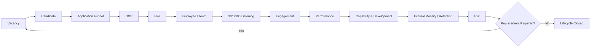

# FIT HUB People Intelligence
## Product Requirements Document, UX/UI Design Specification, and Technical Implementation Plan

**Document status:** Prototype Blueprint v1.2  
**Product type:** Future-state People Intelligence prototype  
**Primary deployment:** Next.js on Vercel  
**Backend and data platform:** Supabase PostgreSQL  
**Companion data architecture:** `FIT_HUB_People_Intelligence_Data_Architecture_v4.md`  
**Companion ERD:** `FIT_HUB_People_Intelligence_ERD_v3.dbml`

> This document defines the product experience, visual system, page layouts, data-to-UI contracts, metric definitions, and Supabase implementation for the FIT HUB People Intelligence prototype. The companion data architecture remains the source of truth for the full `Source -> Raw -> Staging -> Core -> Mart -> App` data model. This PRD adds the product-facing requirements needed to turn that model into an interconnected prototype.

> **Revision v1.1:** Adds SQL-based internal mobility decision support, target-role success benchmarks, optional reuse of existing psychometric / work-style / strengths assessments, and explicit cost and governance rules. Capability and demonstrated performance remain the primary evidence. Psychometric or behavioral assessment is supporting context only and should not become an automatic promotion or rejection gate.


---

# 1. Executive Summary

FIT HUB People Intelligence is a lightweight future-state prototype that demonstrates how the recommendations from the People Analytics case study could become an operationally useful People data product.

The product should not look like a collection of unrelated dashboards. It should present one connected employee lifecycle:

```text
Vacancy
  -> Candidate
  -> Application
  -> Offer
  -> Hire
  -> Team
  -> Early-Tenure Listening
  -> Engagement
  -> Performance
  -> Capability and Development
  -> Internal Mobility or Retention
  -> Exit
  -> Replacement Vacancy
```

The prototype has two primary entry points:

1. **Vacancy**, representing the pre-hire side of the lifecycle.
2. **Team**, representing the post-hire side of the lifecycle.

The product then connects these two sides through governed identifiers and lifecycle relationships, especially `requisition_id`, `employee_id`, `employment_id`, and explicit exit-to-replacement linkage.

The prototype uses two clearly separated data classes:

- **Observed Case Data**, based on the supplied Hiring, Turnover, and Engagement case datasets.
- **Synthetic Future-State Data**, generated to demonstrate capabilities that require data not available in the original case, such as shared Employee IDs, Recruitment Funnel, Monthly Headcount, Performance, Capability, Internal Mobility, and explicit exit-to-replacement linkage.

The app is intentionally a **decision-support and analytics prototype**, not a full ATS or HRIS replacement. It should help a reviewer see how workforce signals can become targeted People actions and measurable outcomes.

---

# 2. Relationship to the Existing Data Architecture

This PRD is designed to work together with:

`FIT_HUB_People_Intelligence_Data_Architecture_v2.md`

The responsibilities are separated as follows:

| Document | Primary responsibility |
|---|---|
| Data Architecture v2 | Source systems, Raw, Staging, Core, Mart, identifiers, PK/FK design, source-to-target logic, governance |
| This PRD | Product behavior, app navigation, UI layouts, success metrics, frontend data contracts, Supabase implementation, visual design |

If there is a conflict:

- the **Data Architecture document wins for database modeling and transformation logic**;
- this **PRD wins for product behavior and user interface requirements**.

The end-to-end architecture remains:

```text
Source -> Raw -> Staging -> Core -> Mart -> App
```

The App should primarily consume Mart-level outputs. Core is used for controlled drill-through and entity relationships. Raw and Staging should never be queried directly from the browser.

---

# 3. Product Vision

## 3.1 Vision statement

**Turn workforce signals into targeted People decisions across the employee lifecycle.**

The prototype should make it possible to move from:

```text
"We have a lot of hiring"
```

to:

```text
"Which role-location combinations create the most recruitment pressure, why is the funnel slow, and do we already have a ready talent pool?"
```

From:

```text
"We have a lot of exits"
```

to:

```text
"Which early-tenure cohorts are losing people, what signals appeared before exit, which losses are avoidable, and what intervention should be tested?"
```

From:

```text
"Overall eNPS is positive"
```

to:

```text
"Which workforce segments are weaker, what employee-experience themes explain the difference, and did a targeted action improve the same segment later?"
```

And from:

```text
"Career development matters"
```

to:

```text
"What capabilities are required for the next role, where are the employee's gaps, what development action is assigned, and is the employee becoming ready for internal mobility?"
```

---

# 4. Product Goals

The prototype should demonstrate five things clearly.

## 4.1 Connect Hiring and Team data

A reviewer should be able to understand that a vacancy is not a standalone event. A filled requisition creates an employee lifecycle, and an exit can create a replacement requisition.

## 4.2 Operationalize the case recommendations

Every major recommendation from the case should map to an actual product capability.

| Recommendation area | Product capability |
|---|---|
| Role x Location hiring prioritization | Vacancy Health and Demand Prioritization |
| Role x Location x Channel review | Sourcing and Funnel dashboard |
| Proactive frontline pipelines | Talent Pool |
| 30/60/90 listening | Early-Tenure Listening |
| Structured exit evidence | Exit Diagnosis |
| Cohort diagnosis | Retention Cohorts |
| Segmented Employee Experience | Engagement Explorer |
| Career and Capability Framework | Capability and Development |
| Internal mobility | Mobility and Internal Fill |
| Critical data enablers | Data Readiness page |

## 4.3 Make success metrics measurable

The prototype should show how recommended success metrics could be calculated once the required data exists.

## 4.4 Preserve analytical integrity

The app must never imply that synthetic future-state records were observed in the original case data.

## 4.5 Demonstrate product thinking, not only dashboarding

Each page should follow:

```text
Signal -> Diagnose -> Prioritize -> Action -> Measure
```

rather than:

```text
Chart -> Chart -> Chart -> Chart
```

---

# 5. Non-Goals

The MVP is not intended to become a complete production HR platform.

The following are out of scope for the first prototype:

- payroll;
- leave and attendance administration;
- employee document storage;
- real candidate email or WhatsApp communication;
- interview scheduling integrations;
- approval workflows for actual requisitions;
- compensation administration;
- real employee PII;
- AI-based individual attrition prediction;
- automated employment decisions;
- production-grade ATS replacement;
- production-grade HRIS replacement.

The prototype is read-heavy and analytical. It may include demo actions such as filters, drill-through, cohort comparison, and simulated recommendation cards, but it should not pretend to execute real HR transactions.

---

# 6. Target Users

## 6.1 People Leader

Needs to know:

- where workforce pressure is highest;
- whether pressure comes from hiring, retention, or employee experience;
- which interventions should be prioritized;
- whether outcomes improve after intervention.

## 6.2 Talent Acquisition / Recruiter

Needs to know:

- which vacancies are urgent;
- where SLA pressure is concentrated;
- which sourcing channels work for a specific Role x Location combination;
- whether a ready talent pool already exists;
- how recruitment outcomes translate into later retention and Quality of Hire.

## 6.3 HRBP / People Partner

Needs to know:

- which teams or cohorts have early-tenure risk;
- what listening signals exist;
- whether exit patterns are avoidable or regrettable;
- which manager, role, or location segments need deeper diagnosis.

## 6.4 L&D / Talent Management

Needs to know:

- which role capabilities are defined;
- where employee capability gaps exist;
- what development actions are active;
- who is approaching next-role readiness;
- whether internal mobility is increasing.

## 6.5 People Analytics

Needs to know:

- data readiness;
- metric definitions;
- lifecycle completeness;
- observed versus synthetic origin;
- whether success metrics are supported by the available data.

---

# 7. Product Information Architecture

## 7.1 Primary navigation

The product is organized around two lifecycle zones rather than three disconnected analytical topics.

```text
FIT HUB People Intelligence
|
|-- Home
|
|-- Vacancy
|   |-- Vacancy Overview
|   |-- Sourcing & Funnel
|   |-- Talent Pool
|   `-- Hiring Outcomes
|
|-- Team
|   |-- Team Overview
|   |-- Retention
|   |-- Engagement
|   |-- Capability & Development
|   `-- Exit & Mobility
|
`-- Data Readiness
```

## 7.2 Why Vacancy and Team

**Vacancy** represents the lifecycle before employment begins.

```text
Demand -> Requisition -> Candidate -> Funnel -> Offer -> Hire
```

**Team** represents the lifecycle after employment begins.

```text
Join -> Listen -> Engage -> Perform -> Develop -> Move / Stay / Exit
```

The system links both sides:

```text
Exit -> Replacement Requirement -> New Requisition -> Vacancy
```

This makes the product concept easy to explain without forcing the reviewer to think in separate Hiring, Turnover, and Engagement silos.

---

# 8. Core Product Loop

The core experience should be visible throughout the product.



A subtle version of this lifecycle should appear as a reusable component in relevant pages.

---

# 9. Recommended Product Name and Copy

## 9.1 Product name

**FIT HUB People Intelligence**

This is preferred over a more generic name because it is broad enough to cover recruitment, retention, engagement, capability, performance, mobility, and data readiness.

## 9.2 Homepage subtitle

Preferred:

**Future-state workforce analytics and decision prototype**

Case-study context line:

**Mini Prototype Recommendation from the People Intelligence Case Study**

Attribution:

**by M. Fakhri Musyaffa Budiman**

## 9.3 Product voice

The UI should be:

- concise;
- analytical;
- action-oriented;
- cautious about causality;
- specific about workforce segments;
- transparent about synthetic data.

Preferred wording:

- `High SLA pressure observed in Bali frontline hiring.`
- `Validate local funnel bottlenecks before increasing sourcing volume.`
- `Early-tenure listening indicates lower manager-support scores in this cohort.`

Avoid:

- `Bali hiring is failing.`
- `Manager support causes attrition.`
- `This employee will resign.`

---

# 10. Visual Design System

## 10.1 Font recommendation

The web prototype should use **League Spartan + Poppins**.

This is the preferred option because it keeps continuity with the visual language of the case deck while simplifying the font system for an application.

### Display and headings

**League Spartan**

Recommended weights:

- 700 for H1 and major page titles;
- 600 or 700 for major KPI numbers if a stronger display treatment is needed.

### UI and body

**Poppins**

Recommended weights:

- 400 body;
- 500 labels and navigation;
- 600 buttons, table headers, KPI labels;
- 700 only for small emphasis where needed.

### Why not use every font from the deck

The deck contains a broader mix of display and body fonts. A web product should be more systematic. Using League Spartan for strong headlines and Poppins for everything else preserves the deck character while improving consistency.

### One-font fallback

If implementation speed matters, **Poppins-only is acceptable**. In that case:

- 700 for titles;
- 600 for section headings;
- 500 for labels;
- 400 for body.

However, the preferred showcase version is still **League Spartan + Poppins**.

## 10.2 Typography scale

| Token | Font | Weight | Desktop size / line height | Use |
|---|---|---:|---:|---|
| Display XL | League Spartan | 700 | 48 / 52 | Landing hero only |
| H1 | League Spartan | 700 | 36 / 42 | Page title |
| H2 | League Spartan | 700 | 28 / 34 | Major section |
| H3 | Poppins | 600 | 20 / 28 | Card/section heading |
| KPI XL | League Spartan | 700 | 36 / 40 | Primary KPI |
| KPI | Poppins | 600 | 26 / 32 | Secondary KPI |
| Body | Poppins | 400 | 14 / 22 | Main body |
| Body Small | Poppins | 400 | 12 / 18 | Notes |
| Label | Poppins | 500 | 12 / 16 | Filters, chips |
| Button | Poppins | 600 | 14 / 20 | CTA |

Avoid body text below 12 px on desktop.

---

# 11. Color System

The palette should remain very close to the presentation.

## 11.1 Core brand palette

| Token | Hex | Use |
|---|---|---|
| `brand.teal` | `#23C9D3` | Brand accent, highlights, active navigation, selected states |
| `brand.yellow` | `#FFED00` | Priority highlights, special callouts, accent badges |
| `ink.primary` | `#111111` | Main text, charts, strong CTA |
| `surface.white` | `#FFFFFF` | Main surface |
| `surface.soft` | `#F6FAFA` | Page background, soft card zones |
| `mint.soft` | `#B2D9D0` | Secondary informational background |
| `warm.gray` | `#E9E7DB` | Neutral accent, note surfaces |
| `border.default` | `#DDE5E6` | Borders and dividers |
| `text.secondary` | `#5F6B6D` | Secondary copy |

## 11.2 Semantic colors

Semantic colors should be used sparingly so they do not fight the FIT HUB palette.

| Meaning | Suggested token | Use |
|---|---|---|
| Healthy / positive | `#2E8B57` | retention improvement, healthy vacancy |
| Attention | `#C99400` | at-risk vacancy, monitoring state |
| Critical | `#C65353` | beyond threshold, critical issue |
| Information | `#2585A6` | data or methodology notes |

## 11.3 Contrast rules

- use **black/dark text on yellow**;
- use **black/dark text on brand teal** for buttons and chips where possible;
- do not rely on color alone for risk states;
- pair state color with icon and label such as `Healthy`, `At Risk`, `Critical`;
- charts should prioritize clarity rather than using many arbitrary colors.

---

# 12. Shape, Spacing, and Component Style

## 12.1 Grid

Desktop baseline:

- canvas: 1440 px;
- app sidebar: 232 to 248 px;
- top header: 64 px;
- page gutter: 32 px;
- content grid: 12 columns;
- gap: 20 to 24 px;
- max readable content width: about 1360 px.

## 12.2 Radius

- cards: 16 px;
- large feature cards: 20 px;
- chips: full pill or 999 px;
- inputs/buttons: 10 to 12 px.

## 12.3 Shadows

Use very light shadows only for hierarchy.

Preferred:

```css
box-shadow: 0 6px 24px rgba(17, 17, 17, 0.06);
```

Avoid heavy floating-card aesthetics.

## 12.4 Borders

Default:

```css
1px solid #DDE5E6
```

Use teal border only for selected or active states.

---

# 13. Global App Shell

The homepage is a branded entry page. All functional pages use a shared app shell.

## 13.1 Left navigation

Width: 240 px.

Structure:

```text
[FIT HUB logo]
People Intelligence

HOME
Overview

VACANCY
Vacancy Overview
Sourcing & Funnel
Talent Pool
Hiring Outcomes

TEAM
Team Overview
Retention
Engagement
Capability & Development
Exit & Mobility

DATA
Data Readiness
```

Active state:

- soft teal background;
- thin teal left indicator;
- dark text;
- icon + label.

## 13.2 Top header

Contains:

- page title;
- global period selector;
- Role filter when relevant;
- Location filter when relevant;
- data-origin badge;
- `Last refreshed` text;
- optional `About Prototype` icon.

Global filters should not appear on the landing page.

## 13.3 Data-origin badge

Every page should make data provenance visible.

Badge options:

- `Observed Case Data`
- `Synthetic Future-State`
- `Observed + Synthetic`
- `Derived Metric`

Tooltip should explain what each means.

---

# 14. Homepage Specification

## 14.1 Purpose

The homepage should communicate the product concept in less than 30 seconds and provide two clear ways into the lifecycle: Vacancy and Team.

## 14.2 Route

`/`

## 14.3 Above-the-fold layout

Desktop:

```text
+--------------------------------------------------------------+
|                         FIT HUB LOGO                         |
|                                                              |
|                 FIT HUB People Intelligence                  |
|       Future-state workforce analytics and decision          |
|                         prototype                             |
|                                                              |
|       +------------------+   +------------------+             |
|       |     VACANCY      |   |       TEAM       |             |
|       | pre-hire         |   | post-hire        |             |
|       | demand/funnel    |   | retain/develop   |             |
|       | [Enter Vacancy]  |   | [Enter Team]     |             |
|       +------------------+   +------------------+             |
|                                                              |
|   Vacancy -> Hire -> Team -> Develop -> Exit -> Replacement  |
+--------------------------------------------------------------+
```

## 14.4 Vacancy card

Icon concept:

- key, vacancy tag, briefcase, or search icon;
- use a hand-drawn-inspired accent only if it remains visually clean.

Copy:

**Vacancy**  
*Prioritize hiring demand, diagnose funnel pressure, optimize sourcing, and maintain recurring talent pipelines.*

CTA:

**Enter Vacancy**

## 14.5 Team card

Icon concept:

- group / team outline;
- human figure + dashboard.

Copy:

**Team**  
*Monitor retention, employee experience, capability, internal mobility, and workforce outcomes after employees join.*

CTA:

**Enter Team**

## 14.6 Below-the-fold signal strip

Keep this minimal. Three compact cards:

1. **Frontline Hiring Pressure**
2. **Early-Tenure Workforce Stability**
3. **Localized Employee Experience**

Observed case figures may be used where already supported. Each card should link to the relevant module.

## 14.7 Footer disclosure

> Historical case insights use observed data. Future-state person-level lifecycle capabilities use clearly labeled synthetic data.

---

# 15. Vacancy Module

The Vacancy module operationalizes the Hiring recommendations.

The mental model is:

```text
Where is hiring pressure?
  -> Why is the vacancy difficult?
     -> Which source/funnel stage should change?
        -> Can a ready pool reduce reactive hiring?
           -> Did hiring quality improve?
```

---

# 16. Vacancy Overview

## 16.1 Purpose

Answer:

**Which hiring demand should Talent Acquisition focus on first?**

## 16.2 Route

`/vacancy`

## 16.3 Page header

Title:

**Vacancy Overview**

Subtitle:

**Prioritize hiring demand by role, location, hiring type, and SLA pressure.**

Filters:

- Period
- Role / Job Family
- Location / Region
- Hiring Type
- Requisition Status
- SLA Status

## 16.4 KPI row

Recommended KPI cards:

1. Open Requisitions
2. Replacement Share
3. Beyond SLA Rate
4. Median Time to Fill
5. Pipeline Coverage
6. Filled This Period

Each card includes:

- current value;
- comparison period when synthetic history supports it;
- `Observed`, `Synthetic`, or `Derived` badge;
- tooltip with definition.

## 16.5 Main layout

```text
12-column grid

+-------------------------------------+--------------------+
| Vacancy Health / Priority Table     | Priority Signals   |
| 8 columns                           | 4 columns          |
|                                     |                    |
| Role | Location | Type | Age | SLA  | 1. Bali FC        |
| ...                                 | 2. Sales/Memb.     |
|                                     | 3. ...             |
+-------------------------------------+--------------------+

+---------------------------+------------------------------+
| Hiring Demand Trend       | SLA / Aging Distribution     |
| 6 columns                 | 6 columns                    |
+---------------------------+------------------------------+
```

## 16.6 Vacancy Health table

Columns:

- Requisition Code
- Role
- Location
- Hiring Type
- Openings
- Days Open
- Pipeline Size
- Current Stage Bottleneck
- SLA Status
- Health

Health logic should be simple and transparent.

Example:

```text
Healthy
At Risk
Critical
```

Do not present a black-box score.

## 16.7 Priority signal card

Example:

**Fitness Consultant x Bali**  
`Replacement-heavy` `High SLA pressure`

Signal:

> Repeated replacement demand and elevated SLA pressure are concentrated in this segment.

Recommended next step:

> Diagnose local funnel conversion and recruiter capacity before increasing sourcing volume.

Button:

**Open Funnel Analysis**

## 16.8 Product meaning

This page is not only a dashboard. It implements Recommendation 1 by telling TA **where to focus first**.

---

# 17. Sourcing & Funnel

## 17.1 Purpose

Answer:

**For the selected hiring priority, which sourcing channel and recruitment stage require attention?**

## 17.2 Route

`/vacancy/funnel`

## 17.3 Context selector

At minimum:

- Role
- Location
- Hiring Type
- Period

The selected context should be visible as a persistent chip:

`Fitness Consultant | Bali | Replacement`

## 17.4 KPI row

- Applications
- Screening Conversion
- Interview Conversion
- Offer Rate
- Offer Acceptance
- Hire Conversion
- Median Time in Funnel

## 17.5 Main layout

```text
+------------------------------------------------------------+
| Recruitment Funnel                                        |
| Applied -> Screening -> Interview -> Offer -> Hire         |
+------------------------------------------------------------+

+--------------------------------+---------------------------+
| Source Effectiveness           | Stage Bottleneck          |
| Volume / Conversion / SLA      | Time-in-stage             |
+--------------------------------+---------------------------+

+------------------------------------------------------------+
| Source-to-Outcome table                                    |
| Source | Hires | TTF | Offer Acceptance | 6M Retention    |
+------------------------------------------------------------+
```

## 17.6 Source comparison

Do not rank source using hire volume alone.

Minimum fields:

- applicants;
- hires;
- hire conversion;
- Beyond SLA rate;
- offer acceptance;
- median time to fill.

Future-state fields:

- 6M retention;
- 12M retention;
- performance after hire;
- Quality of Hire component metrics.

## 17.7 Decision-support copy

Example:

> Employee Referral contributes the highest volume, while Social Media Ads shows a higher delay rate for this selected segment. Channel decisions should consider both volume and efficiency.

## 17.8 Product meaning

This page implements Recommendation 2. The recommendation is not `build a sourcing dashboard`. The recommendation is **evaluate channel effectiveness in the context of Role x Location x Channel and downstream outcomes**.

---

# 18. Talent Pool

## 18.1 Purpose

Answer:

**Can recurring hiring demand be served from a prepared candidate pool instead of restarting sourcing from zero?**

## 18.2 Route

`/vacancy/talent-pool`

## 18.3 KPI row

- Total Active Pool
- Interview Ready
- Previous Finalists
- Pre-qualified
- Stale Candidates
- Pipeline Coverage

## 18.4 Page layout

```text
+------------------------------------------------------------+
| Talent Pools                                               |
| Bali Fitness Consultant | Jakarta PT | CS Pool | ...       |
+------------------------------------------------------------+

+----------------------------------+-------------------------+
| Candidate readiness table        | Pool health             |
| Name/ID | Readiness | Source     | Ready now               |
| Last contact | Role fit          | Aging                   |
+----------------------------------+-------------------------+
```

Because this is a public prototype, candidate names should be synthetic. Prefer display IDs or clearly fictional names.

## 18.5 Pool readiness statuses

- Potential
- Pre-qualified
- Interview Ready
- Previous Finalist
- Inactive

## 18.6 Pipeline Coverage

Illustrative definition:

```text
Interview-ready candidates / expected near-term openings
```

If denominator assumptions are synthetic, label them.

## 18.7 Product meaning

This page implements Recommendation 3, proactive frontline pipelines.

---

# 19. Hiring Outcomes

## 19.1 Purpose

Show whether hiring efficiency and downstream quality improve over time.

## 19.2 Route

`/vacancy/outcomes`

## 19.3 Success metrics

- Beyond SLA Rate
- Median TTF
- Funnel Conversion
- Offer Acceptance
- Source-to-Retention
- 6M New Hire Retention
- 12M New Hire Retention
- Quality of Hire components

## 19.4 Layout

Top:

- 6 KPI cards.

Middle:

- trend of SLA and TTF;
- source-to-retention comparison.

Bottom:

- Quality of Hire components by Role x Location or source.

Do not hide the components behind only one composite number.

---

# 20. Team Module

The Team module represents the post-hire lifecycle.

The mental model is:

```text
Who is in the workforce?
  -> Where are early-tenure losses concentrated?
     -> What did employees experience before exit?
        -> Are development pathways clear?
           -> Can internal mobility reduce avoidable loss?
              -> Which exits create replacement demand?
```

---

# 21. Team Overview

## 21.1 Purpose

Give People leaders a concise workforce health view before they drill into Retention, Engagement, Capability, or Exit.

## 21.2 Route

`/team`

## 21.3 KPI row

- Active Headcount
- New Joiners
- <12M Headcount Share
- 6M Retention
- 12M Retention
- eNPS
- Internal Fill Rate

Use six at once on desktop. Move less critical metrics into a second row if required.

## 21.4 Main layout

```text
+--------------------------------+---------------------------+
| Workforce Composition          | Priority Signals          |
| Role / Job Family              | Early tenure              |
| Location                       | Bali                      |
+--------------------------------+---------------------------+

+--------------------------------+---------------------------+
| Tenure Distribution            | Lifecycle Outcomes        |
| <3M / 3-6M / 6-12M / 12M+    | retain / move / exit      |
+--------------------------------+---------------------------+
```

## 21.5 Priority cards

Examples:

- Early-Tenure Frontline Retention
- Geographic Workforce Readiness
- Localized Employee Experience
- Career and Capability Readiness

Each priority card links to the relevant page.

---

# 22. Retention

## 22.1 Purpose

Operationalize the six-stage retention loop:

```text
1. 30 / 60 / 90 Listening
2. Structured Exit Evidence
3. Cohort Diagnosis
4. Identify Avoidable / Regrettable Loss
5. Targeted Intervention
6. Re-measure
```

This is one process, not six independent recommendations.

## 22.2 Route

`/team/retention`

## 22.3 KPI row

- 90-Day Retention
- 6M Retention
- 12M Retention
- Early-Tenure Exit Rate
- Voluntary Exit Rate
- Regrettable Voluntary Exit Rate

## 22.4 Main page layout

```text
+------------------------------------------------------------+
| Retention Cohort View                                      |
| Join cohort x tenure month / retention curve               |
+------------------------------------------------------------+

+--------------------------------+---------------------------+
| 30/60/90 Listening             | Cohort Diagnosis          |
| completion + signals           | Role x Location x Tenure  |
+--------------------------------+---------------------------+

+--------------------------------+---------------------------+
| Exit Drivers                   | Targeted Intervention     |
| voluntary reasons              | conditional action cards  |
+--------------------------------+---------------------------+

+------------------------------------------------------------+
| Re-measure: previous cohort vs subsequent cohort           |
+------------------------------------------------------------+
```

## 22.5 30 / 60 / 90 Listening component

Each checkpoint displays:

- response rate;
- role expectation;
- manager support;
- career clarity;
- workload;
- role fit;
- stay intention.

These are future-state synthetic fields for the prototype unless observed data supports them.

## 22.6 Conditional intervention examples

**Example A**

IF `Role Expectation Mismatch` is validated:

> Improve realistic job preview and onboarding expectation setting.

**Example B**

IF `Manager Support` is validated:

> Implement structured early-tenure manager check-ins.

The UI should emphasize `IF validated`. The examples are not findings from the original case.

## 22.7 Re-measure component

Compare cohorts before and after a targeted intervention.

Example:

```text
Bali Fitness Consultant
Q1 6M Retention: 66%
Q2 6M Retention: 70%
Q3 6M Retention: 74%
```

If synthetic, the badge must say `Illustrative Future-State`.

---

# 23. Engagement

## 23.1 Purpose

Move from company-wide averages to segmented workforce listening.

## 23.2 Route

`/team/engagement`

## 23.3 KPI row

- Overall eNPS
- Promoter Share
- Detractor Share
- Response Rate
- Lowest Comparable Segment
- Top Positive Theme
- Top Improvement Theme

## 23.4 Main layout

```text
+-----------------------------+------------------------------+
| eNPS Overview               | Segment Comparison           |
| +56.6 etc.                  | Role / Location / Lifecycle  |
+-----------------------------+------------------------------+

+------------------------------------------------------------+
| Experience Dimensions                                      |
| Work Clarity | Career Growth | Supportive Workplace | ...  |
+------------------------------------------------------------+

+-----------------------------+------------------------------+
| What employees value       | What employees want improved |
| themes                      | themes                       |
+-----------------------------+------------------------------+
```

## 23.5 eNPS calculation

The app should calculate eNPS as:

```text
% Promoters - % Detractors
```

Classification:

```text
9-10 Promoter
7-8 Passive
0-6 Detractor
```

Do not label the average 1-10 recommendation score as eNPS.

## 23.6 Segmentation controls

- Role
- Location
- Region
- Tenure / Lifecycle Stage
- Survey Cycle

Default comparisons should not show very small groups. Use a configurable minimum sample threshold.

## 23.7 Voice of Employee

Support:

- positive themes;
- improvement themes;
- role-specific theme shares;
- optional coded comments in synthetic demo data.

Public demo should not expose real free-text comments from employees.

---

# 24. Capability, Development & Internal Mobility

## 24.1 Purpose

Demonstrate how career-development signals can become a measurable medium-term capability and internal-mobility decision-support system.

The module should answer five questions:

1. What does the target role require?
2. What capabilities and performance evidence does the employee currently demonstrate?
3. What gaps remain?
4. What development action could close those gaps?
5. Is the employee Ready, Near Ready, or still Development Needed for an internal opportunity?

This module may also show existing psychometric, work-style, or strengths data as **supporting context** when those assessments already exist and remain relevant. They are not the primary basis of internal-mobility readiness.

## 24.2 Route

`/team/capability`

Optional deeper route:

`/team/capability/internal-opportunity/[requisition_id]`

## 24.3 Page header controls

- Current Role
- Target Role
- Location / Org Unit
- Employee or Cohort selector in synthetic demo only
- Internal Vacancy selector where applicable
- Benchmark Version
- `Show Work-Style Context` toggle

## 24.4 KPI row

- Roles with Capability Framework
- Employees Assessed
- Average Current Role Fit
- Average Next-Role Readiness
- Active Development Plans
- Capability Progression Rate
- Internal Fill Rate
- Ready / Near-Ready Internal Talent

## 24.5 Main layout

```text
+------------------------------------------------------------+
| Target Role Profile                                       |
| Approved capability requirements + performance expectations|
+------------------------------------------------------------+

+--------------------------------+---------------------------+
| Capability Profile             | Performance Evidence      |
| current vs target              | recent role outcomes      |
+--------------------------------+---------------------------+

+--------------------------------+---------------------------+
| Development Gaps               | Internal Mobility Status  |
| gap -> action -> reassess      | Ready / Near Ready / Gap  |
+--------------------------------+---------------------------+

+------------------------------------------------------------+
| Optional Supporting Context                                 |
| DISC / MBTI / PAPI / Strengths, only when available         |
+------------------------------------------------------------+
```

## 24.6 Proficiency scale

Recommended:

- L1 Basic
- L2 Developing
- L3 Independent
- L4 Advanced / Next-Role Ready

## 24.7 Readiness evidence hierarchy

The prototype should make the evidence hierarchy explicit.

### Primary evidence

1. **Approved Role Capability Requirements**
2. **Actual Performance Evidence**
3. **Development / Stretch Assignment Evidence**
4. **Required role certifications or mandatory role conditions**

### Supporting evidence

Optional existing assessments, for example:

- DISC
- MBTI, if FIT HUB already uses it
- PAPI / work-style dimensions
- Strengths profile
- another role-relevant behavioral instrument

Supporting assessment must not silently become the dominant factor in the overall decision.

Recommended default product behavior:

```text
Capability + Performance + Development Evidence
        = core readiness evidence

Psychometric / Work-Style / Strengths
        = supporting context
```

## 24.8 Cost-aware assessment policy

For operational roles, the platform should **reuse existing valid assessment data rather than automatically retesting employees**.

Recommended rules:

- Do not require a new IQ, GTQ, MBTI, DISC, PAPI, or similar assessment merely because an employee is being considered for internal movement.
- If a relevant assessment already exists from recruitment or a prior talent process, it can be reused as contextual evidence subject to validity / recency rules.
- Missing optional psychometric data must not automatically make an employee ineligible.
- New assessment should only be requested if the target role has a documented business need and the organization has chosen a validated instrument for that purpose.
- For frontline / operational internal mobility, capability and demonstrated performance should normally carry more decision value than broad cognitive or personality similarity.
- For HO / specialist roles, job-specific assessment may be added where it is relevant, but the same governance and cost rules apply.

This keeps the future-state model operationally realistic and avoids unnecessary assessment cost.

## 24.9 Target-role benchmark

The module may use a target-role success benchmark as an **empirical calibration layer**.

Preferred logic:

```text
APPROVED ROLE REQUIREMENTS
        +
HIGH-PERFORMER INCUMBENT BENCHMARK
        =
TARGET-ROLE DECISION SUPPORT PROFILE
```

The approved role framework remains authoritative.

The observed benchmark helps answer:

- What capability levels are commonly demonstrated by successful incumbents?
- What performance range is typical among successful incumbents?
- What work-style or strengths patterns appear frequently, if any?

The benchmark should never mean:

> "Everyone promoted into this role must look exactly like the historical high performers."

## 24.10 SQL benchmark logic

The benchmark and matching logic should be calculated in PostgreSQL / Supabase SQL rather than in the browser.

Illustrative process:

```text
1. Select target role
2. Select eligible high-performing incumbents
3. Build benchmark profile
4. Load approved target-role capability requirements
5. Compare internal employees
6. Apply performance evidence / critical requirement gates
7. Produce transparent component results
8. Return Ready / Near Ready / Development Needed
```

Recommended benchmark eligibility can use configurable criteria such as:

- target role currently held;
- minimum number of completed performance cycles;
- agreed high-performance threshold;
- no missing critical capability assessment;
- minimum benchmark sample size.

## 24.11 Assessment-type benchmark logic

Different assessment types require different treatment.

| Evidence | Data type | Recommended benchmark treatment |
|---|---|---|
| Capability | Ordinal L1-L4 | Approved target + median / distribution of successful incumbents |
| Performance | Numeric / categorical | Threshold, median, distribution |
| DISC | Categorical | Mode **plus full distribution**, not hard binary match |
| MBTI | Categorical | Mode **plus full distribution**, supporting context only |
| Strengths | Ranked multi-category | Frequency of themes + top-N overlap |
| PAPI | Numeric dimensions | Median and IQR / acceptable range by dimension |
| IQ / GTQ | Numeric | Only if role-relevant and governed; median / range, not generic mandatory use |

For categorical data, the mode may summarize the most common observed profile, but the UI should retain the distribution so alternatives are not treated as automatic mismatches.

Example:

```text
High-performing FC Leaders
DISC distribution:
SC 44%
SI 33%
DC 11%
D  11%

Candidate DISC:
SI

Interpretation:
SI is represented among successful incumbents.
Do not convert this into a pass/fail rule.
```

## 24.12 Readiness output

Avoid an unexplained black-box percentage.

Display component-level evidence:

```text
Target Role: FC Leader

Capability Fit          92%
Performance Evidence    Strong / Meets
Development Evidence    1 active gap
Critical Requirements   Met
Work-Style Context      Available

Overall Status:
NEAR READY
```

If a summary percentage is used, its weights must be visible and configurable.

Recommended product rule:

- psychometric / behavioral context should have either **no composite weight** or a deliberately low weight;
- it must never override failure to meet critical capability or performance requirements;
- a low contextual match must not be used as an automatic rejection.

## 24.13 Internal opportunity matching

For a selected internal vacancy, the prototype can rank or group potential internal candidates as:

- Ready
- Near Ready
- Development Needed

Example table:

| Employee | Capability Fit | Performance | Benchmark Context | Critical Gaps | Status |
|---|---:|---|---|---:|---|
| EMP-0142 | 96% | Strong | Similar | 1 | Near Ready |
| EMP-0381 | 100% | Strong | Within observed range | 0 | Ready |
| EMP-0029 | 87% | Meets | Different but represented | 2 | Development Needed |

This is **decision support**, not an automatic employment decision.

## 24.14 Medium-term framing

The product should explicitly say:

> Capability and mobility features represent a medium-term future-state recommendation. They require standardized role expectations, capability definitions, actual performance evidence, proficiency criteria, manager calibration, repeated assessment, and governance of any optional work-style or psychometric evidence.

## 24.15 SQL implementation contract

The production-like prototype implementation must not calculate internal mobility readiness in React.

The complete executable SQL is maintained in the companion architecture:

`FIT_HUB_People_Intelligence_Data_Architecture_v4.md`
-> **Appendix D. Full SQL Internal Mobility Benchmark and Matching Engine**

Standalone migration:

`010_internal_mobility_engine.sql`

Execution:

```sql
SELECT mart.refresh_internal_mobility_match(
    '<target_requisition_uuid>'::uuid
);
```

The App then reads `public.vw_internal_mobility_match`.

The SQL output must expose:

- capability coverage;
- approved role requirement fit;
- recent performance score and status;
- development evidence;
- optional assessment-context score;
- empirical benchmark alignment;
- required and critical gap counts;
- final readiness score;
- Ready / Near Ready / Development Needed / Insufficient Data status;
- recommended next step;
- benchmark version;
- scoring config version.

This makes the prototype auditable and keeps business logic in Supabase rather than duplicating it in the frontend.

---

# 25. Exit & Mobility

## 25.1 Purpose

Close the employee lifecycle and reconnect Team outcomes to Vacancy demand.

## 25.2 Route

`/team/exit-mobility`

## 25.3 KPI row

- Total Exits
- Voluntary Exit Rate
- Regrettable Voluntary Exit Rate
- Internal Moves
- Promotions
- Internal Fill Rate
- Replacement-Required Exit Share

## 25.4 Main layout

```text
+--------------------------------+---------------------------+
| Exit Composition               | Internal Mobility         |
| Voluntary / Involuntary        | Promotion / Transfer      |
+--------------------------------+---------------------------+

+--------------------------------+---------------------------+
| Exit Reasons                   | Mobility Flow             |
| by tenure / role / location    | Role A -> Role B          |
+--------------------------------+---------------------------+

+------------------------------------------------------------+
| Exit -> Replacement Requisition Linkage                    |
+------------------------------------------------------------+
```

## 25.5 Exit-to-Replacement component

Synthetic lifecycle example:

```text
EMP-00421
Fitness Consultant, Bali
        |
        v
EXIT-00192
Voluntary, Regrettable
Replacement Required = Yes
        |
        v
REQ-2027-0184
Fitness Consultant, Bali
Hiring Type = Replacement
        |
        v
Vacancy module
```

CTA:

**Open Linked Vacancy**

This is one of the clearest demonstrations that the platform is interconnected.

---

# 26. Data Readiness

## 26.1 Purpose

Explain why the current case can diagnose directional workforce patterns but cannot fully operationalize every recommendation without additional data.

## 26.2 Route

`/data-readiness`

## 26.3 Current-state panel

Show:

- Hiring dataset;
- Turnover dataset;
- Engagement dataset;
- no shared Employee ID;
- no Requisition-to-Exit linkage;
- no active monthly headcount denominator;
- no <6M Engagement respondents;
- limited post-hire performance/probation data.

## 26.4 Future-state enablers

Show six primary cards:

1. Employee ID
2. Requisition ID
3. Monthly Headcount
4. Recruitment Funnel
5. Performance
6. Internal Mobility

## 26.5 Architecture visualization

```text
SOURCE
  |
  v
RAW
  |
  v
STAGING
  |
  v
CORE
  |
  v
MART
  |
  v
FIT HUB PEOPLE INTELLIGENCE
```

Each stage can be clickable to reveal one sentence:

- Source: what the operational system sends;
- Raw: exact landed source;
- Staging: cleaned and standardized;
- Core: canonical entities and lifecycle relationships;
- Mart: app-ready metrics;
- App: decisions, workflows, and measurement.

## 26.6 Observed vs Synthetic legend

A visible comparison:

| Observed Case | Synthetic Future-State |
|---|---|
| Historical Hiring rows | Employee IDs |
| Historical Turnover rows | Requisition IDs |
| Historical Engagement rows | Funnel events |
| Supported aggregate findings | Monthly Headcount |
| | Performance |
| | Capability |
| | Mobility |
| | Exit-to-Replacement linkage |

---

# 27. Cross-Module Interconnection Requirements

The prototype should not merely link pages in navigation. It should demonstrate actual entity relationships.

## 27.1 Vacancy to Team

When a synthetic application becomes `HIRED`:

```text
application_id
  -> hire_id
  -> employment_id
  -> employee_id
```

UI:

**View Employee Journey**

## 27.2 Team to Vacancy

When a synthetic exit has `replacement_required = true`:

```text
exit_event_id
  -> requisition_replacement
  -> requisition_id
```

UI:

**View Replacement Vacancy**

## 27.3 Capability to Mobility

```text
capability_assessment
  -> development_plan
  -> mobility_event
```

UI:

**View Mobility Outcome**

## 27.4 Recruitment Source to Retention

```text
source_id
  -> application
  -> hire
  -> employment
  -> retention cohort
```

UI:

**Compare Source-to-6M Retention**

---

# 28. Optional Entity Drill-Through

This is recommended for P1 if time allows.

## 28.1 Candidate detail

Route:

`/vacancy/candidate/[candidate_id]`

Show:

- source;
- requisition;
- funnel timeline;
- offer result;
- talent-pool membership;
- hire result.

If hired:

**Open Employee Journey**

## 28.2 Employee journey

Route:

`/team/employee/[employee_id]`

Synthetic only.

Show a horizontal or vertical timeline:

```text
Hired
  -> Assignment
  -> Day 30
  -> Day 60
  -> Day 90
  -> Engagement
  -> Performance
  -> Capability
  -> Development
  -> Mobility or Exit
```

This is a strong showcase feature but should not delay the dashboard MVP.

---

# 29. Success Metric Dictionary

Every KPI shown in the app needs a visible definition.

## 29.1 Hiring

### Beyond SLA Rate

Preferred future-state definition:

```text
Filled requisitions where actual fill/join date > need_by_date
/
eligible filled requisitions
```

For the observed case, preserve the case's existing SLA logic.

### Median Time to Fill

```text
median(actual_join_date - request_date)
```

If FIT HUB production definition uses another terminal event, document and use that consistently.

### Funnel Conversion

For stage A to B:

```text
applications entering B
/
applications entering A
```

### Offer Acceptance

```text
accepted offers
/
offers with a final candidate decision
```

### Source-to-Retention

At N months:

```text
hires from source retained at N months
/
hires from source eligible to have reached N months
```

Eligibility is critical. Recent hires that have not yet reached N months must not be included in the denominator.

### Quality of Hire

Prefer showing components rather than only one score:

- probation outcome;
- post-hire performance;
- 6M retention;
- 12M retention;
- optional manager quality rating.

A composite score may be included only if weights are labeled as illustrative and configurable.

## 29.2 Retention

### 90-Day Retention

```text
employees still active at day 90
/
hires eligible to have reached day 90
```

### 6M Retention

```text
employees still active at 6 months
/
hires eligible to have reached 6 months
```

### 12M Retention

```text
employees still active at 12 months
/
hires eligible to have reached 12 months
```

### Early-Tenure Exit Rate

Recommended denominator:

```text
exits during defined early-tenure window
/
employees exposed to that tenure window
```

For a simple demo, cohort survival is usually easier to explain than an ambiguous company-wide rate.

### Voluntary Exit Rate

```text
voluntary exits in period
/
average active headcount in period
```

### Regrettable Voluntary Exit Rate

```text
regrettable voluntary exits in period
/
average active headcount in period
```

## 29.3 Engagement

### eNPS

```text
% Promoters - % Detractors
```

Where:

- Promoter = 9-10
- Passive = 7-8
- Detractor = 0-6

### Segment eNPS

Use the same formula after filtering to the selected segment.

### Response Rate

```text
completed responses
/
eligible invited population
```

## 29.4 Capability and Mobility

### Capability Framework Coverage

```text
active roles with approved capability requirements
/
active roles in scope
```

### Capability Assessment Coverage

```text
employees with a current capability assessment
/
eligible employees in roles with a framework
```

### Capability Progression

```text
employees whose assessed proficiency increased in the measurement period
/
employees with comparable prior and current assessments
```

### Internal Fill Rate

```text
vacancies filled through internal movement
/
all filled vacancies eligible for internal fill
```

---

# 30. Database Requirements for This Product

The companion data architecture already supports most of the product. The following additions are recommended to align the database with the final UI.

## 30.1 `recruiting.requisition_status_history`

Purpose:

Track when a requisition changes status so vacancy aging and hold periods are measured correctly.

Suggested fields:

| Field | Type | Key | Notes |
|---|---|---|---|
| `status_history_id` | uuid | PK | history row |
| `requisition_id` | uuid | FK | requisition |
| `status` | enum/varchar | | OPEN, ON_HOLD, FILLED, etc. |
| `valid_from` | timestamp | | status start |
| `valid_to` | timestamp | nullable | status end |
| `changed_by_employee_id` | uuid | FK nullable | audit |
| `data_origin` | varchar | | observed/synthetic |

Relationship:

```text
requisition 1 -> N requisition_status_history
```

## 30.2 `mart.employee_listening_signal`

Purpose:

Provide cohort-level 30/60/90 listening signals to the Retention page.

Suggested grain:

```text
survey_cycle x lifecycle_checkpoint x role x location x cohort
```

Suggested fields:

- lifecycle_checkpoint;
- role_id;
- location_id;
- cohort_month;
- response_count;
- response_rate;
- role_expectation_score;
- manager_support_score;
- career_clarity_score;
- workload_score;
- role_fit_score;
- stay_intention_score;
- risk_label;
- data_origin.

## 30.3 `mart.workforce_priority`

Purpose:

Drive Home and Team Overview priority cards.

Suggested fields:

- priority_id;
- priority_type;
- role_id nullable;
- location_id nullable;
- lifecycle_stage nullable;
- severity;
- signal_title;
- signal_1;
- signal_2;
- signal_3;
- recommended_next_step;
- destination_route;
- calculated_at;
- data_origin.

## 30.4 Recommended additional marts

To reduce frontend logic:

- `mart.vacancy_health`
- `mart.recruitment_funnel`
- `mart.hiring_outcomes`
- `mart.team_overview`
- `mart.employee_experience`
- `mart.capability_readiness`
- `mart.internal_mobility`
- `mart.exit_replacement_link`

These should be built from Core. They are not independent sources of truth.


## 30.5 Generic employee assessment model

Add a generic model instead of separate tables for DISC, MBTI, PAPI, Strengths, and future assessment types.

Recommended Core tables:

```text
talent.assessment_definition
talent.assessment_dimension
talent.employee_assessment
talent.employee_assessment_result
talent.role_assessment_reference
```

Purpose:

- reuse existing employee assessment data;
- avoid building one schema per assessment vendor;
- support categorical, numeric, and ranked results;
- attach validity / recency rules;
- make assessment usage optional and transparent.

The database must support:

```text
DISC
  -> categorical result

MBTI
  -> categorical result

PAPI
  -> multiple numeric dimensions

Strengths
  -> ranked categorical themes
```

`role_assessment_reference` should be treated as contextual guidance by default, not a hard requirement.

Suggested fields:

| Field | Purpose |
|---|---|
| `job_role_id` | target role |
| `assessment_definition_id` | assessment type |
| `dimension_code` | optional dimension |
| `reference_type` | OBSERVED_DISTRIBUTION / BUSINESS_CONTEXT |
| `preferred_value` | optional categorical context |
| `min_numeric` / `max_numeric` | optional numeric contextual range |
| `use_type` | SUPPORTING_CONTEXT by default |
| `max_weight` | optional cap if a composite is used |
| `valid_from` / `valid_to` | governance |

## 30.6 Target-role benchmark model

Add:

```text
talent.role_benchmark_profile
talent.role_benchmark_member
talent.role_benchmark_metric
```

`role_benchmark_profile` stores benchmark version and eligibility logic.

`role_benchmark_member` preserves lineage of which synthetic incumbents formed the benchmark.

`role_benchmark_metric` stores aggregate benchmark outputs by evidence type.

Examples:

```text
Capability -> median target-role incumbent level
Performance -> median / distribution
DISC -> mode + category distribution
Strengths -> theme frequency
PAPI -> median + IQR per dimension
```

The benchmark is a calibration layer. Approved role capability requirements remain authoritative.

## 30.7 `talent.mobility_scoring_config`

Purpose:

Store role-specific or global weights and thresholds for the SQL readiness engine.

Prototype default:

- Capability 55%
- Performance 30%
- Development 10%
- Optional assessment context 5% maximum

The weights are illustrative and configurable.

## 30.8 Internal mobility match mart

Add:

`mart.internal_mobility_match`

Recommended grain:

```text
target_requisition x employee
```

Suggested fields:

- target_requisition_id;
- target_role_id;
- employee_id;
- role_requirement_fit;
- performance_status;
- development_status;
- benchmark_alignment;
- critical_gap_count;
- readiness_status;
- recommended_next_step;
- benchmark_version;
- calculated_at;
- data_origin.

Business logic should be implemented in SQL / Supabase, not React.


---

# 31. Source -> Raw -> Staging -> Core -> Mart -> App Mapping

## 31.1 Recruitment example

```text
SOURCE
ATS_Requisition.xlsx / CSV
        |
        v
RAW
raw.ats_requisition
        |
        v
STAGING
staging.stg_ats_requisition
        |
        v
CORE
recruiting.requisition
        |
        v
MART
mart.vacancy_health
mart.hiring_effectiveness
        |
        v
APP
Vacancy Overview
```

## 31.2 Retention example

```text
SOURCE
HRIS_Employee
HRIS_Employment
HRIS_Exit
Survey_Response
        |
        v
RAW
raw.hris_*
raw.survey_*
        |
        v
STAGING
staging.stg_hris_*
staging.stg_survey_*
        |
        v
CORE
employee
employment
exit_event
survey_response
        |
        v
MART
mart.retention_cohort
mart.employee_listening_signal
        |
        v
APP
Retention
```

## 31.3 Capability example

```text
SOURCE
Capability_Assessment
Performance_Review
Employee_Assessment
Employee_Assessment_Result
Development_Plan
Mobility_Event
        |
        v
RAW
raw.capability_assessment
raw.performance_review
raw.employee_assessment
raw.employee_assessment_result
raw.development_plan
raw.mobility_event
        |
        v
STAGING
staging.stg_capability_assessment
staging.stg_performance_review
staging.stg_employee_assessment
staging.stg_employee_assessment_result
staging.stg_development_plan
staging.stg_mobility_event
        |
        v
CORE
capability_assessment
performance_review
employee_assessment
employee_assessment_result
role_benchmark_profile
development_plan
mobility_event
        |
        v
MART
mart.capability_readiness
mart.role_success_benchmark
mart.internal_mobility_match
mart.internal_mobility
        |
        v
APP
Capability & Development
Exit & Mobility
```

---

# 32. Supabase Backend Architecture

Yes, the prototype backend can live entirely in Supabase.

A separate API server is not required for the MVP.

## 32.1 Recommended stack

```text
Observed Case Excel + Synthetic Future-State Excel
                    |
                    v
              Supabase Project
                    |
        +-----------+-----------+
        |           |           |
       raw       staging       core
                                |
                                v
                               mart
                                |
                                v
                         public/app views
                                |
                                v
                             Next.js
                                |
                                v
                              Vercel
```

## 32.2 PostgreSQL schemas

Recommended:

```sql
raw
staging
core
recruiting
retention
experience
performance
talent
mart
restricted
public
```

The companion architecture uses domain schemas such as `recruiting`, `retention`, `experience`, `performance`, and `talent` for canonical Core entities. This is fine. Conceptually, those domain schemas together form the **Core layer**.

The six-layer model therefore maps as:

```text
Source
  -> raw
  -> staging
  -> Core domains:
       core
       recruiting
       retention
       experience
       performance
       talent
  -> mart
  -> public app views
  -> App
```

## 32.3 Supabase Storage

Optional but useful:

- store the synthetic source workbook;
- store exported demo CSVs;
- store documentation snapshots.

Do not expose sensitive files publicly.

For the portfolio prototype, the synthetic source workbook can also live in the repository if it contains no sensitive information.

## 32.4 Ingestion

Simplest MVP options:

1. Export each Excel sheet to CSV and import into Supabase Raw tables.
2. Use a Python seed script to load the workbook and insert to Supabase.
3. Use Supabase CLI seed SQL for small reference tables.

Recommended approach:

- Python generates the synthetic workbook;
- the same generator exports CSVs;
- a seed/load script writes the CSVs to Raw;
- SQL migrations transform Raw -> Staging -> Core -> Mart.

This keeps the demo reproducible.

## 32.5 Transformation

For the prototype, transformations can run as SQL in Supabase migrations.

Recommended repository structure:

```text
supabase/
  migrations/
    001_create_schemas.sql
    002_raw_tables.sql
    003_staging_models.sql
    004_core_identity_org.sql
    005_core_recruiting.sql
    006_core_retention_experience.sql
    007_core_performance_talent.sql
    008_marts.sql
    009_public_views.sql
  seed.sql
```

If the project grows, dbt can replace or complement these SQL transformations. It is not required for the MVP.

## 32.6 Public API exposure

Do not let the browser query Raw or Staging.

Recommended:

```text
mart.*
    |
    v
public.vw_vacancy_overview
public.vw_recruitment_funnel
public.vw_retention
public.vw_engagement
public.vw_capability
public.vw_exit_mobility
    |
    v
Supabase client
```

The public views should expose only synthetic and safe aggregate data.

## 32.7 Authentication

MVP recommendation:

**No login required.**

Reason:

- portfolio/showcase friction should be minimal;
- all public data is synthetic or safe aggregate;
- the goal is product demonstration.

P1 option:

- demo role switch such as `People Leader`, `Recruiter`, `HRBP`;
- this can remain a frontend state without real authentication.

## 32.8 Security

- never put `SUPABASE_SERVICE_ROLE_KEY` in browser code;
- browser uses the anon key only;
- server-side seed/admin scripts may use service role;
- keep sensitive fields in `restricted` schema;
- only expose selected app views;
- enable RLS where tables are exposed;
- public prototype should contain no real PII.

---

# 33. Frontend Architecture

## 33.1 Recommended stack

- Next.js App Router
- TypeScript
- Tailwind CSS
- Supabase JS
- Recharts for charts
- Lucide React for icons

Optional:

- shadcn/ui as primitive component foundation, heavily restyled to the FIT HUB visual system.

## 33.2 Font implementation

Use `next/font/google`:

```text
League Spartan
Poppins
```

Do not self-host or redistribute font files in the project unless licensing and deployment requirements are clear. Google Fonts through Next.js is simpler for this showcase.

## 33.3 Route structure

```text
app/
  page.tsx

  vacancy/
    page.tsx
    funnel/page.tsx
    talent-pool/page.tsx
    outcomes/page.tsx

  team/
    page.tsx
    retention/page.tsx
    engagement/page.tsx
    capability/page.tsx
    exit-mobility/page.tsx

  data-readiness/
    page.tsx
```

Optional:

```text
vacancy/candidate/[id]/page.tsx
team/employee/[id]/page.tsx
```

## 33.4 Component groups

```text
components/
  shell/
    AppSidebar
    TopHeader
    GlobalFilters

  data/
    DataOriginBadge
    MetricTooltip
    EmptyState
    SampleSizeWarning

  kpi/
    KpiCard
    KpiStrip

  vacancy/
    VacancyHealthTable
    FunnelChart
    SourceEffectivenessTable
    TalentPoolCard

  team/
    CohortRetentionChart
    ListeningCheckpoint
    EnpsCard
    ExperienceDimensionChart
    CapabilityMatrix
    MobilityFlow

  lifecycle/
    LifecycleRibbon
    EntityLinkChip
    ReplacementLinkCard
```

---

# 34. Data Access Pattern

The frontend should not construct complex metrics.

Bad:

```text
Browser downloads employee, exit, survey, and performance tables
-> performs joins in React
-> calculates retention
```

Preferred:

```text
Supabase Mart / public view
-> returns already governed metric grain
-> React filters and visualizes
```

The frontend may calculate harmless display transforms such as percentages from already aggregated numerator/denominator fields, but metric business logic belongs in Mart SQL.

---

# 35. Product-to-Data Contract

| App page | Primary Mart / view | Core drill-through |
|---|---|---|
| Home | `mart.workforce_priority` | none |
| Vacancy Overview | `mart.vacancy_health`, `mart.hiring_effectiveness` | requisition |
| Sourcing & Funnel | `mart.recruitment_funnel` | application stage events |
| Talent Pool | talent-pool summary view | candidate, talent_pool_member |
| Hiring Outcomes | `mart.hiring_outcomes`, `mart.quality_of_hire` | hire/employment |
| Team Overview | `mart.team_overview`, monthly headcount | employee assignment |
| Retention | `mart.retention_cohort`, `mart.employee_listening_signal` | exit/survey |
| Engagement | `mart.employee_experience` | survey answers/themes |
| Capability | `mart.capability_readiness`, `mart.role_success_benchmark`, `mart.internal_mobility_match` | capability, performance, optional employee assessment, benchmark, development |
| Exit & Mobility | `mart.internal_mobility`, `mart.exit_replacement_link` | mobility/exit/requisition |
| Data Readiness | metadata/static configuration | no employee-level drill |

---

# 36. Observed Case Data vs Synthetic Future-State Rules

This is a hard product requirement.

## 36.1 Observed Case

May be used for:

- historical aggregate Hiring findings;
- historical aggregate Turnover findings;
- historical aggregate Engagement findings;
- supported Role, Location, Source, SLA, tenure, and eNPS analysis.

## 36.2 Synthetic Future-State

Required for:

- shared employee lifecycle IDs;
- open requisitions and current pipeline;
- candidate-level funnel;
- monthly active headcount;
- 30/60/90 listening;
- true cohort retention;
- probation;
- performance;
- capability assessments;
- development plans;
- internal mobility;
- exit-to-replacement linkage;
- downstream source-to-retention;
- Quality of Hire.

## 36.3 UI requirement

Synthetic data should not be hidden behind an obscure methodology page.

Use a visible chip or note in future-state views:

**Illustrative Future-State Data**

Tooltip:

> This view demonstrates the recommended operating model using synthetic lifecycle records because these identifiers or measures were not available in the original case dataset.

---

# 37. Synthetic Source Workbook Requirement

The source workbook should be reviewable in Excel before it enters Supabase.

Recommended file:

`FIT_HUB_Synthetic_Future_State_Source.xlsx`

Recommended sheets:

```text
ATS_Requisition
ATS_Candidate
ATS_Application
ATS_Application_Stage_Event
ATS_Offer
ATS_Hire
ATS_Talent_Pool
ATS_Talent_Pool_Member

HRIS_Employee
HRIS_Employment
HRIS_Assignment
HRIS_Exit

Survey_Definition
Survey_Cycle
Survey_Question
Survey_Response
Survey_Answer

Performance_Cycle
Performance_Review
Performance_Result
Probation_Review

Capability
Role_Capability_Requirement
Capability_Assessment

Assessment_Definition
Assessment_Dimension
Employee_Assessment
Employee_Assessment_Result
Role_Assessment_Reference

Role_Benchmark_Profile
Role_Benchmark_Member
Role_Benchmark_Metric

Development_Plan
Development_Action
Mobility_Event
```

Every synthetic source table should include technical metadata where practical:

- `data_origin = SYNTHETIC_FUTURE_STATE`
- `scenario_version`
- `synthetic_seed`
- `source_system`

The workbook is the **Source layer**. Do not manually write final Mart rows in Excel.

---

# 38. Sample Data Volumes for Demo

The prototype does not need millions of records.

Recommended realistic but manageable scale:

| Entity | Approx. records |
|---|---:|
| Employees | 3,000 to 5,000 |
| Employment periods | 3,300 to 5,500 |
| Assignments | 5,000 to 8,000 |
| Requisitions | 1,500 to 2,500 |
| Candidates | 8,000 to 15,000 |
| Applications | 15,000 to 30,000 |
| Stage events | 60,000 to 120,000 |
| Hires | 1,500 to 2,500 |
| Exit events | 700 to 1,200 |
| Survey responses | 5,000 to 12,000 |
| Performance reviews | 4,000 to 8,000 |
| Capability assessments | 8,000 to 20,000 |
| Employee assessment headers | 2,000 to 6,000 |
| Employee assessment results | 10,000 to 40,000 |
| Role benchmark profiles | 10 to 40 |
| Mobility events | 300 to 800 |

This is enough to make filters and distributions feel real without creating unnecessary complexity.

---

# 39. Synthetic Data Conditioning

Synthetic distributions may be shaped to preserve the story of the case without pretending to reproduce the exact historical data.

Recommended directional constraints:

- replacement hiring is more common than new hiring;
- frontline roles account for a large share of demand;
- selected Bali hiring has elevated SLA pressure;
- Sales / Membership has relatively high replacement pressure;
- early-tenure exits are more concentrated than later-tenure exits;
- overall eNPS is positive;
- selected roles and locations have lower eNPS than company average;
- career-development themes remain visible;
- no synthetic intervention should magically solve all metrics.

The synthetic future should contain normal variation. It should not look engineered to make every recommendation successful.

---

# 40. Interaction Design

## 40.1 Filters

Global filters:

- Period
- Role / Job Family
- Location / Region

Module filters:

- Vacancy: Hiring Type, Source, Status, SLA
- Retention: Cohort, Tenure, Exit Type, Regrettability
- Engagement: Survey Cycle, Lifecycle Stage
- Capability: Current Role, Target Role, Readiness, Benchmark Version, Optional Work-Style Context

## 40.2 Cross-filter behavior

When Role = `Fitness Consultant` and Location = `Bali`:

- KPI cards update;
- charts update;
- priority cards update;
- tables update;
- filter chip remains visible.

Provide `Reset filters`.

## 40.3 Drill-through

Clicking a vacancy row:

- opens detail drawer or page;
- shows funnel and talent-pool context;
- link to filled employee journey if available.

Clicking an exit replacement link:

- opens linked vacancy.

## 40.4 Tooltips

Every non-obvious metric should answer:

1. What is it?
2. How is it calculated?
3. Is it Observed, Synthetic, or Derived?

---

# 41. Chart Design Rules

- use horizontal bars for ranked roles/locations;
- use line charts for time trends;
- use funnel only for actual recruitment stages;
- use cohort heatmap or retention curve for retention;
- use stacked bars for Promoter/Passive/Detractor composition;
- use simple bars for engagement dimensions;
- use matrix/table for capability current vs target;
- use Sankey only if internal mobility paths remain readable, otherwise use ranked flows;
- avoid decorative radar charts unless there is a strong reason;
- label critical values directly rather than requiring hover;
- no 3D charts.

---

# 42. Empty States and Data Warnings

## 42.1 No data

Example:

> No comparable records are available for the selected Role x Location x period. Try widening the filter.

## 42.2 Small sample

Example:

> Sample below the comparison threshold. This segment is hidden to reduce unstable interpretation.

## 42.3 Future-state field

Example:

> This metric requires Recruitment Funnel and linked Employee ID data. The prototype demonstrates it with synthetic future-state records.

## 42.4 Missing capability definition

Example:

> This role does not yet have an approved capability framework. Readiness cannot be calculated.

---

# 43. Accessibility

- keyboard-accessible navigation;
- visible focus states;
- table rows usable without hover only;
- color states also have labels/icons;
- minimum 4.5:1 contrast for normal text where practical;
- chart labels readable at 100% zoom;
- all icons have accessible labels where needed;
- tables should have clear headers and scope.

---

# 44. Responsive Behavior

Primary showcase target is desktop.

## 44.1 Desktop

1440 px optimized.

## 44.2 Tablet

- sidebar collapses;
- 6 KPI cards become 3 x 2;
- 8/4 layouts become stacked.

## 44.3 Mobile

Functional, but not the primary evaluation surface.

- navigation becomes drawer;
- KPI cards horizontal scroll or 2-column;
- large tables become card views or horizontal scroll;
- lifecycle ribbon becomes horizontally scrollable.

---

# 45. Content and Analytical Guardrails

The prototype should preserve the discipline used in the case.

## 45.1 No unsupported causality

Use:

- `directionally associated`;
- `observed signal`;
- `plausible contributor`;
- `requires validation`.

## 45.2 No fake precision

Do not show scores to two decimals unless the metric requires it.

## 45.3 No denominator ambiguity

Always define retention and turnover denominators.

## 45.4 No raw-data identity fabrication

Never infer that an observed Hiring, Turnover, and Engagement row belongs to the same person without a reliable key.

## 45.5 No psychometric overclaim

Do not present DISC, MBTI, PAPI, Strengths, IQ, GTQ, or similar measures as deterministic predictors of promotion success.

Use them only when:

- the data already exists or there is a documented reason to collect it;
- the assessment is relevant to the role and governed by the organization;
- the result is shown as supporting context;
- missing optional assessment data does not automatically disqualify an employee;
- the system does not infer that one personality type is inherently better than another.

## 45.6 No performance overclaim

`Fair Performance` from Engagement is a perception dimension, not an employee performance outcome.

---

# 46. MVP Scope

The recommended MVP includes:

1. Home
2. Vacancy Overview
3. Sourcing & Funnel
4. Talent Pool
5. Hiring Outcomes
6. Team Overview
7. Retention
8. Engagement
9. Capability & Development
10. Exit & Mobility
11. Data Readiness

This is larger than a one-page dashboard but still reasonable because many pages reuse the same shell, filter system, KPI cards, and chart components.

---

# 47. Priority Levels

## P0: Required to tell the story

- Home with Vacancy and Team entry cards
- Vacancy Overview
- Talent Pool
- Team Overview
- Retention
- Engagement
- Capability
- Exit-to-Replacement link
- Data Readiness
- observed/synthetic disclosure

## P1: Strongly recommended

- Sourcing & Funnel
- Hiring Outcomes
- 30/60/90 synthetic listening
- Internal Mobility
- cross-page filters
- direct entity links

## P2: Nice to have

- Candidate profile
- Employee journey profile
- role-based demo switch
- intervention comparison simulation
- downloadable filtered table

---

# 48. Implementation Sequence

## Phase 1: Lock product design

- confirm navigation;
- confirm page list;
- confirm design tokens;
- confirm metric dictionary;
- update DBML with product-driven table deltas.

## Phase 2: Build synthetic Source

- generate the future-state Excel workbook;
- validate relationships;
- ensure directional case patterns remain plausible;
- clearly mark synthetic origin.

## Phase 3: Supabase data platform

- create schemas;
- load Raw;
- build Staging;
- build Core;
- build Mart;
- create public app views.

## Phase 4: App shell and Home

- typography;
- colors;
- sidebar;
- header;
- data-origin badges;
- landing experience.

## Phase 5: Vacancy

- Overview;
- Funnel;
- Talent Pool;
- Outcomes.

## Phase 6: Team

- Overview;
- Retention;
- Engagement;
- Capability;
- Exit & Mobility.

## Phase 7: Data Readiness and lifecycle links

- source-to-app architecture;
- observed vs synthetic matrix;
- linked vacancy/employee/exit examples.

## Phase 8: QA and deploy

- metric checks;
- filter checks;
- responsive checks;
- accessibility;
- Vercel deploy.

---

# 49. Repository Structure

Recommended:

```text
fit-hub-people-intelligence/
|
|-- app/
|   |-- page.tsx
|   |-- vacancy/
|   |-- team/
|   `-- data-readiness/
|
|-- components/
|   |-- shell/
|   |-- charts/
|   |-- vacancy/
|   |-- team/
|   `-- lifecycle/
|
|-- lib/
|   |-- supabase/
|   |-- metrics/
|   `-- formatting/
|
|-- data/
|   |-- source/
|   |   `-- FIT_HUB_Synthetic_Future_State_Source.xlsx
|   `-- generation/
|
|-- scripts/
|   |-- generate_synthetic_data.py
|   `-- load_supabase.py
|
|-- supabase/
|   |-- migrations/
|   `-- seed.sql
|
|-- docs/
|   |-- FIT_HUB_People_Intelligence_Data_Architecture_v2.md
|   |-- FIT_HUB_People_Intelligence_PRD_Design_TechSpec.md
|   `-- FIT_HUB_People_Intelligence_ERD_FIXED.dbml
|
`-- README.md
```

---

# 50. Acceptance Criteria

The prototype is considered successful when:

1. A first-time reviewer understands `Vacancy` vs `Team` without explanation.
2. A reviewer can trace a synthetic lifecycle from requisition to hire to employee to exit and back to replacement requisition.
3. Every major case recommendation maps to an app capability.
4. Every success metric has a defined numerator and denominator or a clearly documented methodology.
5. Observed and synthetic data are visually distinguishable.
6. No unsupported person-level linkage is created from the original case files.
7. Vacancy Overview answers `where should TA focus?`.
8. Sourcing & Funnel answers `how should TA source for the selected priority?`.
9. Talent Pool answers `can recurring demand be served proactively?`.
10. Retention demonstrates the six-stage diagnose-before-intervene loop.
11. Engagement calculates eNPS correctly and supports segment comparison.
12. Capability demonstrates role requirement, current level, gap, development, and readiness.
13. Exit & Mobility demonstrates internal movement and exit-to-replacement linkage.
14. Data Readiness explains `Source -> Raw -> Staging -> Core -> Mart -> App`.
15. The frontend primarily reads governed Mart/public views rather than Raw tables.
16. The app contains no real PII.
17. The visual language clearly resembles the submitted FIT HUB case deck.
18. The public Vercel build works without authentication friction.

---

# 51. Demo Walkthrough Script

A concise interview walkthrough can follow this flow.

## Step 1: Home

> I designed the prototype around two parts of the employee lifecycle: Vacancy before someone joins, and Team after they become an employee. The two are connected rather than treated as separate dashboards.

## Step 2: Vacancy Overview

> The first hiring recommendation is about prioritization. Instead of looking only at company-wide hiring volume, this page identifies Role x Location combinations with repeated replacement demand and SLA pressure.

## Step 3: Sourcing & Funnel

> Once a priority is identified, the next question is not simply which channel has the most hires. The prototype compares channel volume, conversion, time, offer acceptance, and eventually downstream retention.

## Step 4: Talent Pool

> For recurring frontline demand, the prototype maintains pre-qualified pools so recruitment does not always restart from zero.

## Step 5: Team Retention

> After the employee joins, the retention recommendation shifts the organization from reacting to exits toward early listening. The 30/60/90 data is illustrative because it does not exist in the original case dataset.

## Step 6: Engagement

> Overall eNPS can be positive while specific roles or locations are weaker, so the experience view is segmented rather than company-wide only.

## Step 7: Capability

> Career-development signals are translated into a medium-term capability framework so role expectations, development gaps, and mobility readiness become measurable.

## Step 8: Exit & Mobility

> If an employee exits and replacement is required, the platform links the exit directly to the replacement requisition, closing the lifecycle loop back to Vacancy.

## Step 9: Data Readiness

> The original case data cannot support all of these linked measures. This page shows the data enablers required and the Source-to-App architecture. Historical findings remain observed, while missing lifecycle fields are demonstrated using synthetic future-state data.

---

# 52. Final Design Recommendation

Use the presentation as the visual anchor, but adapt it to an application rather than copying slide layouts.

Preferred design system:

```text
HEADINGS
League Spartan Bold

BODY / UI / TABLES / CHARTS
Poppins

PRIMARY ACCENT
#23C9D3 teal

SECONDARY ACCENT
#FFED00 yellow

BASE
White + black + soft neutral surfaces
```

The strongest product concept is:

```text
FIT HUB People Intelligence

HOME
  |
  +-- VACANCY
  |     Prioritize -> Diagnose Funnel -> Talent Pool -> Measure Hiring Outcome
  |
  `-- TEAM
        Retain -> Listen -> Engage -> Develop -> Move / Exit
                                      |
                                      `-> Replacement Vacancy
```

The backend can remain entirely in Supabase for the prototype:

```text
Excel / CSV Source
        -> Supabase Raw
        -> Supabase Staging
        -> Supabase Core
        -> Supabase Mart
        -> safe public views
        -> Next.js
        -> Vercel
```

This keeps the platform technically coherent with the existing data-architecture document while making the recommendations visible as one interconnected People Intelligence product.

---

# Appendix A. Recommended Design Tokens

```css
:root {
  --fit-teal: #23C9D3;
  --fit-yellow: #FFED00;
  --ink: #111111;
  --white: #FFFFFF;
  --surface-soft: #F6FAFA;
  --mint-soft: #B2D9D0;
  --warm-gray: #E9E7DB;
  --border: #DDE5E6;
  --text-secondary: #5F6B6D;
  --success: #2E8B57;
  --warning: #C99400;
  --critical: #C65353;
  --info: #2585A6;

  --radius-sm: 10px;
  --radius-md: 16px;
  --radius-lg: 20px;

  --space-1: 4px;
  --space-2: 8px;
  --space-3: 12px;
  --space-4: 16px;
  --space-5: 20px;
  --space-6: 24px;
  --space-8: 32px;
  --space-10: 40px;
  --space-12: 48px;
}
```

---

# Appendix B. Component Inventory

| Component | Used on |
|---|---|
| `DataOriginBadge` | all analytical pages |
| `KpiCard` | all dashboards |
| `MetricTooltip` | KPI and chart titles |
| `GlobalFilters` | app shell |
| `LifecycleRibbon` | Home, Vacancy, Team, Exit |
| `PrioritySignalCard` | Home, Vacancy Overview, Team Overview |
| `VacancyHealthTable` | Vacancy Overview |
| `RecruitmentFunnel` | Sourcing & Funnel |
| `SourceEffectivenessTable` | Sourcing & Funnel |
| `TalentPoolCard` | Talent Pool |
| `RetentionCohortChart` | Retention |
| `ListeningCheckpoint` | Retention |
| `ConditionalInterventionCard` | Retention |
| `EnpsSummary` | Engagement |
| `ExperienceDimensionBars` | Engagement |
| `VoiceThemeList` | Engagement |
| `CapabilityMatrix` | Capability |
| `ReadinessPanel` | Capability |
| `MobilityFlow` | Exit & Mobility |
| `ReplacementLinkCard` | Exit & Mobility |
| `DataReadinessMatrix` | Data Readiness |
| `ArchitectureFlow` | Data Readiness |

---

# Appendix C. Recommended Public Supabase Views

```text
public.vw_home_priorities
public.vw_vacancy_overview
public.vw_vacancy_health
public.vw_recruitment_funnel
public.vw_source_effectiveness
public.vw_talent_pool_summary
public.vw_hiring_outcomes
public.vw_team_overview
public.vw_retention_cohort
public.vw_listening_signals
public.vw_employee_experience
public.vw_capability_readiness
public.vw_internal_mobility
public.vw_exit_replacement
public.vw_data_readiness
```

These public views should contain only data safe for the public prototype.

---

# Appendix D. Recommended Build Order for a Fast Showcase

If time becomes constrained, build in this order:

1. Home
2. App shell and design system
3. Vacancy Overview
4. Talent Pool
5. Retention
6. Engagement
7. Capability
8. Exit-to-Replacement linkage
9. Data Readiness
10. Sourcing & Funnel
11. Team Overview
12. Hiring Outcomes
13. Internal Mobility polish
14. Optional entity profiles

This order prioritizes the pieces that best communicate the recommendation story, rather than building every technical feature before any visible product exists.
